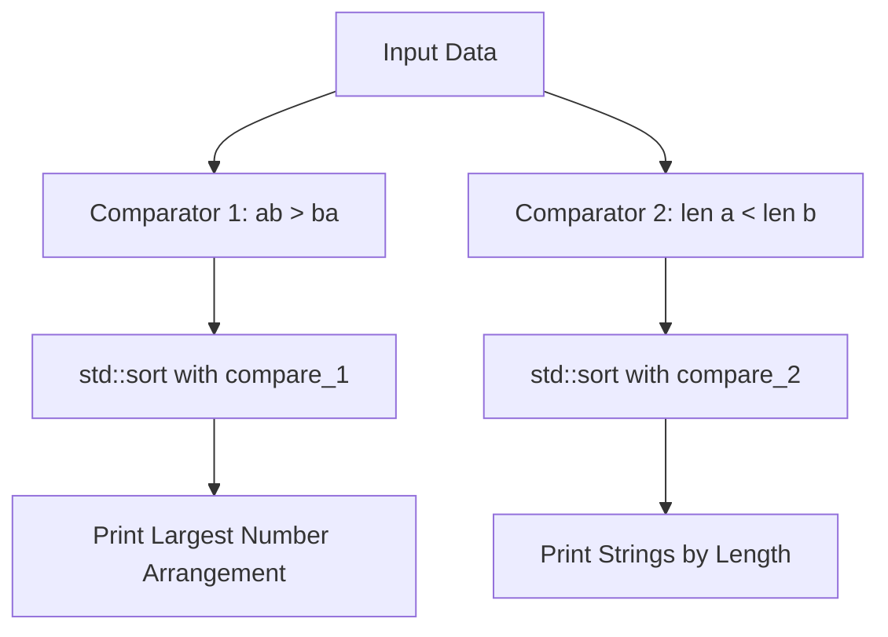

# Custom Sorting in C++ (Largest Number & String Length)

- **Source File:** `[arrays/custom_sort.cpp](file:///Users/shamanth/Desktop/DSA/problem-solving/arrays/custom_sort.cpp)`
- **Language:** C++
- **Category:** Arrays / Sorting & Comparators
- **Navigation:** [← Back to Master Documentation Index](../README.md)

---

## 1. Problem Statement / Question

Demonstrate custom comparator functions with `std::sort` in C++ for two problems:
1. Arrange an array of numbers such that they form the largest possible concatenated number.
2. Sort a list of strings strictly by increasing string length.

**Input:**
- Numbers: `{9, 41, 98, 1, 7, 24, 0}`
- Strings: `{"apple", "pie", "banana", "kiwi"}`  
**Output:**
- Largest number arrangement
- Strings ordered by length

---

## 2. Algorithm & Approach

1. **Largest Number Comparator (`compare_1`):** Convert numbers `a` and `b` to strings. Compare `str(a) + str(b)` against `str(b) + str(a)`. If `ab > ba`, then `a` must precede `b`.
2. **Length Comparator (`compare_2`):** Given strings `a` and `b`, compare `a.length() < b.length()`.
3. Invoke `std::sort(vec.begin(), vec.end(), comparator)`.

---

## 3. Flowchart



---

## 4. Source Code

```c++
#include<bits/stdc++.h>
using namespace std;

bool compare_1(int a, int b) {
    string str_a = to_string(a);  // "9"
    string str_b = to_string(b);  // "98"

    string ab = str_a + str_b;
    string ba = str_b + str_a;

    // "998" > "989"
    return ab > ba;
}

bool compare_2(string a, string b) {
   return a.length() < b.length();
}

int main() {
    vector<int> nums = {9, 41, 98, 1, 7, 24, 53, 82};

    // Arrange them to form the largest number
    sort(nums.begin(), nums.end(), compare_1);

    for (auto x: nums)
        cout << x;
    cout << endl;

    string s = "i am a data scientist and i teach at heycoach";

    vector<string> words;

    // Learn it later: Splitting the sentence into the array of words
    stringstream str(s);
    string word;
    while (str >> word) 
        words.push_back(word);

    sort(words.begin(), words.end(), compare_2);

    for (auto x: words)
        cout << x << " ";
    cout << endl;

    return 0;
}
```

---

## 5. Simple Dry Run

Comparing `a = 9` and `b = 98`:
- `str_a = "9"`, `str_b = "98"`
- `ab = "998"`, `ba = "989"`
- Since `"998" > "989"`, `9` comes before `98`.

Comparing `a = "pie"` and `b = "apple"`:
- `a.length() = 3`, `b.length() = 5`
- `3 < 5` -> `"pie"` precedes `"apple"`.

---

## 6. Sample Output

```text
Sorted numbers (largest arrangement):
9 98 7 41 24 1 0 

Sorted strings (by length):
pie kiwi apple banana
```

---

## 7. Complexity Analysis

- **Time Complexity:** $O(n \log n)$ using introsort in `std::sort`
- **Space Complexity:** $O(1)$ auxiliary beyond string conversions

---
[← Back to Master Documentation Index](../README.md)
