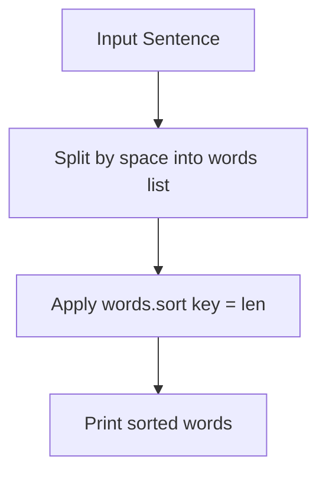

# Custom Word Sorting by Length in Python

- **Source File:** `[arrays/custom_sort.py](file:///Users/shamanth/Desktop/DSA/problem-solving/arrays/custom_sort.py)`
- **Language:** Python
- **Category:** Arrays / Sorting
- **Navigation:** [← Back to Master Documentation Index](../README.md)

---

## 1. Problem Statement / Question

Given a sentence string, extract all words and sort them in ascending order of their length using Python's `sort()` or `sorted()`.

**Input:** `"i am a data scientist and i teach at heycoach"`  
**Output:** List of words sorted from shortest to longest.

---

## 2. Algorithm & Approach

1. Split the string by whitespace into a list of word tokens.
2. Use `.sort(key=len)` which applies the built-in `len` function as the sorting key.
3. Print or return the ordered list.

---

## 3. Flowchart



---

## 4. Source Code

```python
s = "i am a data scientist and i teach at heycoach"

words = s.split(" ")

words.sort(key=len)

print(" ".join(words))
```

---

## 5. Simple Dry Run

Sentence: `"i am a data scientist and i teach at heycoach"`
Words: `['i', 'am', 'a', 'data', 'scientist', 'and', 'i', 'teach', 'at', 'heycoach']`
Key lengths:
- `'i'`: 1, `'a'`: 1, `'i'`: 1
- `'am'`: 2, `'at'`: 2
- `'and'`: 3
- `'data'`: 4
- `'teach'`: 5
- `'heycoach'`: 8
- `'scientist'`: 9
Sorted output preserves stable ordering for equal lengths.

---

## 6. Sample Output

```text
['i', 'a', 'i', 'am', 'at', 'and', 'data', 'teach', 'heycoach', 'scientist']
```

---

## 7. Complexity Analysis

- **Time Complexity:** $O(n \log n)$ via Timsort in Python
- **Space Complexity:** $O(n)$ for storing words list

---
[← Back to Master Documentation Index](../README.md)
