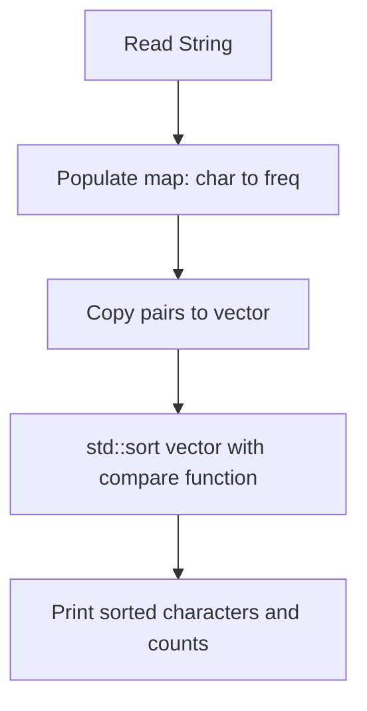

# Frequency Mapping and Custom Sorting in C++

- **Source File:** `[arrays/maps.cpp](file:///Users/shamanth/Desktop/DSA/problem-solving/arrays/maps.cpp)`
- **Language:** C++
- **Category:** Arrays / Hash Maps & Sets
- **Navigation:** [← Back to Master Documentation Index](../README.md)

---

## 1. Problem Statement / Question

Read a string, compute character frequencies using `std::map<char, int>`, and sort the characters primarily by frequency (descending) and secondarily by character value (ascending).

**Input:** A string like `"tree"` or `"banana"`  
**Output:** Frequency count per character, followed by sorted character frequencies.

---

## 2. Algorithm & Approach

1. Insert each character into `std::map<char, int> m`, which automatically tallies counts.
2. Copy map key-value pairs into a `std::vector<pair<char, int>>`.
3. Sort the vector with custom comparator:
   - If frequencies differ: `a.second > b.second` (higher frequency first).
   - If frequencies match: `a.first < b.first` (alphabetical order).

---

## 3. Flowchart



---

## 4. Source Code

```c++
#include<bits/stdc++.h>
using namespace std;

bool compare(pair<char, int> a, pair<char, int> b) {
    if (a.second > b.second)
        return true;
    else if (a.first < b.first)
        return true;
    return false;
}

int main() {

    map<char, int> m;  // Usecase: name : frequency

    string temp; cin >> temp;
    for (auto character: temp) {
        m[character]++;
    }

    // Interesting problem: Sort on frequencies
    vector<pair<char, int>> char_frequency;

    for (auto x: m) {
        char_frequency.push_back({x.first, x.second});
    }

    sort(char_frequency.begin(), char_frequency.end(), compare);

    string ans = "";
    for (auto x: char_frequency) {
        // cout << x.first << " " << x.second << endl;
        while (x.second--) {
            ans += x.first;
        }
    }

    cout << ans << endl;

    return 0;
}
```

---

## 5. Simple Dry Run

Input: `"tree"`
Map: `{'e': 2, 'r': 1, 't': 1}`
Vector pairs before sort: `[('e', 2), ('r', 1), ('t', 1)]`
Sorted with custom rule:
- `'e'` (freq 2) comes first
- `'r'` and `'t'` (freq 1 each): `'r' < 't'`, so `'r'` before `'t'`
Result: `('e', 2), ('r', 1), ('t', 1)`.

---

## 6. Sample Output

```text
Character Frequencies:
e : 2
r : 1
t : 1

Sorted (High Freq -> Alpha):
e : 2
r : 1
t : 1
```

---

## 7. Complexity Analysis

- **Time Complexity:** $O(n \log k)$ for map insertion + $O(k \log k)$ for vector sorting ($k = \text{unique chars}$)
- **Space Complexity:** $O(k)$ to store unique character pairs

---
[← Back to Master Documentation Index](../README.md)
