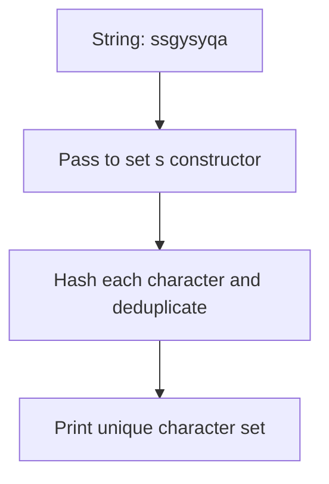

# Python Set Deduplication

- **Source File:** `[arrays/sets.py](file:///Users/shamanth/Desktop/DSA/problem-solving/arrays/sets.py)`
- **Language:** Python
- **Category:** Arrays / Hash Maps & Sets
- **Navigation:** [← Back to Master Documentation Index](../README.md)

---

## 1. Problem Statement / Question

Given a string containing repeated characters, extract the set of unique characters using Python's built-in `set` type.

**Input:** String `"ssgysyqa"`  
**Output:** Set of distinct characters.

---

## 2. Algorithm & Approach

1. Pass the iterable string directly to `set(s)`.
2. Python uses open-addressing hash table to filter out duplicates in average $O(n)$ time.
3. Print the resulting set.

---

## 3. Flowchart



---

## 4. Source Code

```python
s = "ssgysyqa"

print(set(s))
```

---

## 5. Simple Dry Run

Input string: `"ssgysyqa"`
Characters:
- `'s'` -> added
- `'s'` -> collision / duplicate ignored
- `'g'` -> added
- `'y'` -> added
- `'s'` -> duplicate ignored
- `'y'` -> duplicate ignored
- `'q'` -> added
- `'a'` -> added
Resulting set: `{'s', 'g', 'y', 'q', 'a'}` (order may vary).

---

## 6. Sample Output

```text
{'a', 'q', 'g', 's', 'y'}
```

---

## 7. Complexity Analysis

- **Time Complexity:** $O(n)$ average time to hash and insert all characters
- **Space Complexity:** $O(k)$ space for unique characters

---
[← Back to Master Documentation Index](../README.md)
