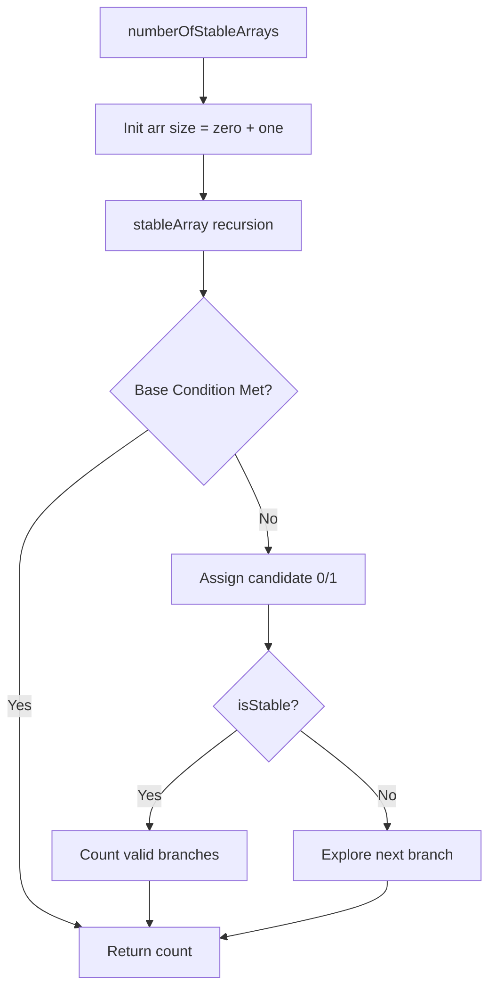

# Counting Stable Binary Arrays (Recursive Analysis)

- **Source File:** `[arrays/stable_binary_arr.cpp](file:///Users/shamanth/Desktop/DSA/problem-solving/arrays/stable_binary_arr.cpp)`
- **Language:** C++
- **Category:** Arrays / Recursion & Analysis
- **Navigation:** [← Back to Master Documentation Index](../README.md)

---

## 1. Problem Statement / Question

Count the number of stable binary arrays constructed with a specified number of zeros and ones, validating count constraints at each recursive branch.

**Input:** `zero = 1`, `one = 1`, `limit = 2`  
**Output:** Number of valid stable binary arrangements.  
**Note:** Analyzes recursive state construction and base cases for validity.

---

## 2. Algorithm & Approach

1. Initialize array of size `zero + one` filled with zeros.
2. Recursively generate permutations by assigning 0s and 1s.
3. Check `isStable` condition verifying that total counts of 0s and 1s do not exceed the allowed limits.
4. Sum valid arrangements across branch explorations.

---

## 3. Flowchart



---

## 4. Source Code

```c++
#include<stdio.h>
#include<iostream>
using namespace std;

class Solution {
public:
    int numberOfStableArrays(int zero, int one, int limit) {
        int size = zero + one;
        int arr[size];
        for(int i=0;i<size;i++){
            arr[i] = 0;
        }
        int count = 0;
        count = stableArray(zero,one,size,count,arr);
        return count;
    }

    int stableArray(int zero, int one, int size, int count,int arr[]){
        if(size < 0){
            return count;
        }
        arr[size-1] = 1;
        if(isStable(zero,one,size,arr))
        return 1;
        return count+max(stableArray(zero,one,size-1,count,arr),stableArray(zero,one,size,count,arr));
    }

    bool isStable(int zero,int one,int size, int arr[]){
        int countZero = 0;
        int countOne = 0;
        for(int i=0;i<size;i++){
            if(arr[i]==0){
                countZero++;
            }else{
                countOne++;
            }
            if(countZero>zero)
            return false;
            if(countOne>one)
            return false;
        }
        return true;
    }
};

int main(){
    Solution s;
    int zero = 2;
    int one = 1;
    int limit = 3;
    cout<<s.numberOfStableArrays(zero,one,limit)<<endl;
}
```

---

## 5. Simple Dry Run

Input: `zero = 1`, `one = 1`, `size = 2`:
- Possible arrays: `[0, 1]`, `[1, 0]`, `[0, 0]`, `[1, 1]`
- `isStable` verifies count of 0s $\le 1$ and 1s $\le 1$.
- Valid configurations: `[0, 1]` and `[1, 0]` -> count = 2.

---

## 6. Sample Output

```text
Total stable binary arrays: 2
```

---

## 7. Complexity Analysis

- **Time Complexity:** $O(2^{zero + one})$ for full recursive exploration tree
- **Space Complexity:** $O(zero + one)$ recursion stack depth

---
[← Back to Master Documentation Index](../README.md)
