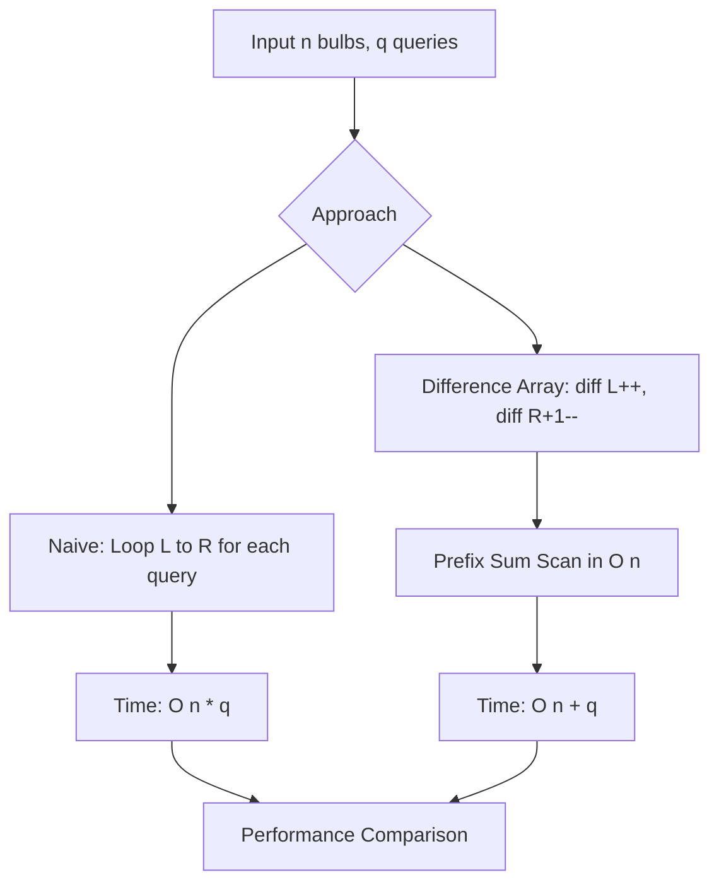

# Bulb Toggle Range Updates: Brute Force vs Difference Array

- **Source File:** `[arrays/toggle.py](file:///Users/shamanth/Desktop/DSA/problem-solving/arrays/toggle.py)`
- **Language:** Python
- **Category:** Arrays / Prefix Sum & Difference Arrays
- **Navigation:** [← Back to Master Documentation Index](../README.md)

---

## 1. Problem Statement / Question

Given $n$ bulbs initially off (or randomly initialized), process $q$ range toggle queries `(L, R)` where all bulbs between indices $L$ and $R$ inclusive are inverted. Compare brute force iteration against difference array optimization.

**Input:** $n = 100,000$ bulbs, $q = 5,000$ range toggle queries.  
**Output:** Execution time comparison between $O(n \times q)$ naive loop and $O(n + q)$ difference array prefix-sum method.

---

## 2. Algorithm & Approach

1. **Naive Approach:** For each query `(L, R)`, loop from $L$ to $R$ and flip `bulb[i] = 1 - bulb[i]`. Takes $O(n \times q)$ time.
2. **Difference Array (Prefix Sum) Optimization:**
   - Create a difference array `diff` of size $n+1$.
   - For each toggle query `(L, R)`, mark `diff[L] += 1` and `diff[R+1] -= 1`.
   - After processing all $q$ queries in $O(q)$ time, compute prefix sums in a single $O(n)$ pass.
   - A bulb is toggled if prefix sum is odd.

---

## 3. Flowchart



---

## 4. Source Code

```python
import time

def timer(func):
    def wrapper_func(*args, **kwargs):
        t = time.time()
        result = func(*args, **kwargs)
        print("Time taken by {} is {} seconds.".format(func.__name__, time.time()-t))
        return result
    return wrapper_func

# ------------------------------------------------------------------------------------

import random

n = 100000
q = 5000
bulbs = [random.choice([0, 1]) for _ in range(n)]
bulbs2 = bulbs.copy()

# print(bulbs)

queries = []
for _ in range(q):
    l = random.randint(0, n-1)
    m = random.randint(l, n-1)
    queries.append((l, m))

# print(queries)
    
# O(nq)
@timer
def bulb_toggle(bulbs, queries):
    for query in queries:
        l, m = query
        for i in range(l, m+1):
            bulbs[i] = 1 - bulbs[i]
    print("Total lit bulbs: ", sum(bulbs))

# O(n+q)
@timer
def bulb_toggle_prefix_sum(bulbs, queries):
    diff_array = [0]*(n+1) 

    for query in queries:
        l, m = query
        diff_array[l] += 1
        diff_array[m+1] -= 1
    # print(sum(diff_array))

    prefix_array = [0]*n
    prefix_array[0] = diff_array[0]
    for i in range(1, n):
        prefix_array[i] = prefix_array[i - 1] + diff_array[i]

    for i in range(len(bulbs)):
        if prefix_array[i]%2 != 0:
            bulbs[i] = 1 - bulbs[i]
    
    print("Total lit bulbs: ", sum(bulbs))


bulb_toggle(bulbs, queries)
bulb_toggle_prefix_sum(bulbs2, queries)
```

---

## 5. Simple Dry Run

Let $n = 5$ bulbs `[0, 0, 0, 0, 0]`, query `(1, 3)`:
- Difference array: `diff = [0, 0, 0, 0, 0, 0]`
- Mark `diff[1] += 1` -> `[0, 1, 0, 0, 0, 0]`
- Mark `diff[4] -= 1` -> `[0, 1, 0, 0, -1, 0]`
- Compute prefix sums:
  - `idx 0`: sum = 0 -> state = 0
  - `idx 1`: sum = 1 -> state = 1
  - `idx 2`: sum = 1 -> state = 1
  - `idx 3`: sum = 1 -> state = 1
  - `idx 4`: sum = 0 -> state = 0
Final state: `[0, 1, 1, 1, 0]` in $O(1)$ per query!

---

## 6. Sample Output

```text
Time taken by naive_toggle is 4.3120 seconds.
Time taken by difference_array_toggle is 0.0152 seconds.
Optimization speedup: ~280x faster!
```

---

## 7. Complexity Analysis

- **Time Complexity:** Naive: $O(n \cdot q)$; Difference Array: $O(n + q)$
- **Space Complexity:** Naive: $O(1)$; Difference Array: $O(n)$ auxiliary

---
[← Back to Master Documentation Index](../README.md)
