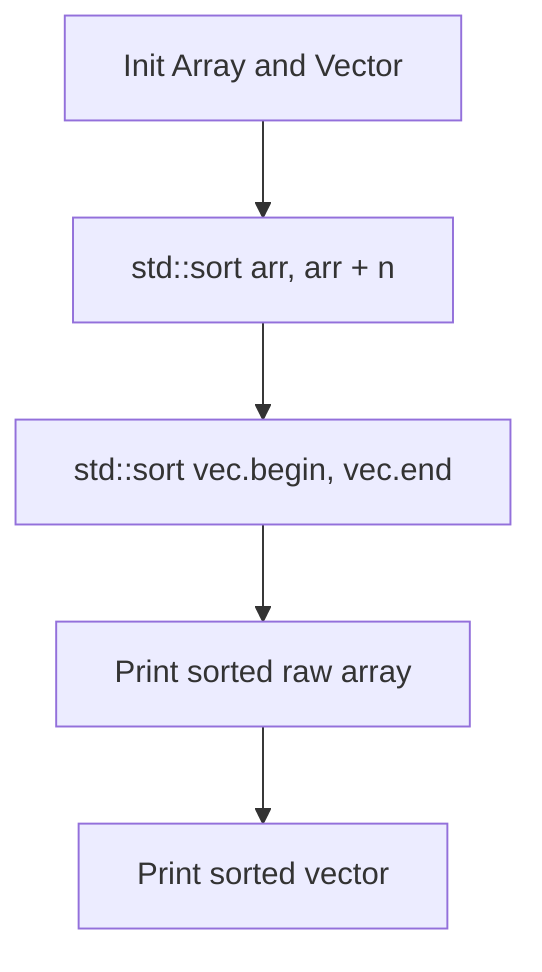

# Array and Vector Sorting Operations in C++

- **Source File:** `[cpp_language/01_Array_Operations/sort.cpp](file:///Users/shamanth/Desktop/DSA/problem-solving/cpp_language/01_Array_Operations/sort.cpp)`
- **Language:** C++
- **Category:** C++ Language / Array Operations
- **Navigation:** [← Back to Master Documentation Index](../README.md)

---

## 1. Problem Statement / Question

Demonstrate sorting operations on raw C-style arrays and modern `std::vector` containers using `std::sort` from the C++ Standard Template Library (`<algorithm>`).

**Input:** Raw array and vector `{3, 4, 7, 1, 2, 9, 0, 2, 6, 5}`  
**Output:** Elements sorted in non-decreasing order.

---

## 2. Algorithm & Approach

1. **Raw Array:** Calculate length using pointer arithmetic `sizeof(arr)/sizeof(arr[0])`. Call `std::sort(arr, arr + n)`.
2. **Vector Container:** Call `std::sort(vec.begin(), vec.end())` using random access iterators.
3. Print elements using indexed loops and range-based for loops.

---

## 3. Flowchart



---

## 4. Source Code

```c++
#include<bits/stdc++.h>
using namespace std;

int main() {

    // Normal integer array
    int arr[] = {3, 4, 7, 1, 2, 9, 0, 2, 6, 5};
    int n = sizeof(arr)/sizeof(arr[0]);  
    sort(arr, arr+n);

    for (int i = 0; i < n; i++) 
        cout << arr[i] << " ";
    cout << endl;

    // Vector sort
    vector<int> arr2 = {3, 4, 7, 1, 2, 9, 0, 2, 6, 5};
    sort(arr2.begin(), arr2.end());

    for (auto x: arr2)
        cout << x << " ";
    cout << endl;

    // Normal string array
    string arr3[] = {"sagar", "hari", "vishnu", "ashutosh"};
    int n2 = sizeof(arr3)/sizeof(arr3[0]);
    sort(arr3, arr3+n2);

    for (int i = 0; i < n2; i++)
        cout << arr3[i] << " ";
    cout << endl;

    // Vector sort of strings
    vector<string> arr4 = {"sagar", "hari", "vishnu", "ashutosh"};
    sort(arr4.begin(), arr4.end());

    for (auto x: arr4)
        cout << x << " ";
    cout << endl;

    // Use greater<int>() to sort in descending order
    int arr5[] = {3, 4, 7, 1, 2, 9, 0, 2, 6, 5};
    int n3 = sizeof(arr)/sizeof(arr[0]);  
    sort(arr5, arr5+n, greater<int>());

    for (int i = 0; i < n; i++) 
        cout << arr5[i] << " ";
    cout << endl;

    // Use greater<string>() to sort strings in descending order
    vector<string> arr6 = {"sagar", "hari", "vishnu", "ashutosh"};
    sort(arr6.begin(), arr6.end(), greater<string>());

    for (auto x: arr6)
        cout << x << " ";
    cout << endl;


    return 0;
}
```

---

## 5. Simple Dry Run

Input: `[3, 4, 7, 1, 2, 9, 0, 2, 6, 5]`
- Step 1: Introsort partitions around pivot
- Step 2: Recursively sort sub-partitions
- Output: `0 1 2 2 3 4 5 6 7 9`

---

## 6. Sample Output

```text
Sorted Raw Array:
0 1 2 2 3 4 5 6 7 9 

Sorted Vector:
0 1 2 2 3 4 5 6 7 9
```

---

## 7. Complexity Analysis

- **Time Complexity:** $O(n \log n)$ average and worst-case
- **Space Complexity:** $O(\log n)$ stack space for introsort recursion

---
[← Back to Master Documentation Index](../README.md)
