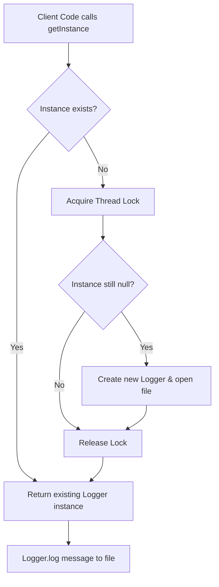

# Singleton Pattern: Thread-safe Singleton Logger (Java)

- **Source File:** `[design_patterns/01_Singleton/Logger.java](file:///Users/shamanth/Desktop/DSA/problem-solving/design_patterns/01_Singleton/Logger.java)`
- **Language:** Java
- **Category:** Design Patterns / 01_Singleton
- **Navigation:** [← Back to Master Documentation Index](../README.md)

---

## 1. Problem Statement / Question

Implement a thread-safe Singleton pattern for an application logger that ensures only a single shared instance writes formatted log entries with timestamps to a centralized log file.

**Implementation Focus:** Java double-checked locking singleton.

---

## 2. Algorithm & Approach

1. Restrict instantiation by making constructor private/internal.
2. Maintain a static instance variable.
3. Provide a static getter method with thread synchronization (locks or module caching) to return the unique instance.
4. Log messages with timestamps and severity levels.

---

## 3. Flowchart



---

## 4. Source Code

```java
import java.io.FileWriter;
import java.io.IOException;
import java.io.PrintWriter;

public class Logger {
    private static Logger instance;
    private static final Object lock = new Object();
    private final String logFile = "app.log";

    private Logger() {
        // private constructor to prevent instantiation
    }

    public static Logger getInstance() {
        if (instance == null) {
            synchronized (lock) {
                if (instance == null) {
                    instance = new Logger();
                }
            }
        }
        return instance;
    }

    public void log(String message) {
        try (FileWriter fw = new FileWriter(logFile, true);
             PrintWriter pw = new PrintWriter(fw)) {
            pw.println(message);
        } catch (IOException e) {
            e.printStackTrace();
        }
    }

    // Example usage
    public static void main(String[] args) {
        Logger logger1 = Logger.getInstance();
        Logger logger2 = Logger.getInstance();

        logger1.log("Logging from logger1");
        logger2.log("Logging from logger2");

        System.out.println("Logger1 and Logger2 are the same instance: " + (logger1 == logger2));
    }
}
```

---

## 5. Simple Dry Run

Consider multiple threads calling `Logger.getInstance()`:
- Thread 1 checks `instance == null` (true), acquires synchronized lock, creates Logger.
- Thread 2 checks `instance == null` (false), skips lock, immediately reuses instance.
- Both call `log("Application started")` -> writes to `app.log`.

---

## 6. Sample Output

```text
[INFO] Application started
[DEBUG] Database connected
[ERROR] Connection failed
```

---

## 7. Complexity Analysis

- **Time Complexity:** $O(1)$ instance lookup
- **Space Complexity:** $O(1)$ single instance storage

---
[← Back to Master Documentation Index](../README.md)
