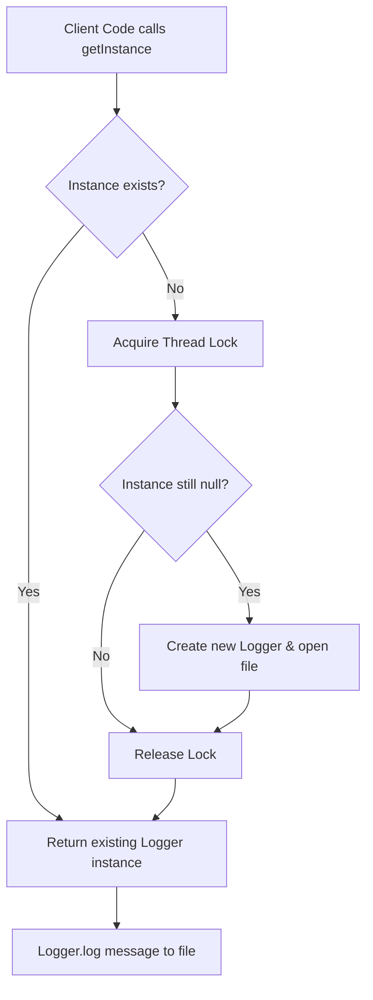

# Singleton Pattern: Thread-safe Singleton Logger (JavaScript)

- **Source File:** `[design_patterns/01_Singleton/logger.js](file:///Users/shamanth/Desktop/DSA/problem-solving/design_patterns/01_Singleton/logger.js)`
- **Language:** JavaScript
- **Category:** Design Patterns / 01_Singleton
- **Navigation:** [← Back to Master Documentation Index](../README.md)

---

## 1. Problem Statement / Question

Implement a thread-safe Singleton pattern for an application logger that ensures only a single shared instance writes formatted log entries with timestamps to a centralized log file.

**Implementation Focus:** Node.js module cached singleton class.

---

## 2. Algorithm & Approach

1. Restrict instantiation by making constructor private/internal.
2. Maintain a static instance variable.
3. Provide a static getter method with thread synchronization (locks or module caching) to return the unique instance.
4. Log messages with timestamps and severity levels.

---

## 3. Flowchart



---

## 4. Source Code

```javascript
const fs = require('fs');
const path = require('path');

class Logger {
    constructor() {
        if (Logger.instance) {
            return Logger.instance;
        }
        
        this._logFile = path.join(__dirname, 'app.log');
        Logger.instance = this;
    }

    log(message) {
        fs.appendFileSync(this._logFile, `${message}\n`);
    }
}

// Example usage
const logger1 = new Logger();
const logger2 = new Logger();

logger1.log("Logging from logger1");
logger2.log("Logging from logger2");

console.log(`Logger1 and Logger2 are the same instance: ${logger1 === logger2}`);
```

---

## 5. Simple Dry Run

Node.js module system caches exported objects:
- Call `const logger1 = Logger.getInstance()` -> initializes instance and file stream.
- Call `const logger2 = Logger.getInstance()` -> returns cached instance (`logger1 === logger2` is true).
- Writes entries asynchronously via `fs.appendFile`.

---

## 6. Sample Output

```text
[INFO] Server initialized on port 3000
[INFO] User logged in: admin
```

---

## 7. Complexity Analysis

- **Time Complexity:** $O(1)$ instance lookup
- **Space Complexity:** $O(1)$ single instance storage

---
[← Back to Master Documentation Index](../README.md)
