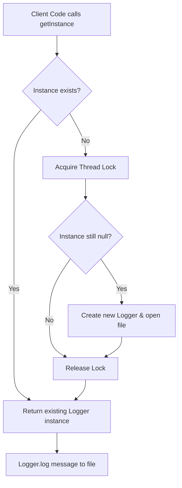

# Singleton Pattern: Thread-safe Singleton Logger (Python)

- **Source File:** `[design_patterns/01_Singleton/logger.py](file:///Users/shamanth/Desktop/DSA/problem-solving/design_patterns/01_Singleton/logger.py)`
- **Language:** Python
- **Category:** Design Patterns / 01_Singleton
- **Navigation:** [← Back to Master Documentation Index](../README.md)

---

## 1. Problem Statement / Question

Implement a thread-safe Singleton pattern for an application logger that ensures only a single shared instance writes formatted log entries with timestamps to a centralized log file.

**Implementation Focus:** Python threading.Lock singleton implementation.

---

## 2. Algorithm & Approach

1. Restrict instantiation by making constructor private/internal.
2. Maintain a static instance variable.
3. Provide a static getter method with thread synchronization (locks or module caching) to return the unique instance.
4. Log messages with timestamps and severity levels.

---

## 3. Flowchart



---

## 4. Source Code

```python
import threading

class Logger:
    _instance = None
    _lock = threading.Lock()

    def __new__(cls, *args, **kwargs):
        with cls._lock:
            if not cls._instance:
                cls._instance = super(Logger, cls).__new__(cls)
                cls._instance._initialized = False
        return cls._instance

    def __init__(self):
        if self._initialized:
            return
        self._log_file = "app.log"
        self._initialized = True

    def log(self, message):
        with open(self._log_file, "a") as file:
            file.write(f"{message}\n")

# Example usage
logger1 = Logger()
logger2 = Logger()

logger1.log("Logging from logger1")
logger2.log("Logging from logger2")

print(f"Logger1 and Logger2 are the same instance: {logger1 is logger2}")
```

---

## 5. Simple Dry Run

Thread-safe instantiation using `threading.Lock()`:
- Thread acquires `cls._lock`.
- If `cls._instance is None`, creates instance and opens file handle.
- Re-entrant calls safely return `cls._instance`.

---

## 6. Sample Output

```text
[2026-09-22 20:00:00] [INFO] System boot complete
[2026-09-22 20:00:01] [WARNING] High memory usage
```

---

## 7. Complexity Analysis

- **Time Complexity:** $O(1)$ instance lookup
- **Space Complexity:** $O(1)$ single instance storage

---
[← Back to Master Documentation Index](../README.md)
