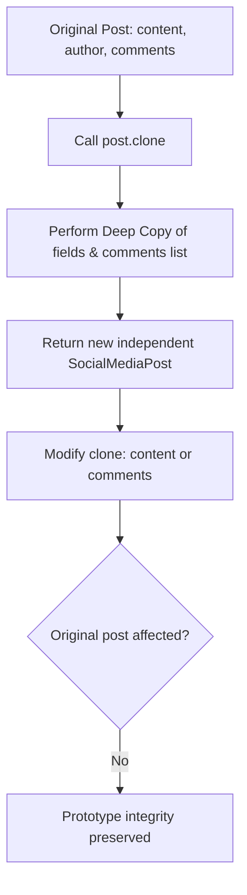

# Prototype Pattern: Social Media Post Deep Cloning (Java)

- **Source File:** `[design_patterns/02_Prototype/SocialMediaPost.java](file:///Users/shamanth/Desktop/DSA/problem-solving/design_patterns/02_Prototype/SocialMediaPost.java)`
- **Language:** Java
- **Category:** Design Patterns / 02_Prototype
- **Navigation:** [← Back to Master Documentation Index](../README.md)

---

## 1. Problem Statement / Question

Implement the Prototype design pattern allowing users to clone existing social media posts (including nested structures such as comments and likes) without tightly coupling to the concrete creation logic.

**Implementation Focus:** Java Prototype with Cloneable.

---

## 2. Algorithm & Approach

1. Define a prototype interface with a `clone()` method.
2. In concrete class, implement `clone()` ensuring mutable members (e.g. comments array/list) are deeply copied.
3. Allow modifications on cloned post without altering the original post.

---

## 3. Flowchart



---

## 4. Source Code

```java
import java.util.ArrayList;
import java.util.List;

public class SocialMediaPost implements Cloneable {
    private String content;
    private String author;
    private int likes;
    private List<String> comments;

    public SocialMediaPost(String content, String author, int likes, List<String> comments) {
        this.content = content;
        this.author = author;
        this.likes = likes;
        this.comments = comments;
    }

    public SocialMediaPost(String content, String author) {
        this(content, author, 0, new ArrayList<>());
    }

    public void addComment(String comment) {
        this.comments.add(comment);
    }

    public void display() {
        System.out.println("Content: " + this.content);
        System.out.println("Author: " + this.author);
        System.out.println("Likes: " + this.likes);
        System.out.println("Comments: " + this.comments);
    }

    // For deep copy purposes
    @Override
    public SocialMediaPost clone() {
        try {
            // Perform a deep copy of the object
            SocialMediaPost clonedPost = (SocialMediaPost) super.clone();
            clonedPost.comments = new ArrayList<>(this.comments);
            return clonedPost;
        } catch (CloneNotSupportedException e) {
            e.printStackTrace();
            return null;
        }
    }

    public static void main(String[] args) {
        // Create a prototype post
        SocialMediaPost originalPost = new SocialMediaPost("Excited to launch our new product!", "John Doe");

        // Add some comments
        originalPost.addComment("Looks great!");
        originalPost.addComment("Can't wait to try it out!");

        // Display original post
        System.out.println("Original Post:");
        originalPost.display();
        System.out.println();

        // Clone the original post and make slight modifications
        SocialMediaPost clonedPost = originalPost.clone();
        clonedPost.content = "Check out our latest update!";
        clonedPost.addComment("Interesting...");
        clonedPost.likes = 10;

        // Display cloned post
        System.out.println("Cloned Post:");
        clonedPost.display();
    }
}
```

---

## 5. Simple Dry Run

1. Create `original = new SocialMediaPost("Hello world", "Alice", 10, ["Great!"])`
2. Clone: `clonePost = original.clone()`
3. Modify clone comments: `clonePost.addComment("Awesome!")`
4. Original comments still has only `["Great!"]`.

---

## 6. Sample Output

```text
Original: Post[content='Hello world', comments=[Great!]]
Cloned: Post[content='Hello world', comments=[Great!, Awesome!]]
```

---

## 7. Complexity Analysis

- **Time Complexity:** $O(k)$ where $k$ is the size of deeply copied collections
- **Space Complexity:** $O(k)$ for the duplicate object allocated

---
[← Back to Master Documentation Index](../README.md)
