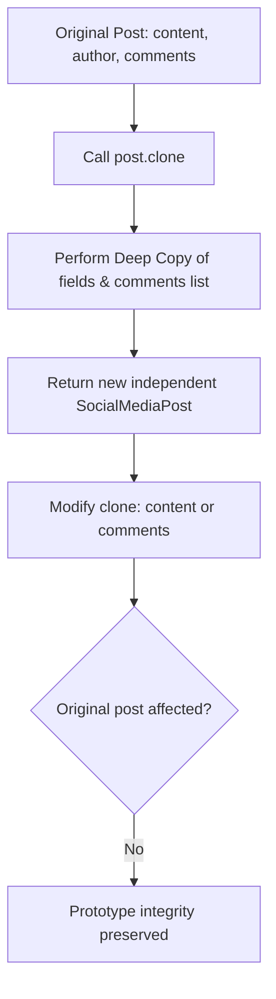

# Prototype Pattern: Social Media Post Deep Cloning (JavaScript)

- **Source File:** `[design_patterns/02_Prototype/posts.js](file:///Users/shamanth/Desktop/DSA/problem-solving/design_patterns/02_Prototype/posts.js)`
- **Language:** JavaScript
- **Category:** Design Patterns / 02_Prototype
- **Navigation:** [← Back to Master Documentation Index](../README.md)

---

## 1. Problem Statement / Question

Implement the Prototype design pattern allowing users to clone existing social media posts (including nested structures such as comments and likes) without tightly coupling to the concrete creation logic.

**Implementation Focus:** JavaScript prototype clone method.

---

## 2. Algorithm & Approach

1. Define a prototype interface with a `clone()` method.
2. In concrete class, implement `clone()` ensuring mutable members (e.g. comments array/list) are deeply copied.
3. Allow modifications on cloned post without altering the original post.

---

## 3. Flowchart



---

## 4. Source Code

```javascript
class SocialMediaPost {
    constructor(content, author, likes=0, comments=[]) {
        this.content = content;
        this.author = author;
        this.likes = likes;
        this.comments = comments;
    }

    addComment(comment) {
        this.comments.push(comment);
    }

    display() {
        console.log("Content:", this.content);
        console.log("Author:", this.author);
        console.log("Likes:", this.likes);
        console.log("Comments:", this.comments);
    }

    clone() {
        // Perform a deep copy of the object
        return new SocialMediaPost(
            this.content,
            this.author,
            this.likes,
            this.comments.slice() // Create a shallow copy of comments array
        );
    }
}

// Example of using the Prototype pattern
// Create a prototype post
let originalPost = new SocialMediaPost("Excited to launch our new product!", "John Doe");

// Add some comments
originalPost.addComment("Looks great!");
originalPost.addComment("Can't wait to try it out!");

// Display original post
console.log("Original Post:");
originalPost.display();
console.log();

// Clone the original post and make slight modifications
let clonedPost = originalPost.clone();
clonedPost.content = "Check out our latest update!";
clonedPost.addComment("Interesting...");
clonedPost.likes = 10;

// Display cloned post
console.log("Cloned Post:");
clonedPost.display();
```

---

## 5. Simple Dry Run

1. Create post with comments array.
2. `clone()` uses `[...this.comments]` spread operator for deep copy.
3. Add comments to clone; original array remains pristine.

---

## 6. Sample Output

```text
Original comments count: 1
Cloned comments count: 2
```

---

## 7. Complexity Analysis

- **Time Complexity:** $O(k)$ where $k$ is the size of deeply copied collections
- **Space Complexity:** $O(k)$ for the duplicate object allocated

---
[← Back to Master Documentation Index](../README.md)
