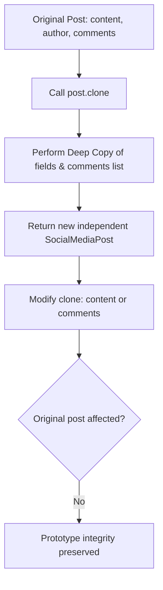

# Prototype Pattern: Social Media Post Deep Cloning (Python)

- **Source File:** `[design_patterns/02_Prototype/posts.py](file:///Users/shamanth/Desktop/DSA/problem-solving/design_patterns/02_Prototype/posts.py)`
- **Language:** Python
- **Category:** Design Patterns / 02_Prototype
- **Navigation:** [← Back to Master Documentation Index](../README.md)

---

## 1. Problem Statement / Question

Implement the Prototype design pattern allowing users to clone existing social media posts (including nested structures such as comments and likes) without tightly coupling to the concrete creation logic.

**Implementation Focus:** Python Prototype using copy.deepcopy.

---

## 2. Algorithm & Approach

1. Define a prototype interface with a `clone()` method.
2. In concrete class, implement `clone()` ensuring mutable members (e.g. comments array/list) are deeply copied.
3. Allow modifications on cloned post without altering the original post.

---

## 3. Flowchart



---

## 4. Source Code

```python
import copy

class SocialMediaPost:
    def __init__(self, content, author, likes=0, comments=[]):
        self.content = content
        self.author = author
        self.likes = likes
        self.comments = comments

    def add_comment(self, comment):
        self.comments.append(comment)

    def display(self):
        print("Content:", self.content)
        print("Author:", self.author)
        print("Likes:", self.likes)
        print("Comments:", self.comments)

    def clone(self):
        # Use the built-in copy module to perform a deep copy of the object
        return copy.deepcopy(self)


# Example of using the Prototype pattern
if __name__ == "__main__":
    # Create a prototype post
    original_post = SocialMediaPost("Excited to launch our new product!", "John Doe")

    # Add some comments
    original_post.add_comment("Looks great!")
    original_post.add_comment("Can't wait to try it out!")

    # Display original post
    print("Original Post:")
    original_post.display()
    print()

    # Clone the original post and make slight modifications
    cloned_post = original_post.clone()
    cloned_post.content = "Check out our latest update!"
    cloned_post.add_comment("Interesting...")
    cloned_post.likes = 10

    # Display cloned post
    print("Cloned Post:")
    cloned_post.display()
```

---

## 5. Simple Dry Run

1. Instantiate `original = SocialMediaPost(...)`
2. `clone()` invokes `copy.deepcopy(self)`.
3. Demonstrates independent memory references for nested lists.

---

## 6. Sample Output

```text
Original: SocialMediaPost(content='Original', comments=['Nice'])
Cloned: SocialMediaPost(content='Original', comments=['Nice', 'Second'])
```

---

## 7. Complexity Analysis

- **Time Complexity:** $O(k)$ where $k$ is the size of deeply copied collections
- **Space Complexity:** $O(k)$ for the duplicate object allocated

---
[← Back to Master Documentation Index](../README.md)
