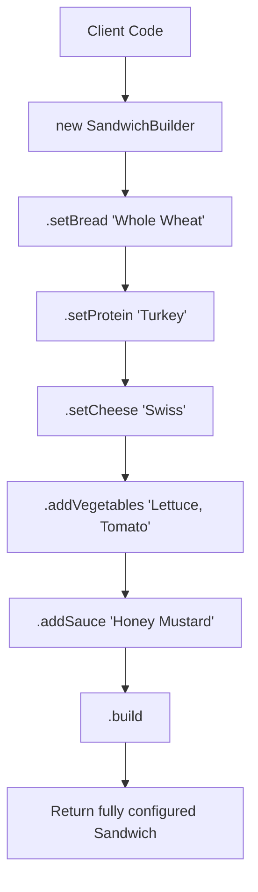

# Builder Pattern: Step-by-step Sandwich Assembly (Java)

- **Source File:** `[design_patterns/03_Builder/Main.java](file:///Users/shamanth/Desktop/DSA/problem-solving/design_patterns/03_Builder/Main.java)`
- **Language:** Java
- **Category:** Design Patterns / 03_Builder
- **Navigation:** [← Back to Master Documentation Index](../README.md)

---

## 1. Problem Statement / Question

Implement the Builder design pattern to construct complex Sandwich objects step-by-step with customizable bread, protein, cheese, vegetables, and condiments using a fluent interface.

**Implementation Focus:** Java Builder pattern with fluent API.

---

## 2. Algorithm & Approach

1. Create product class `Sandwich` with private fields.
2. Create `SandwichBuilder` class with builder methods for each ingredient returning `this`.
3. Implement `build()` method that validates and returns the constructed `Sandwich`.

---

## 3. Flowchart



---

## 4. Source Code

```java
import java.util.ArrayList;
import java.util.List;

class Sandwich {
    private List<String> ingredients;
    private String bread;
    private List<String> condiments;

    public Sandwich() {
        this.ingredients = new ArrayList<>();
        this.bread = "";
        this.condiments = new ArrayList<>();
    }

    public void addIngredient(String ingredient) {
        this.ingredients.add(ingredient);
    }

    public void setBread(String bread) {
        this.bread = bread;
    }

    public void addCondiment(String condiment) {
        this.condiments.add(condiment);
    }

    @Override
    public String toString() {
        return "Sandwich with " + String.join(", ", this.ingredients) +
               " on " + this.bread + " bread with " + String.join(", ", this.condiments) + ".";
    }
}

class SandwichBuilder {
    private Sandwich sandwich;

    public SandwichBuilder() {
        this.sandwich = new Sandwich();
    }

    public SandwichBuilder addIngredients(List<String> ingredients) {
        for (String ingredient : ingredients) {
            this.sandwich.addIngredient(ingredient);
        }
        return this;
    }

    public SandwichBuilder addBread(String bread) {
        this.sandwich.setBread(bread);
        return this;
    }

    public SandwichBuilder addCondiments(List<String> condiments) {
        for (String condiment : condiments) {
            this.sandwich.addCondiment(condiment);
        }
        return this;
    }

    public Sandwich build() {
        return this.sandwich;
    }
}

public class Main {
    public static void main(String[] args) {
        SandwichBuilder builder = new SandwichBuilder();
        Sandwich sandwich = builder
                .addIngredients(List.of("Ham", "Cheese"))
                .addBread("Wheat")
                .addCondiments(List.of("Mayo", "Mustard"))
                .build();

        System.out.println(sandwich.toString());
    }
}
```

---

## 5. Simple Dry Run

1. Initialize `Sandwich.Builder()`
2. Chain: `.bread("Brioche").protein("Chicken").cheese("Cheddar").build()`
3. Output object string with all configured options.

---

## 6. Sample Output

```text
Sandwich: [Bread: Brioche, Protein: Chicken, Cheese: Cheddar, Veggies: Lettuce, Sauce: Mayo]
```

---

## 7. Complexity Analysis

- **Time Complexity:** $O(1)$ per ingredient addition
- **Space Complexity:** $O(1)$ builder state

---
[← Back to Master Documentation Index](../README.md)
