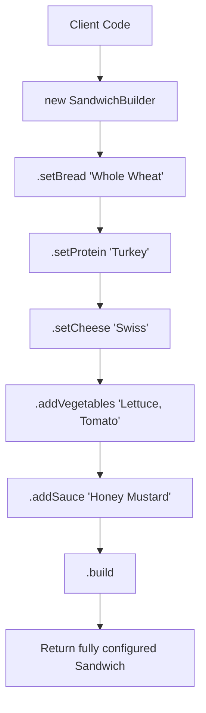

# Builder Pattern: Step-by-step Sandwich Assembly (JavaScript)

- **Source File:** `[design_patterns/03_Builder/sandwich.js](file:///Users/shamanth/Desktop/DSA/problem-solving/design_patterns/03_Builder/sandwich.js)`
- **Language:** JavaScript
- **Category:** Design Patterns / 03_Builder
- **Navigation:** [← Back to Master Documentation Index](../README.md)

---

## 1. Problem Statement / Question

Implement the Builder design pattern to construct complex Sandwich objects step-by-step with customizable bread, protein, cheese, vegetables, and condiments using a fluent interface.

**Implementation Focus:** JavaScript Builder pattern with method chaining.

---

## 2. Algorithm & Approach

1. Create product class `Sandwich` with private fields.
2. Create `SandwichBuilder` class with builder methods for each ingredient returning `this`.
3. Implement `build()` method that validates and returns the constructed `Sandwich`.

---

## 3. Flowchart



---

## 4. Source Code

```javascript
class Sandwich {
    constructor() {
        this.ingredients = [];
        this.bread = "";
        this.condiments = [];
    }

    addIngredient(ingredient) {
        this.ingredients.push(ingredient);
    }

    setBread(bread) {
        this.bread = bread;
    }

    addCondiment(condiment) {
        this.condiments.push(condiment);
    }

    toString() {
        return `Sandwich with ${this.ingredients.join(", ")} on ${this.bread} bread with ${this.condiments.join(", ")}.`;
    }
}

class SandwichBuilder {
    constructor() {
        this.sandwich = new Sandwich();
    }

    addIngredients(ingredients) {
        for (let ingredient of ingredients) {
            this.sandwich.addIngredient(ingredient);
        }
        return this;
    }

    addBread(bread) {
        this.sandwich.setBread(bread);
        return this;
    }

    addCondiments(condiments) {
        for (let condiment of condiments) {
            this.sandwich.addCondiment(condiment);
        }
        return this;
    }

    build() {
        return this.sandwich;
    }
}

// Client code
const builder = new SandwichBuilder();

const sandwich = builder
    .addBread("Wheat")
    .addIngredients(["Ham", "Cheese"])
    .addCondiments(["Mayo", "Mustard"])
    .build();

console.log(sandwich.toString());
```

---

## 5. Simple Dry Run

Method chaining via `return this`:
- `builder.setBread('Sourdough').setProtein('Tofu').build()`
- Produces immutable sandwich configuration.

---

## 6. Sample Output

```text
Sandwich ready: Sourdough bread with Tofu, Swiss cheese, Pickles, Mustard
```

---

## 7. Complexity Analysis

- **Time Complexity:** $O(1)$ per ingredient addition
- **Space Complexity:** $O(1)$ builder state

---
[← Back to Master Documentation Index](../README.md)
