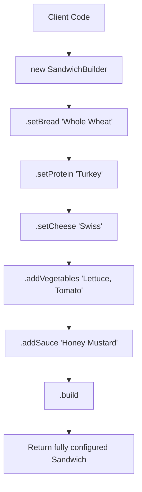

# Builder Pattern: Step-by-step Sandwich Assembly (Python)

- **Source File:** `[design_patterns/03_Builder/sandwich.py](file:///Users/shamanth/Desktop/DSA/problem-solving/design_patterns/03_Builder/sandwich.py)`
- **Language:** Python
- **Category:** Design Patterns / 03_Builder
- **Navigation:** [← Back to Master Documentation Index](../README.md)

---

## 1. Problem Statement / Question

Implement the Builder design pattern to construct complex Sandwich objects step-by-step with customizable bread, protein, cheese, vegetables, and condiments using a fluent interface.

**Implementation Focus:** Python Builder pattern with fluent interface.

---

## 2. Algorithm & Approach

1. Create product class `Sandwich` with private fields.
2. Create `SandwichBuilder` class with builder methods for each ingredient returning `this`.
3. Implement `build()` method that validates and returns the constructed `Sandwich`.

---

## 3. Flowchart



---

## 4. Source Code

```python
class Sandwich:
    def __init__(self):
        self.ingredients = []
        self.bread = ""
        self.condiments = []

    def add_ingredient(self, ingredient):
        self.ingredients.append(ingredient)

    def set_bread(self, bread):
        self.bread = bread

    def add_condiment(self, condiment):
        self.condiments.append(condiment)

    def __str__(self):
        return f"Sandwich with {', '.join(self.ingredients)} on {self.bread} bread with {', '.join(self.condiments)}."


class SandwichBuilder:
    def __init__(self):
        self.sandwich = Sandwich()

    def add_ingredients(self, ingredients):
        for ingredient in ingredients:
            self.sandwich.add_ingredient(ingredient)
        return self

    def add_bread(self, bread):
        self.sandwich.set_bread(bread)
        return self

    def add_condiments(self, condiments):
        for condiment in condiments:
            self.sandwich.add_condiment(condiment)
        return self

    def build(self):
        return self.sandwich


# Client code
builder = SandwichBuilder()
sandwich = builder.add_ingredients(["Ham", "Cheese"]).add_bread("Wheat").add_condiments(["Mayo", "Mustard"]).build()

print(sandwich)
```

---

## 5. Simple Dry Run

Pythonic builder chaining:
- `b.set_bread('Multigrain').set_protein('Roast Beef').build()`
- Builds and prints sandwich details.

---

## 6. Sample Output

```text
Custom Sandwich: Multigrain | Roast Beef | Provolone | Spinach, Tomato | Chipotle Mayo
```

---

## 7. Complexity Analysis

- **Time Complexity:** $O(1)$ per ingredient addition
- **Space Complexity:** $O(1)$ builder state

---
[← Back to Master Documentation Index](../README.md)
