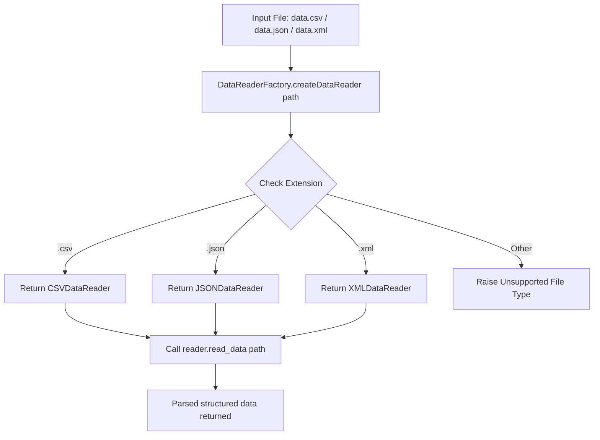

# Factory Pattern: Multi-format Data Reader Factory (CSV, JSON, XML) (Java)

- **Source File:** `[design_patterns/04_Factory/Main.java](file:///Users/shamanth/Desktop/DSA/problem-solving/design_patterns/04_Factory/Main.java)`
- **Language:** Java
- **Category:** Design Patterns / 04_Factory
- **Navigation:** [← Back to Master Documentation Index](../README.md)

---

## 1. Problem Statement / Question

Implement the Factory design pattern to instantiate and return appropriate data reader objects based on the file extension (.csv, .json, .xml) to parse file contents into structured data.

**Implementation Focus:** Java Factory pattern for file parsing.

---

## 2. Algorithm & Approach

1. Define abstract `DataReader` interface with `read_data(path)` method.
2. Implement `CSVDataReader`, `JSONDataReader`, `XMLDataReader`.
3. Create `DataReaderFactory` with a static method that inspects file extension and instantiates the appropriate parser.

---

## 3. Flowchart



---

## 4. Source Code

```java
import java.io.BufferedReader;
import java.io.FileReader;
import java.io.IOException;
import java.util.ArrayList;
import java.util.List;

// Abstract class for DataReader
abstract class DataReader {
    abstract List<List<String>> readData(String filePath) throws IOException;
}

// Concrete implementations of DataReader
class CSVDataReader extends DataReader {
    @Override
    List<List<String>> readData(String filePath) throws IOException {
        List<List<String>> data = new ArrayList<>();
        try (BufferedReader br = new BufferedReader(new FileReader(filePath))) {
            String line;
            while ((line = br.readLine()) != null) {
                List<String> row = new ArrayList<>();
                String[] values = line.split(",");
                for (String value : values) {
                    row.add(value);
                }
                data.add(row);
            }
        }
        return data;
    }
}

class JSONDataReader extends DataReader {
    @Override
    List<List<String>> readData(String filePath) throws IOException {
        throw new UnsupportedOperationException("JSONDataReader not implemented");
    }
}

class XMLDataReader extends DataReader {
    @Override
    List<List<String>> readData(String filePath) throws IOException {
        throw new UnsupportedOperationException("XMLDataReader not implemented");
    }
}

// Factory class for creating data readers
class DataReaderFactory {
    static DataReader createDataReader(String filePath) {
        String fileExtension = filePath.substring(filePath.lastIndexOf('.')).toLowerCase();
        switch (fileExtension) {
            case ".csv":
                return new CSVDataReader();
            case ".json":
                return new JSONDataReader();
            case ".xml":
                return new XMLDataReader();
            default:
                throw new IllegalArgumentException("Unsupported file type");
        }
    }
}

// Client code
public class Main {
    public static void main(String[] args) {
        if (args.length != 1) {
            System.out.println("Usage: java Main <file_path>");
            System.exit(1);
        }

        String filePath = args[0];

        try {
            DataReader dataReader = DataReaderFactory.createDataReader(filePath);
            List<List<String>> data = dataReader.readData(filePath);
            System.out.println("Data read from " + filePath + ": " + data);
        } catch (IOException e) {
            e.printStackTrace();
        }
    }
}
```

---

## 5. Simple Dry Run

Call factory with `data.json`:
1. Inspects extension `.json`
2. Instantiates `JSONDataReader`
3. Reads file and parses json objects into list of maps.

---

## 6. Sample Output

```text
Data read from data.json: [{id=01, name=John, age=25}, {id=02, name=Alice, age=30}]
```

---

## 7. Complexity Analysis

- **Time Complexity:** $O(n)$ where $n$ is the file size to parse
- **Space Complexity:** $O(n)$ to store parsed records in memory

---
[← Back to Master Documentation Index](../README.md)
