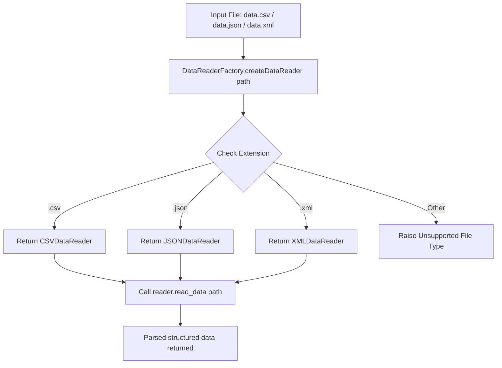

# Factory Pattern: Multi-format Data Reader Factory (CSV, JSON, XML) (JavaScript)

- **Source File:** `[design_patterns/04_Factory/data_reader.js](file:///Users/shamanth/Desktop/DSA/problem-solving/design_patterns/04_Factory/data_reader.js)`
- **Language:** JavaScript
- **Category:** Design Patterns / 04_Factory
- **Navigation:** [← Back to Master Documentation Index](../README.md)

---

## 1. Problem Statement / Question

Implement the Factory design pattern to instantiate and return appropriate data reader objects based on the file extension (.csv, .json, .xml) to parse file contents into structured data.

**Implementation Focus:** JavaScript Factory pattern with fs module.

---

## 2. Algorithm & Approach

1. Define abstract `DataReader` interface with `read_data(path)` method.
2. Implement `CSVDataReader`, `JSONDataReader`, `XMLDataReader`.
3. Create `DataReaderFactory` with a static method that inspects file extension and instantiates the appropriate parser.

---

## 3. Flowchart



---

## 4. Source Code

```javascript
const fs = require('fs');
const path = require('path');

// Abstract class for DataReader
class DataReader {
    readData(file_path) {}
}

// Concrete implementations of DataReader
class CSVDataReader extends DataReader {
    readData(file_path) {
        const data = fs.readFileSync(file_path, 'utf8').split('\n').map(row => row.split(','));
        return data;
    }
}

class JSONDataReader extends DataReader {
    readData(file_path) {
        const data = JSON.parse(fs.readFileSync(file_path, 'utf8'));
        return data;
    }
}

class XMLDataReader extends DataReader {
    readData(file_path) {
        const xmlContent = fs.readFileSync(file_path, 'utf8');
        const data = this.parseXML(xmlContent);
        return data;
    }

    parseXML(xmlContent) {
        const parser = new Parser();
        const data = {};
        parser.parseString(xmlContent, (err, result) => {
            if (err) {
                console.error(err);
                return;
            }
            data.root = result;
        });
        return data;
    }
}

// Factory class for creating data readers
class DataReaderFactory {
    static createDataReader(file_path) {
        const file_extension = path.extname(file_path).toLowerCase();
        if (file_extension === ".csv") {
            return new CSVDataReader();
        } else if (file_extension === ".json") {
            return new JSONDataReader();
        } else if (file_extension === ".xml") {
            return new XMLDataReader();
        } else {
            throw new Error("Unsupported file type");
        }
    }
}

// Client code
if (process.argv.length !== 3) {
    console.log("Usage: node script.js <file_path>");
    process.exit(1);
}

const file_path = process.argv[2];

const dataReader = DataReaderFactory.createDataReader(file_path);
const data = dataReader.readData(file_path);
console.log("Data read from", file_path, ":", data);
```

---

## 5. Simple Dry Run

Call factory with `data.csv`:
1. Selects `CSVDataReader`
2. Splits lines by commas
3. Returns array of row arrays.

---

## 6. Sample Output

```text
Data read from data.csv: [ ['id', 'name', 'age'], ['01', 'John', '25'] ]
```

---

## 7. Complexity Analysis

- **Time Complexity:** $O(n)$ where $n$ is the file size to parse
- **Space Complexity:** $O(n)$ to store parsed records in memory

---
[← Back to Master Documentation Index](../README.md)
