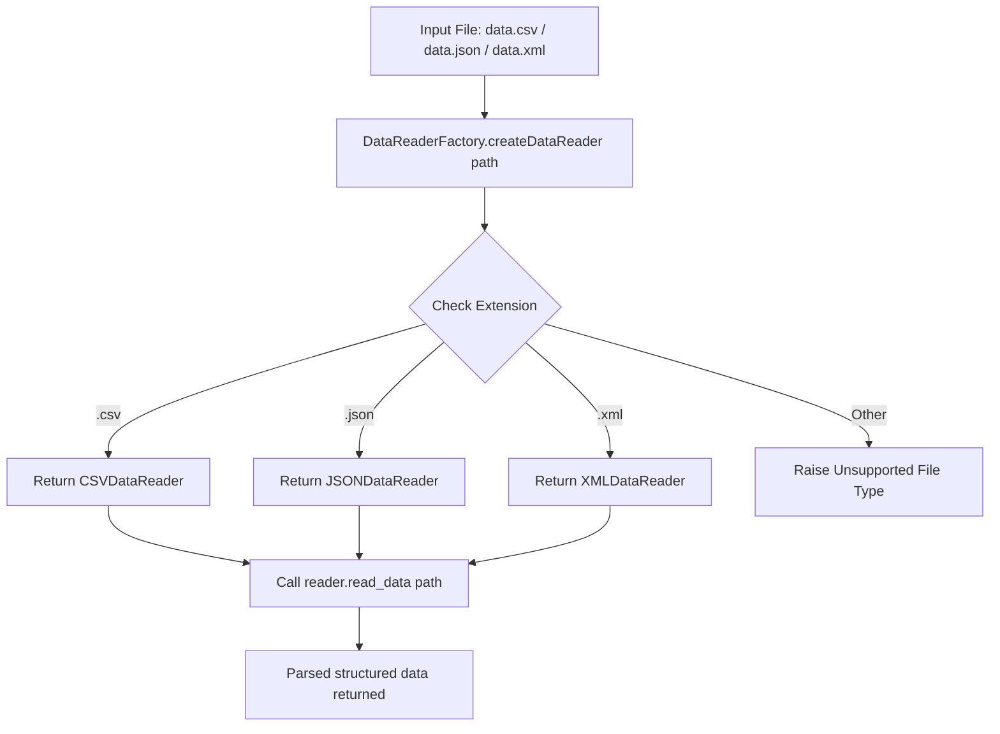

# Factory Pattern: Multi-format Data Reader Factory (CSV, JSON, XML) (Python)

- **Source File:** `[design_patterns/04_Factory/data_reader.py](file:///Users/shamanth/Desktop/DSA/problem-solving/design_patterns/04_Factory/data_reader.py)`
- **Language:** Python
- **Category:** Design Patterns / 04_Factory
- **Navigation:** [← Back to Master Documentation Index](../README.md)

---

## 1. Problem Statement / Question

Implement the Factory design pattern to instantiate and return appropriate data reader objects based on the file extension (.csv, .json, .xml) to parse file contents into structured data.

**Implementation Focus:** Python Factory pattern with abc.ABC.

---

## 2. Algorithm & Approach

1. Define abstract `DataReader` interface with `read_data(path)` method.
2. Implement `CSVDataReader`, `JSONDataReader`, `XMLDataReader`.
3. Create `DataReaderFactory` with a static method that inspects file extension and instantiates the appropriate parser.

---

## 3. Flowchart



---

## 4. Source Code

```python
import csv
import json
import xml.etree.ElementTree as ET
from abc import ABC, abstractmethod
import os
import sys

# Abstract class for DataReader
class DataReader(ABC):
    @abstractmethod
    def read_data(self, file_path):
        pass

# Concrete implementations of DataReader
class CSVDataReader(DataReader):
    def read_data(self, file_path):
        data = []
        with open(file_path, 'r') as file:
            csv_reader = csv.reader(file)
            for row in csv_reader:
                data.append(row)
        return data

class JSONDataReader(DataReader):
    def read_data(self, file_path):
        with open(file_path, 'r') as file:
            data = json.load(file)
        return data

class XMLDataReader(DataReader):
    def read_data(self, file_path):
        tree = ET.parse(file_path)
        root = tree.getroot()
        data = []
        for element in root:
            element_data = {}
            for child in element:
                element_data[child.tag] = child.text
            data.append(element_data)
        return data

# Factory class for creating data readers
class DataReaderFactory:
    @staticmethod
    def create_data_reader(file_path):
        file_extension = os.path.splitext(file_path)[1].lower()
        if file_extension == ".csv":
            return CSVDataReader()
        elif file_extension == ".json":
            return JSONDataReader()
        elif file_extension == ".xml":
            return XMLDataReader()
        else:
            raise ValueError("Unsupported file type")

# Client code
if __name__ == "__main__":
    if len(sys.argv) != 2:
        print("Usage: python script.py <file_path>")
        sys.exit(1)

    file_path = sys.argv[1]
    
    data_reader = DataReaderFactory.create_data_reader(file_path)
    data = data_reader.read_data(file_path)
    print("Data read from", file_path, ":", data)
```

---

## 5. Simple Dry Run

Call factory with `data.xml`:
1. `DataReaderFactory.create_data_reader('data.xml')` returns `XMLDataReader`.
2. Parses XML tree via `xml.etree.ElementTree`.

---

## 6. Sample Output

```text
Data read from data.xml : [{'name': 'John', 'age': '25', 'city': 'New York'}]
```

---

## 7. Complexity Analysis

- **Time Complexity:** $O(n)$ where $n$ is the file size to parse
- **Space Complexity:** $O(n)$ to store parsed records in memory

---
[← Back to Master Documentation Index](../README.md)
