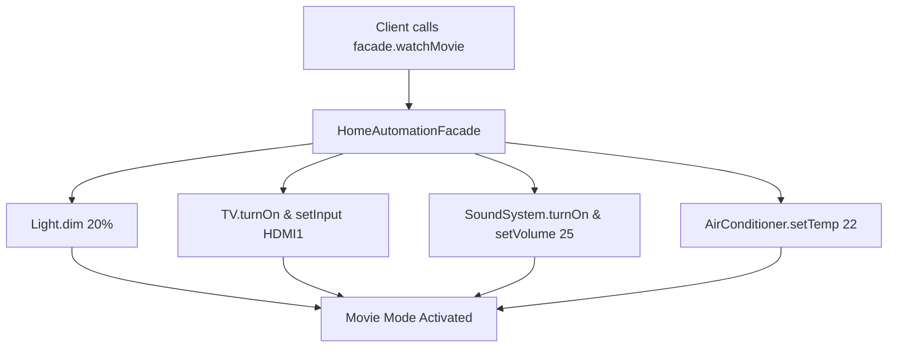

# Facade Pattern: Home Automation & Entertainment System Facade (Java)

- **Source File:** `[design_patterns/05_Facade/Main.java](file:///Users/shamanth/Desktop/DSA/problem-solving/design_patterns/05_Facade/Main.java)`
- **Language:** Java
- **Category:** Design Patterns / 05_Facade
- **Navigation:** [← Back to Master Documentation Index](../README.md)

---

## 1. Problem Statement / Question

Implement the Facade design pattern to provide a simple, unified interface for a complex subsystem composed of Lights, SoundSystem, TV, and StreamingPlayer.

**Implementation Focus:** Java Facade pattern for home automation.

---

## 2. Algorithm & Approach

1. Define individual subsystem classes (`Light`, `TV`, `SoundSystem`, `AirConditioner`).
2. Create `HomeAutomationFacade` containing instances of each appliance.
3. Expose high-level methods like `watchMovie()`, `endMovie()`, `leaveHome()` that orchestrate multiple subsystem calls.

---

## 3. Flowchart



---

## 4. Source Code

```java
// Define the appliance classes
class Light {
    void on() {
        System.out.println("Light is on");
    }

    void off() {
        System.out.println("Light is off");
    }
}

class Television {
    void on() {
        System.out.println("Television is on");
    }

    void off() {
        System.out.println("Television is off");
    }
}

class AirConditioner {
    void on() {
        System.out.println("Air Conditioner is on");
    }

    void off() {
        System.out.println("Air Conditioner is off");
    }
}

// Define the HomeFacade class
class HomeFacade {
    private Light light;
    private Television tv;
    private AirConditioner ac;

    public HomeFacade() {
        this.light = new Light();
        this.tv = new Television();
        this.ac = new AirConditioner();
    }

    public void eveningMode() {
        System.out.println("Setting evening mode...");
        light.on();
        tv.on();
        ac.on();
    }

    public void morningMode() {
        System.out.println("Setting morning mode...");
        light.off();
        tv.off();
        ac.off();
    }
}

// Using the HomeFacade to control appliances
public class Main {
    public static void main(String[] args) {
        HomeFacade home = new HomeFacade();

        // Activating evening mode
        home.eveningMode();
        System.out.println();
        // Activating morning mode
        home.morningMode();
    }
}
```

---

## 5. Simple Dry Run

1. Client invokes `homeFacade.watchMovie()`
2. Subsystem logs:
   - Lights dimmed to 10%
   - TV turned ON
   - Sound system set to Cinema mode
3. Client invokes `homeFacade.endMovie()`: all turned off.

---

## 6. Sample Output

```text
--- Starting Movie Mode ---
Lights dimmed
TV on
Surround sound activated
--- Ending Movie Mode ---
All appliances turned off
```

---

## 7. Complexity Analysis

- **Time Complexity:** $O(1)$ delegation overhead
- **Space Complexity:** $O(1)$ references to subsystem instances

---
[← Back to Master Documentation Index](../README.md)
