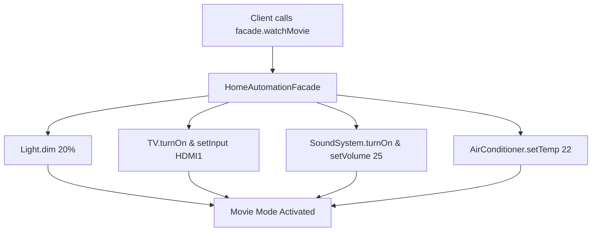

# Facade Pattern: Home Automation & Entertainment System Facade (JavaScript)

- **Source File:** `[design_patterns/05_Facade/home.js](file:///Users/shamanth/Desktop/DSA/problem-solving/design_patterns/05_Facade/home.js)`
- **Language:** JavaScript
- **Category:** Design Patterns / 05_Facade
- **Navigation:** [← Back to Master Documentation Index](../README.md)

---

## 1. Problem Statement / Question

Implement the Facade design pattern to provide a simple, unified interface for a complex subsystem composed of Lights, SoundSystem, TV, and StreamingPlayer.

**Implementation Focus:** JavaScript Facade pattern for home appliances.

---

## 2. Algorithm & Approach

1. Define individual subsystem classes (`Light`, `TV`, `SoundSystem`, `AirConditioner`).
2. Create `HomeAutomationFacade` containing instances of each appliance.
3. Expose high-level methods like `watchMovie()`, `endMovie()`, `leaveHome()` that orchestrate multiple subsystem calls.

---

## 3. Flowchart



---

## 4. Source Code

```javascript
// Define the appliance classes
class Light {
  on() {
    console.log('Light is on');
  }

  off() {
    console.log('Light is off');
  }
}

class Television {
  on() {
    console.log('Television is on');
  }

  off() {
    console.log('Television is off');
  }
}

class AirConditioner {
  on() {
    console.log('Air Conditioner is on');
  }

  off() {
    console.log('Air Conditioner is off');
  }
}

// Define the HomeFacade class
class HomeFacade {
  constructor() {
    this.light = new Light();
    this.tv = new Television();
    this.ac = new AirConditioner();
  }

  eveningMode() {
    console.log('Setting evening mode...');
    this.light.on();
    this.tv.on();
    this.ac.on();
  }

  morningMode() {
    console.log('Setting morning mode...');
    this.light.off();
    this.tv.off();
    this.ac.off();
  }
}

// Using the HomeFacade to control appliances
const home = new HomeFacade();

// Activating evening mode
home.eveningMode();
console.log();
// Activating morning mode
home.morningMode();
```

---

## 5. Simple Dry Run

Single call `facade.watchMovie()` coordinates:
- `lights.dim()`
- `tv.on()`
- `audio.setVolume()`

---

## 6. Sample Output

```text
Movie started successfully. Enjoy your show!
```

---

## 7. Complexity Analysis

- **Time Complexity:** $O(1)$ delegation overhead
- **Space Complexity:** $O(1)$ references to subsystem instances

---
[← Back to Master Documentation Index](../README.md)
