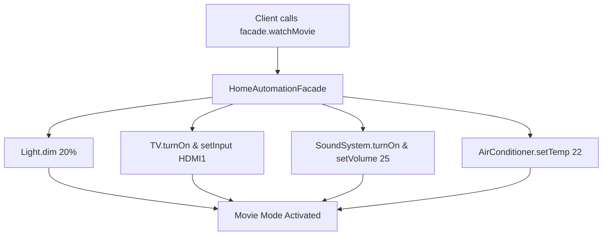

# Facade Pattern: Home Automation & Entertainment System Facade (Python)

- **Source File:** `[design_patterns/05_Facade/home.py](file:///Users/shamanth/Desktop/DSA/problem-solving/design_patterns/05_Facade/home.py)`
- **Language:** Python
- **Category:** Design Patterns / 05_Facade
- **Navigation:** [← Back to Master Documentation Index](../README.md)

---

## 1. Problem Statement / Question

Implement the Facade design pattern to provide a simple, unified interface for a complex subsystem composed of Lights, SoundSystem, TV, and StreamingPlayer.

**Implementation Focus:** Python Facade pattern coordinating subsystems.

---

## 2. Algorithm & Approach

1. Define individual subsystem classes (`Light`, `TV`, `SoundSystem`, `AirConditioner`).
2. Create `HomeAutomationFacade` containing instances of each appliance.
3. Expose high-level methods like `watchMovie()`, `endMovie()`, `leaveHome()` that orchestrate multiple subsystem calls.

---

## 3. Flowchart



---

## 4. Source Code

```python
# Define the appliance classes
class Light:
    def on(self):
        print("Light is on")

    def off(self):
        print("Light is off")

class Television:
    def on(self):
        print("Television is on")

    def off(self):
        print("Television is off")

class AirConditioner:
    def on(self):
        print("Air Conditioner is on")

    def off(self):
        print("Air Conditioner is off")

# Define the HomeFacade class
class HomeFacade:
    def __init__(self):
        self.light = Light()
        self.tv = Television()
        self.ac = AirConditioner()

    def evening_mode(self):
        print("Setting evening mode...")
        self.light.on()
        self.tv.on()
        self.ac.on()

    def morning_mode(self):
        print("Setting morning mode...")
        self.light.off()
        self.tv.off()
        self.ac.off()

# Using the HomeFacade to control appliances
if __name__ == "__main__":
    home = HomeFacade()

    # Activating evening mode
    home.evening_mode()
    print()
    # Activating morning mode
    home.morning_mode()
```

---

## 5. Simple Dry Run

Facade encapsulates 4 discrete device classes behind:
- `facade.start_movie_night()`
- `facade.leave_home()`

---

## 6. Sample Output

```text
Lights dimmed to 15%
TV switched to Netflix
Audio volume set to 30
Movie night ready!
```

---

## 7. Complexity Analysis

- **Time Complexity:** $O(1)$ delegation overhead
- **Space Complexity:** $O(1)$ references to subsystem instances

---
[← Back to Master Documentation Index](../README.md)
