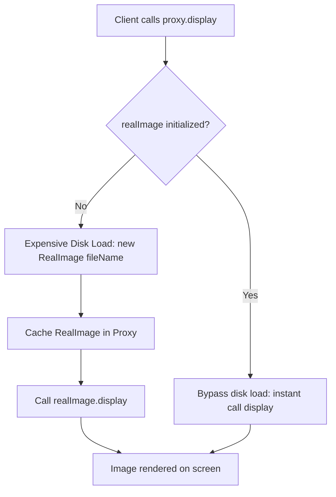

# Proxy Pattern: Image Renderer Virtual Proxy with Lazy Loading (Java)

- **Source File:** `[design_patterns/06_Proxy/Main.java](file:///Users/shamanth/Desktop/DSA/problem-solving/design_patterns/06_Proxy/Main.java)`
- **Language:** Java
- **Category:** Design Patterns / 06_Proxy
- **Navigation:** [← Back to Master Documentation Index](../README.md)

---

## 1. Problem Statement / Question

Implement the Proxy design pattern (Virtual Proxy) that defers expensive loading of high-resolution images from disk until the display request is actually triggered, caching the loaded image for subsequent renders.

**Implementation Focus:** Java Virtual Proxy pattern for lazy loading.

---

## 2. Algorithm & Approach

1. Define `Image` interface with `display()` method.
2. Implement `RealImage` that performs heavy disk I/O / loading simulation in constructor.
3. Implement `ProxyImage` holding a reference to `RealImage`, only creating it upon the first call to `display()`.

---

## 3. Flowchart



---

## 4. Source Code

```java
import java.util.concurrent.TimeUnit;

interface Image {
    void display();
}

class RealImage implements Image {
    private String filename;

    public RealImage(String filename) {
        this.filename = filename;
        loadImage();
    }

    private void loadImage() {
        System.out.println("Loading image '" + filename + "' from disk...");
        try {
            // Simulate the delay of loading a large file
            TimeUnit.SECONDS.sleep(2);
        } catch (InterruptedException e) {
            e.printStackTrace();
        }
        System.out.println("Image '" + filename + "' loaded.");
    }

    @Override
    public void display() {
        System.out.println("Displaying " + filename);
    }
}

class ProxyImage implements Image {
    private String filename;
    private RealImage realImage;

    public ProxyImage(String filename) {
        this.filename = filename;
    }

    @Override
    public void display() {
        if (realImage == null) {
            realImage = new RealImage(filename);
        }
        realImage.display();
    }
}

public class Main {
    public static void main(String[] args) {
        Image[] images = {
            new ProxyImage("image1.jpg"),
            new ProxyImage("image2.jpg"),
            new ProxyImage("image3.jpg")
        };

        System.out.println("User is opening the image viewer.");
        images[0].display();
        System.out.println("User navigates to the next image.");
        images[1].display();
        System.out.println("User goes back to the first image.");
        images[0].display();
    }
}
```

---

## 5. Simple Dry Run

1. `Image img = new ProxyImage("high_res.jpg");` -> No disk load yet!
2. `img.display();` -> Triggers `Loading high_res.jpg from disk...` and displays.
3. `img.display();` -> Reuses cached image, instant display without reload.

---

## 6. Sample Output

```text
Loading high_res.jpg from disk...
Displaying high_res.jpg
Displaying high_res.jpg (instant cache)
```

---

## 7. Complexity Analysis

- **Time Complexity:** First access: $O(\text{load time})$; subsequent accesses: $O(1)$
- **Space Complexity:** $O(\text{image size})$ once loaded into memory

---
[← Back to Master Documentation Index](../README.md)
