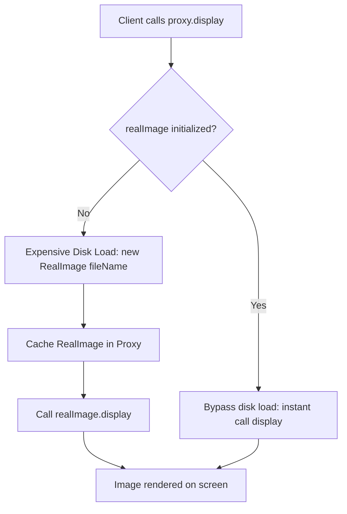

# Proxy Pattern: Image Renderer Virtual Proxy with Lazy Loading (JavaScript)

- **Source File:** `[design_patterns/06_Proxy/image_renderer.js](file:///Users/shamanth/Desktop/DSA/problem-solving/design_patterns/06_Proxy/image_renderer.js)`
- **Language:** JavaScript
- **Category:** Design Patterns / 06_Proxy
- **Navigation:** [← Back to Master Documentation Index](../README.md)

---

## 1. Problem Statement / Question

Implement the Proxy design pattern (Virtual Proxy) that defers expensive loading of high-resolution images from disk until the display request is actually triggered, caching the loaded image for subsequent renders.

**Implementation Focus:** JavaScript Virtual Proxy with cached real object.

---

## 2. Algorithm & Approach

1. Define `Image` interface with `display()` method.
2. Implement `RealImage` that performs heavy disk I/O / loading simulation in constructor.
3. Implement `ProxyImage` holding a reference to `RealImage`, only creating it upon the first call to `display()`.

---

## 3. Flowchart



---

## 4. Source Code

```javascript
// This is an abstract base class => To be inherited. 
class Image {
    display() {
        throw new Error("This method should be overridden.");
    }
}

class RealImage extends Image {
    constructor(filename) {
        super();
        this.filename = filename;
        this._loadImage();
    }

    _loadImage() {
        console.log(`Loading image '${this.filename}' from disk...`);
        // Simulate the delay of loading a large file
        setTimeout(() => {
            console.log(`Image '${this.filename}' loaded.`);
        }, 2000);
    }

    display() {
        console.log(`Displaying ${this.filename}`);
    }
}

class ProxyImage extends Image {
    constructor(filename) {
        super();
        this.filename = filename;
        this._realImage = null;
    }

    display() {
        if (this._realImage === null) {
            this._realImage = new RealImage(this.filename);
        }
        this._realImage.display();
    }
}

function main() {
    const images = [
        new ProxyImage("image1.jpg"),
        new ProxyImage("image2.jpg"),
        new ProxyImage("image3.jpg")
    ];

    console.log("User is opening the image viewer.");
    images[0].display();
    setTimeout(() => {
        console.log("User navigates to the next image.");
        images[1].display();
        setTimeout(() => {
            console.log("User goes back to the first image.");
            images[0].display();
        }, 2500);
    }, 2500);
}

main();
```

---

## 5. Simple Dry Run

Proxy delays instantiation:
- Call 1: Instantiates `RealImage`, simulates delay, renders.
- Call 2: Uses existing `this.realImage` directly.

---

## 6. Sample Output

```text
Loading image from disk: banner.png
Displaying banner.png
Displaying banner.png (cached)
```

---

## 7. Complexity Analysis

- **Time Complexity:** First access: $O(\text{load time})$; subsequent accesses: $O(1)$
- **Space Complexity:** $O(\text{image size})$ once loaded into memory

---
[← Back to Master Documentation Index](../README.md)
