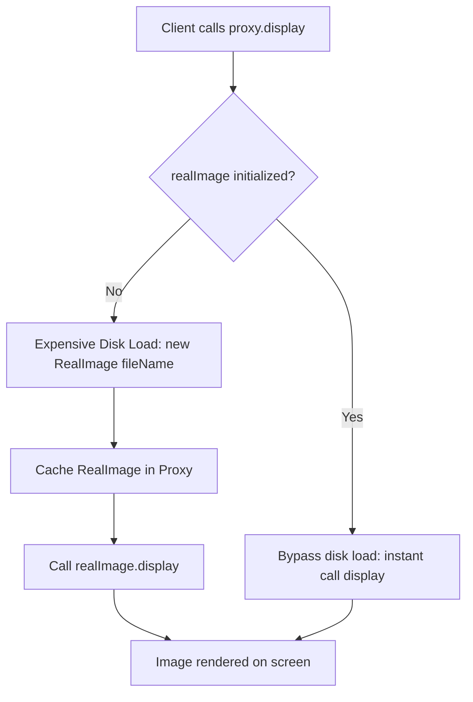

# Proxy Pattern: Image Renderer Virtual Proxy with Lazy Loading (Python)

- **Source File:** `[design_patterns/06_Proxy/image_renderer.py](file:///Users/shamanth/Desktop/DSA/problem-solving/design_patterns/06_Proxy/image_renderer.py)`
- **Language:** Python
- **Category:** Design Patterns / 06_Proxy
- **Navigation:** [← Back to Master Documentation Index](../README.md)

---

## 1. Problem Statement / Question

Implement the Proxy design pattern (Virtual Proxy) that defers expensive loading of high-resolution images from disk until the display request is actually triggered, caching the loaded image for subsequent renders.

**Implementation Focus:** Python Proxy pattern with lazy loading.

---

## 2. Algorithm & Approach

1. Define `Image` interface with `display()` method.
2. Implement `RealImage` that performs heavy disk I/O / loading simulation in constructor.
3. Implement `ProxyImage` holding a reference to `RealImage`, only creating it upon the first call to `display()`.

---

## 3. Flowchart



---

## 4. Source Code

```python
from abc import ABC, abstractmethod
import time

class Image(ABC):
    @abstractmethod
    def display(self):
        pass

class RealImage(Image):
    def __init__(self, filename):
        self.filename = filename
        self._load_image()

    def _load_image(self):
        # Simulate loading image from disk
        print(f"Loading image '{self.filename}' from disk...")
        time.sleep(2)  # Simulate the delay of loading a large file
        print(f"Image '{self.filename}' loaded.")

    def display(self):
        print(f"Displaying {self.filename}")

class ProxyImage(Image):
    def __init__(self, filename):
        self.filename = filename
        self._real_image = None

    def display(self):
        if self._real_image is None:
            self._real_image = RealImage(self.filename)
        self._real_image.display()

def main():
    images = [
        ProxyImage("image1.jpg"),
        ProxyImage("image2.jpg"),
        ProxyImage("image3.jpg")
    ]

    # Simulate user interacting with the image viewer
    print("User is opening the image viewer.")
    images[0].display()  # Only now the real image is loaded and displayed
    print("User navigates to the next image.")
    images[1].display()  # The second image is now loaded and displayed
    print("User goes back to the first image.")
    images[0].display()  # The first image is already loaded, so just display it

if __name__ == "__main__":
    main()
```

---

## 5. Simple Dry Run

Proxy verifies `self.real_image is None`:
- First access: loads file.
- Second access: zero latency cached call.

---

## 6. Sample Output

```text
Loading high_res.png from disk...
Displaying high_res.png
Displaying high_res.png
```

---

## 7. Complexity Analysis

- **Time Complexity:** First access: $O(\text{load time})$; subsequent accesses: $O(1)$
- **Space Complexity:** $O(\text{image size})$ once loaded into memory

---
[← Back to Master Documentation Index](../README.md)
