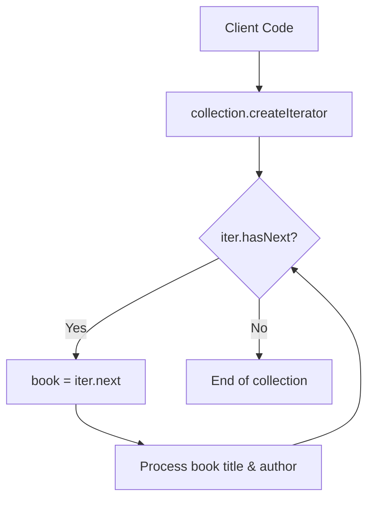

# Iterator Pattern: Sequential Book Collection Traversal (Java)

- **Source File:** `[design_patterns/07_Iterator/Main.java](file:///Users/shamanth/Desktop/DSA/problem-solving/design_patterns/07_Iterator/Main.java)`
- **Language:** Java
- **Category:** Design Patterns / 07_Iterator
- **Navigation:** [← Back to Master Documentation Index](../README.md)

---

## 1. Problem Statement / Question

Implement the Iterator design pattern to allow sequential traversal of books in a library collection without exposing its internal underlying representation (array, list, or set).

**Implementation Focus:** Java Iterator pattern over book collection.

---

## 2. Algorithm & Approach

1. Create `Book` entity.
2. Define `Iterator` interface with `hasNext()` and `next()` methods.
3. Define `Aggregate` / `Iterable` interface with `createIterator()`.
4. Concrete `BookIterator` maintains traversal index cursor.

---

## 3. Flowchart



---

## 4. Source Code

```java
import java.util.ArrayList;
import java.util.Iterator;
import java.util.List;

// Book class
class Book {
    private String title;
    private String author;
    private int year;

    public Book(String title, String author, int year) {
        this.title = title;
        this.author = author;
        this.year = year;
    }

    @Override
    public String toString() {
        return title + " by " + author + ", " + year;
    }
}

// Library class
class Library implements Iterable<Book> {
    private List<Book> books = new ArrayList<>();

    public void addBook(Book book) {
        books.add(book);
    }

    @Override
    public Iterator<Book> iterator() {
        return new LibraryIterator(books);
    }

    public Iterable<Book> getBooksByAuthor(String author) {
        return new LibraryAuthorIterable(books, author);
    }

    public Iterable<Book> getBooksByYear(int year) {
        return new LibraryYearIterable(books, year);
    }
}

// LibraryIterator class
class LibraryIterator implements Iterator<Book> {
    private List<Book> books;
    private int index;

    public LibraryIterator(List<Book> books) {
        this.books = books;
        this.index = 0;
    }

    @Override
    public boolean hasNext() {
        return index < books.size();
    }

    @Override
    public Book next() {
        return books.get(index++);
    }
}

// LibraryAuthorIterable class
class LibraryAuthorIterable implements Iterable<Book> {
    private List<Book> books;

    public LibraryAuthorIterable(List<Book> books, String author) {
        this.books = new ArrayList<>();
        for (Book book : books) {
            if (book.toString().contains(author)) {
                this.books.add(book);
            }
        }
    }

    @Override
    public Iterator<Book> iterator() {
        return books.iterator();
    }
}

// LibraryYearIterable class
class LibraryYearIterable implements Iterable<Book> {
    private List<Book> books;

    public LibraryYearIterable(List<Book> books, int year) {
        this.books = new ArrayList<>();
        for (Book book : books) {
            if (book.toString().contains(Integer.toString(year))) {
                this.books.add(book);
            }
        }
    }

    @Override
    public Iterator<Book> iterator() {
        return books.iterator();
    }
}

// Main class
public class Main {
    public static void main(String[] args) {
        Library library = new Library();
        library.addBook(new Book("The Great Gatsby", "F. Scott Fitzgerald", 1925));
        library.addBook(new Book("1984", "George Orwell", 1949));
        library.addBook(new Book("To Kill a Mockingbird", "Harper Lee", 1960));
        library.addBook(new Book("Animal Farm", "George Orwell", 1945));

        System.out.println("All books in the library:");
        for (Book book : library) {
            System.out.println(book);
        }

        System.out.println("\nBooks by George Orwell:");
        for (Book book : library.getBooksByAuthor("George Orwell")) {
            System.out.println(book);
        }

        System.out.println("\nBooks published in 1945:");
        for (Book book : library.getBooksByYear(1945)) {
            System.out.println(book);
        }
    }
}
```

---

## 5. Simple Dry Run

1. Add 3 books to `BookCollection`.
2. Obtain `Iterator<Book> it = collection.iterator()`.
3. Loop `while (it.hasNext())`: prints each book title.

---

## 6. Sample Output

```text
Book: Clean Code by Robert C. Martin (2008)
Book: Design Patterns by Gang of Four (1994)
Book: Refactoring by Martin Fowler (1999)
```

---

## 7. Complexity Analysis

- **Time Complexity:** $O(1)$ per step; $O(n)$ for full collection traversal
- **Space Complexity:** $O(1)$ iterator cursor state

---
[← Back to Master Documentation Index](../README.md)
