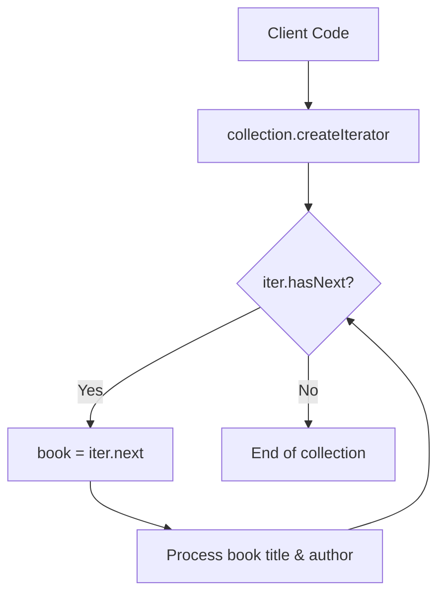

# Iterator Pattern: Sequential Book Collection Traversal (JavaScript)

- **Source File:** `[design_patterns/07_Iterator/books.js](file:///Users/shamanth/Desktop/DSA/problem-solving/design_patterns/07_Iterator/books.js)`
- **Language:** JavaScript
- **Category:** Design Patterns / 07_Iterator
- **Navigation:** [← Back to Master Documentation Index](../README.md)

---

## 1. Problem Statement / Question

Implement the Iterator design pattern to allow sequential traversal of books in a library collection without exposing its internal underlying representation (array, list, or set).

**Implementation Focus:** JavaScript custom iterator with next protocol.

---

## 2. Algorithm & Approach

1. Create `Book` entity.
2. Define `Iterator` interface with `hasNext()` and `next()` methods.
3. Define `Aggregate` / `Iterable` interface with `createIterator()`.
4. Concrete `BookIterator` maintains traversal index cursor.

---

## 3. Flowchart



---

## 4. Source Code

```javascript
class Book {
  constructor(title, author, year) {
    this.title = title;
    this.author = author;
    this.year = year;
  }

  toString() {
    return `${this.title} by ${this.author}, ${this.year}`;
  }
}

class Library {
  constructor() {
    this.books = [];
  }

  addBook(book) {
    this.books.push(book);
  }

  [Symbol.iterator]() {
    return new LibraryIterator(this.books);
  }

  getBooksByAuthor(author) {
    return new LibraryAuthorIterator(this.books, author);
  }

  getBooksByYear(year) {
    return new LibraryYearIterator(this.books, year);
  }
}

class LibraryIterator {
  constructor(books) {
    this._books = books;
    this._index = 0;
  }

  next() {
    if (this._index < this._books.length) {
      return { value: this._books[this._index++], done: false };
    } else {
      return { done: true };
    }
  }
}

class LibraryAuthorIterator {
  constructor(books, author) {
    this._books = books.filter((book) => book.author === author);
    this._index = 0;
  }

  [Symbol.iterator]() {
    return this;
  }

  next() {
    if (this._index < this._books.length) {
      return { value: this._books[this._index++], done: false };
    } else {
      return { done: true };
    }
  }
}

class LibraryYearIterator {
  constructor(books, year) {
    this._books = books.filter((book) => book.year === year);
    this._index = 0;
  }

  [Symbol.iterator]() {
    return this;
  }

  next() {
    if (this._index < this._books.length) {
      return { value: this._books[this._index++], done: false };
    } else {
      return { done: true };
    }
  }
}

// Usage example
const library = new Library();

library.addBook(new Book('The Great Gatsby', 'F. Scott Fitzgerald', 1925));
library.addBook(new Book('1984', 'George Orwell', 1949));
library.addBook(new Book('To Kill a Mockingbird', 'Harper Lee', 1960));
library.addBook(new Book('Animal Farm', 'George Orwell', 1945));

console.log('All books in the library:');
// of => automatically calls next() for you, done flag as well! 
for (const book of library) {  // for loop is sequential 
  console.log(book.toString());
}

// How will you simulate pause? next() by yourself

console.log('\nBooks by George Orwell:');
for (const book of library.getBooksByAuthor('George Orwell')) {
  console.log(book.toString());
}

console.log('\nBooks published in 1945:');
for (const book of library.getBooksByYear(1945)) {
  console.log(book.toString());
}

// const iterator = library[Symbol.iterator]();

// console.log(iterator.next().value.toString())
// console.log(iterator.next().value.toString())
// console.log(iterator.next())
```

---

## 5. Simple Dry Run

Implement `[Symbol.iterator]()` protocol:
- Allows `for...of` syntax directly over custom `BookCollection`.

---

## 6. Sample Output

```text
Title: Design Patterns | Author: GoF | Year: 1994
Title: Pragmatic Programmer | Author: Andy Hunt | Year: 1999
```

---

## 7. Complexity Analysis

- **Time Complexity:** $O(1)$ per step; $O(n)$ for full collection traversal
- **Space Complexity:** $O(1)$ iterator cursor state

---
[← Back to Master Documentation Index](../README.md)
