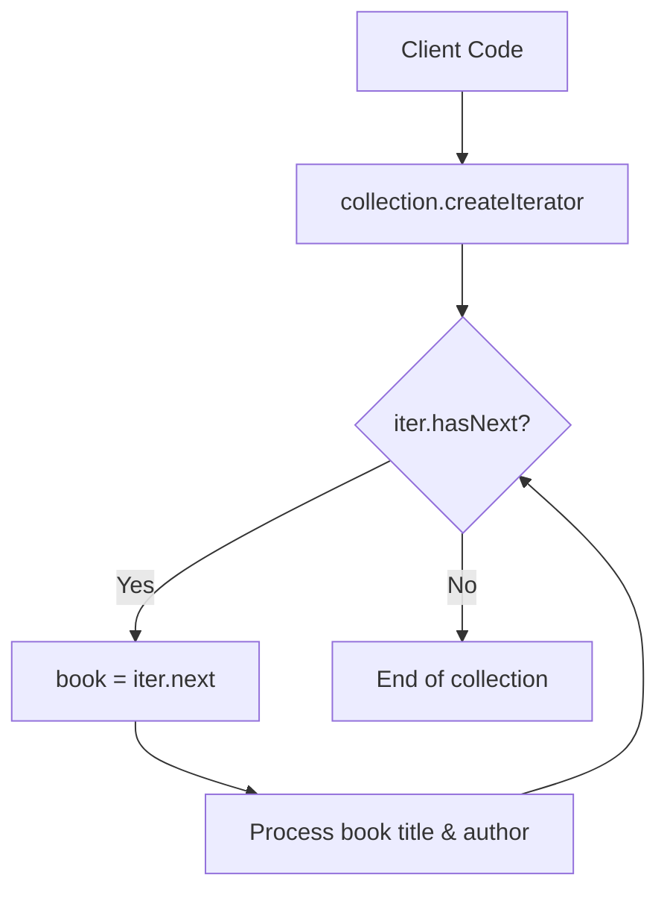

# Iterator Pattern: Sequential Book Collection Traversal (Python)

- **Source File:** `[design_patterns/07_Iterator/books.py](file:///Users/shamanth/Desktop/DSA/problem-solving/design_patterns/07_Iterator/books.py)`
- **Language:** Python
- **Category:** Design Patterns / 07_Iterator
- **Navigation:** [← Back to Master Documentation Index](../README.md)

---

## 1. Problem Statement / Question

Implement the Iterator design pattern to allow sequential traversal of books in a library collection without exposing its internal underlying representation (array, list, or set).

**Implementation Focus:** Python Iterator with __iter__ and __next__.

---

## 2. Algorithm & Approach

1. Create `Book` entity.
2. Define `Iterator` interface with `hasNext()` and `next()` methods.
3. Define `Aggregate` / `Iterable` interface with `createIterator()`.
4. Concrete `BookIterator` maintains traversal index cursor.

---

## 3. Flowchart



---

## 4. Source Code

```python
class Book:
    def __init__(self, title, author, year):
        self.title = title
        self.author = author
        self.year = year

    def __str__(self):
        return f'{self.title} by {self.author}, {self.year}'

class Library:
    def __init__(self):
        self.books = []

    def add_book(self, book):
        self.books.append(book)

    def __iter__(self):
        return LibraryIterator(self.books)

    def get_books_by_author(self, author):
        return LibraryAuthorIterator(self.books, author)

    def get_books_by_year(self, year):
        return LibraryYearIterator(self.books, year)

class LibraryIterator:
    def __init__(self, books):
        self._books = books
        self._index = 0

    def __iter__(self):
        return self

    def __next__(self):
        if self._index < len(self._books):
            result = self._books[self._index]
            self._index += 1
            return result
        else:
            raise StopIteration

class LibraryAuthorIterator:
    def __init__(self, books, author):
        self._books = [book for book in books if book.author == author]
        self._index = 0

    def __iter__(self):
        return self

    def __next__(self):
        if self._index < len(self._books):
            result = self._books[self._index]
            self._index += 1
            return result
        else:
            raise StopIteration

class LibraryYearIterator:
    def __init__(self, books, year):
        self._books = [book for book in books if book.year == year]
        self._index = 0

    def __iter__(self):
        return self

    def __next__(self):
        if self._index < len(self._books):
            result = self._books[self._index]
            self._index += 1
            return result
        else:
            raise StopIteration

if __name__ == "__main__":
    library = Library()
    library.add_book(Book("The Great Gatsby", "F. Scott Fitzgerald", 1925))
    library.add_book(Book("1984", "George Orwell", 1949))
    library.add_book(Book("To Kill a Mockingbird", "Harper Lee", 1960))
    library.add_book(Book("Animal Farm", "George Orwell", 1945))

    print("All books in the library:")
    for book in library:
        print(book)

    print("\nBooks by George Orwell:")
    for book in library.get_books_by_author("George Orwell"):
        print(book)

    print("\nBooks published in 1945:")
    for book in library.get_books_by_year(1945):
        print(book)

    iterator = iter(library)
    print(iterator.__next__())
    print(iterator.__next__())
    print(next(iterator))
```

---

## 5. Simple Dry Run

Python iterator protocol:
- `__iter__()` returns self with index reset.
- `__next__()` returns next book or raises `StopIteration`.

---

## 6. Sample Output

```text
Book: The Pragmatic Programmer (1999)
Book: Clean Architecture (2017)
```

---

## 7. Complexity Analysis

- **Time Complexity:** $O(1)$ per step; $O(n)$ for full collection traversal
- **Space Complexity:** $O(1)$ iterator cursor state

---
[← Back to Master Documentation Index](../README.md)
