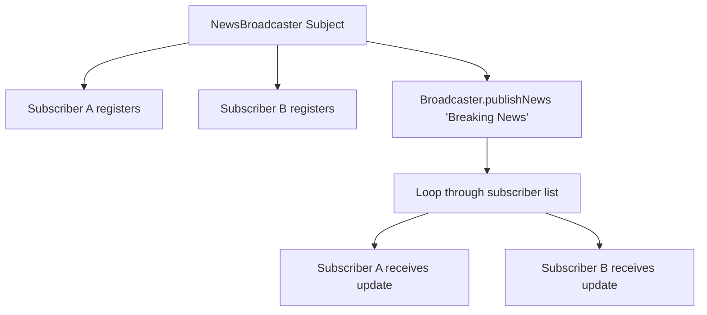

# Observer Pattern: Event / News Broadcast Subscription System (Java)

- **Source File:** `[design_patterns/08_Observer/Main.java](file:///Users/shamanth/Desktop/DSA/problem-solving/design_patterns/08_Observer/Main.java)`
- **Language:** Java
- **Category:** Design Patterns / 08_Observer
- **Navigation:** [← Back to Master Documentation Index](../README.md)

---

## 1. Problem Statement / Question

Implement the Observer design pattern where a central Subject (NewsBroadcaster) maintains a list of dependent Observers (EmailSubscriber, SMSSubscriber) and notifies them automatically upon publishing news.

**Implementation Focus:** Java Observer pattern with interfaces.

---

## 2. Algorithm & Approach

1. Define `Subject` interface with `subscribe()`, `unsubscribe()`, and `notifyObservers()`.
2. Define `Observer` interface with `update(message)`.
3. When new event occurs on subject, it iterates through all registered observers and triggers their `update` callback.

---

## 3. Flowchart



---

## 4. Source Code

```java
import java.util.ArrayList;
import java.util.List;

// Subject (Observable)
interface Subject {
    void registerObserver(Observer observer);
    void removeObserver(Observer observer);
    void notifyObservers();
}

// Concrete Subject
class WeatherStation implements Subject {
    private Double temperature;
    private List<Observer> observers;

    public WeatherStation() {
        this.observers = new ArrayList<>();
    }

    public void registerObserver(Observer observer) {
        observers.add(observer);
    }

    public void removeObserver(Observer observer) {
        observers.remove(observer);
    }

    public void notifyObservers() {
        for (Observer observer : observers) {
            observer.update(temperature);
        }
    }

    public void setTemperature(Double temperature) {
        System.out.println("Setting temperature to: " + temperature);
        this.temperature = temperature;
        notifyObservers();
    }
}

// Observer
interface Observer {
    void update(Double temperature);
}

// Concrete Observer
class Display implements Observer {
    private String name;

    public Display(String name) {
        this.name = name;
    }

    public void update(Double temperature) {
        System.out.println(name + " received temperature update: " + temperature);
    }
}

// Usage example
public class Main {
    public static void main(String[] args) {
        WeatherStation weatherStation = new WeatherStation();

        Observer observer1 = new Display("Observer 1");
        Observer observer2 = new Display("Observer 2");

        weatherStation.registerObserver(observer1);
        weatherStation.registerObserver(observer2);

        weatherStation.setTemperature(25.5);
        weatherStation.setTemperature(30.0);

        weatherStation.removeObserver(observer1);

        weatherStation.setTemperature(27.8);
    }
}
```

---

## 5. Simple Dry Run

1. Register `MobileAppObserver` and `EmailObserver`.
2. Subject publishes: `"New Tech Breakthrough!"`
3. Both observers print received notification.
4. Unsubscribe `EmailObserver`; publish second message -> only Mobile receives it.

---

## 6. Sample Output

```text
Mobile App received: New Tech Breakthrough!
Email alert: New Tech Breakthrough!
Mobile App received: System Maintenance Notice
```

---

## 7. Complexity Analysis

- **Time Complexity:** $O(m)$ notification time where $m$ is the number of active observers
- **Space Complexity:** $O(m)$ to store observer references

---
[← Back to Master Documentation Index](../README.md)
