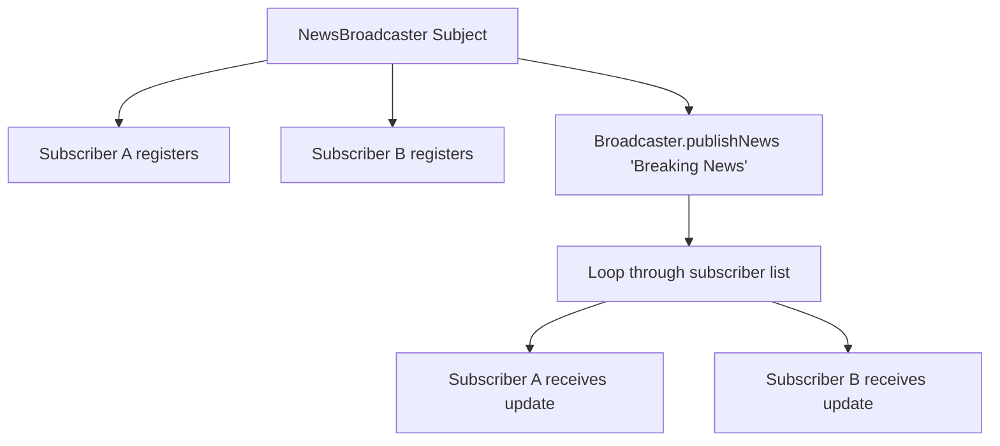

# Observer Pattern: Event / News Broadcast Subscription System (JavaScript)

- **Source File:** `[design_patterns/08_Observer/broadcast.js](file:///Users/shamanth/Desktop/DSA/problem-solving/design_patterns/08_Observer/broadcast.js)`
- **Language:** JavaScript
- **Category:** Design Patterns / 08_Observer
- **Navigation:** [← Back to Master Documentation Index](../README.md)

---

## 1. Problem Statement / Question

Implement the Observer design pattern where a central Subject (NewsBroadcaster) maintains a list of dependent Observers (EmailSubscriber, SMSSubscriber) and notifies them automatically upon publishing news.

**Implementation Focus:** JavaScript Observer pattern with callback listeners.

---

## 2. Algorithm & Approach

1. Define `Subject` interface with `subscribe()`, `unsubscribe()`, and `notifyObservers()`.
2. Define `Observer` interface with `update(message)`.
3. When new event occurs on subject, it iterates through all registered observers and triggers their `update` callback.

---

## 3. Flowchart



---

## 4. Source Code

```javascript
// Subject (Observable)

// Libraries = Redux? Sveltestore? 
class WeatherStation {
    constructor() {
        this.temperature = null; // Variables (states) are dynamically taken care of, each state => observers
        this.observers = [];
    }

    registerObserver(observer) {
        this.observers.push(observer);
    }

    removeObserver(observer) {
        const index = this.observers.indexOf(observer);
        if (index !== -1) {
            this.observers.splice(index, 1);
        }
    }

    notifyObservers() {
        this.observers.forEach(observer => observer.update(this.temperature));
    }

    setTemperature(temperature) {
        console.log(`Setting temperature to: ${temperature}`);
        this.temperature = temperature;
        this.notifyObservers();
    }
}

// Observer
class Display {
    constructor(name) {
        this.name = name;
        // temperature
    }

    update(temperature) {
        console.log(`${this.name} received temperature update: ${temperature}`);
        // this.temperature = temperature
        // Whatever you want to trigger, when value change happens.
    }
}

// Usage example
const weatherStation = new WeatherStation();

const observer1 = new Display("Observer 1");
const observer2 = new Display("Observer 2");

weatherStation.registerObserver(observer1);
weatherStation.registerObserver(observer2);

weatherStation.setTemperature(25.5);
weatherStation.setTemperature(30.0);

weatherStation.removeObserver(observer1);

weatherStation.setTemperature(27.8);
```

---

## 5. Simple Dry Run

Subject stores callbacks in `this.subscribers`:
- `broadcast.subscribe(observer)`
- `broadcast.notify(data)` runs observer update.

---

## 6. Sample Output

```text
Observer 1 got: Breaking News!
Observer 2 got: Breaking News!
```

---

## 7. Complexity Analysis

- **Time Complexity:** $O(m)$ notification time where $m$ is the number of active observers
- **Space Complexity:** $O(m)$ to store observer references

---
[← Back to Master Documentation Index](../README.md)
