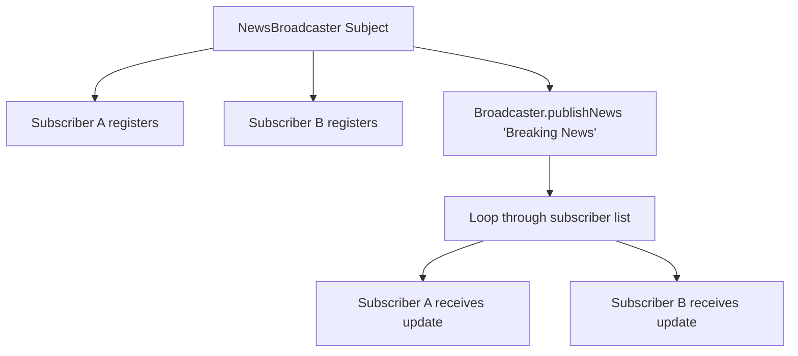

# Observer Pattern: Event / News Broadcast Subscription System (Python)

- **Source File:** `[design_patterns/08_Observer/broadcast.py](file:///Users/shamanth/Desktop/DSA/problem-solving/design_patterns/08_Observer/broadcast.py)`
- **Language:** Python
- **Category:** Design Patterns / 08_Observer
- **Navigation:** [← Back to Master Documentation Index](../README.md)

---

## 1. Problem Statement / Question

Implement the Observer design pattern where a central Subject (NewsBroadcaster) maintains a list of dependent Observers (EmailSubscriber, SMSSubscriber) and notifies them automatically upon publishing news.

**Implementation Focus:** Python Observer pattern with abc classes.

---

## 2. Algorithm & Approach

1. Define `Subject` interface with `subscribe()`, `unsubscribe()`, and `notifyObservers()`.
2. Define `Observer` interface with `update(message)`.
3. When new event occurs on subject, it iterates through all registered observers and triggers their `update` callback.

---

## 3. Flowchart



---

## 4. Source Code

```python
from abc import ABC, abstractmethod

# Abstract Subject
class Subject(ABC):
    @abstractmethod
    def register_observer(self, observer):
        pass
    
    @abstractmethod
    def remove_observer(self, observer):
        pass
    
    @abstractmethod
    def notify_observers(self):
        pass

# Concrete Subject
class WeatherStation(Subject):
    def __init__(self):
        self._temperature = None
        self._observers = []

    def register_observer(self, observer):
        self._observers.append(observer)

    def remove_observer(self, observer):
        self._observers.remove(observer)

    def notify_observers(self):
        for observer in self._observers:
            observer.update(self._temperature)

    def set_temperature(self, temperature):
        print("Setting temperature to:", temperature)
        self._temperature = temperature
        self.notify_observers()

# Abstract Observer
class Observer(ABC):
    @abstractmethod
    def update(self, temperature):
        pass

# Concrete Observer
class Display(Observer):
    def __init__(self, name):
        self._name = name

    def update(self, temperature):
        print(f"{self._name} received temperature update: {temperature}")

# Usage example
if __name__ == "__main__":
    weather_station = WeatherStation()

    observer1 = Display("Observer 1")
    observer2 = Display("Observer 2")

    weather_station.register_observer(observer1)
    weather_station.register_observer(observer2)

    weather_station.set_temperature(25.5)
    weather_station.set_temperature(30.0)

    weather_station.remove_observer(observer1)

    weather_station.set_temperature(27.8)
```

---

## 5. Simple Dry Run

Subject maintains `self._observers = set()`:
- `attach(observer)`, `detach(observer)`
- `notify(event)` dispatches to all observers.

---

## 6. Sample Output

```text
Notification to User1: Flash Sale Live!
Notification to User2: Flash Sale Live!
```

---

## 7. Complexity Analysis

- **Time Complexity:** $O(m)$ notification time where $m$ is the number of active observers
- **Space Complexity:** $O(m)$ to store observer references

---
[← Back to Master Documentation Index](../README.md)
