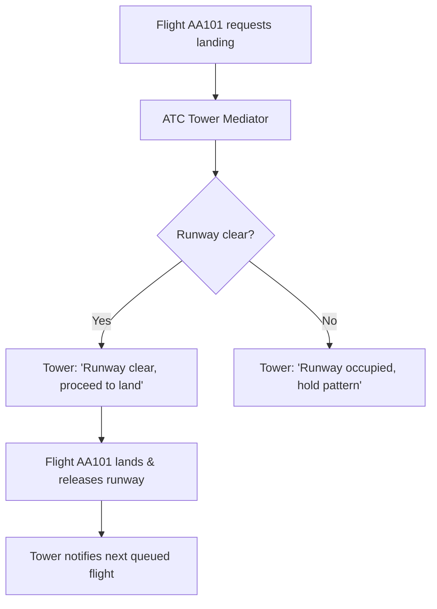

# Mediator Pattern: Air Traffic Control Tower Flight Coordination (Java)

- **Source File:** `[design_patterns/09_Mediator/Main.java](file:///Users/shamanth/Desktop/DSA/problem-solving/design_patterns/09_Mediator/Main.java)`
- **Language:** Java
- **Category:** Design Patterns / 09_Mediator
- **Navigation:** [← Back to Master Documentation Index](../README.md)

---

## 1. Problem Statement / Question

Implement the Mediator design pattern to coordinate landing and takeoff requests among airplanes through an Air Traffic Control (ATC) Tower without flights communicating directly with one another.

**Implementation Focus:** Java Mediator pattern for ATC Tower.

---

## 2. Algorithm & Approach

1. Define `Mediator` interface with `requestLanding(flight)` and `requestTakeoff(flight)`.
2. Define `Colleague` / `Flight` class holding a reference to the mediator.
3. ATC Tower coordinates runway availability, queuing requests and notifying flights when cleared.

---

## 3. Flowchart



---

## 4. Source Code

```java
import java.util.ArrayList;
import java.util.List;

class TowerMediator {
    private List<Runway> runways;
    private List<Airplane> airplanes;

    public TowerMediator() {
        this.runways = new ArrayList<>();
        this.airplanes = new ArrayList<>();
    }

    public void addRunway(Runway runway) {
        runways.add(runway);
    }

    public void addAirplane(Airplane airplane) {
        airplanes.add(airplane);
    }

    public void requestToLand(Airplane airplane) {
        for (Runway runway : runways) {
            if (runway.isAvailable()) {
                runway.land(airplane);
                return;
            }
        }
        System.out.println("All runways are busy, " + airplane.getName() + " cannot land now.");
    }

    public void requestToTakeoff(Airplane airplane) {
        for (Runway runway : runways) {
            if (runway.isAvailable()) {
                runway.takeoff(airplane);
                return;
            }
        }
        System.out.println("All runways are busy, " + airplane.getName() + " cannot take off now.");
    }
}

class Runway {
    private String name;
    private boolean isAvailable;

    public Runway(String name) {
        this.name = name;
        this.isAvailable = true;
    }

    public boolean isAvailable() {
        return isAvailable;
    }

    public void land(Airplane airplane) {
        if (isAvailable) {
            System.out.println(airplane.getName() + " is landing on " + name + ".");
            isAvailable = false;
            airplane.land();
        } else {
            System.out.println(name + " is currently occupied.");
        }
    }

    public void takeoff(Airplane airplane) {
        if (isAvailable) {
            System.out.println(airplane.getName() + " is taking off from " + name + ".");
            isAvailable = false;
            airplane.takeoff();
        } else {
            System.out.println(name + " is currently occupied.");
        }
    }

    public void release() {
        isAvailable = true;
        System.out.println(name + " is now available.");
    }
}

class Airplane {
    private String name;
    private TowerMediator mediator;
    private boolean isFlying;

    public Airplane(String name, TowerMediator mediator) {
        this.name = name;
        this.mediator = mediator;
        this.isFlying = false;
    }

    public String getName() {
        return name;
    }

    public void requestLanding() {
        System.out.println(name + " is requesting to land.");
        mediator.requestToLand(this);
    }

    public void requestTakeoff() {
        System.out.println(name + " is requesting to take off.");
        mediator.requestToTakeoff(this);
    }

    public void land() {
        isFlying = false;
        System.out.println(name + " has landed.");
    }

    public void takeoff() {
        isFlying = true;
        System.out.println(name + " has taken off.");
    }
}

public class Main {
    public static void main(String[] args) {
        TowerMediator mediator = new TowerMediator();

        Runway runway1 = new Runway("Runway 1");
        Runway runway2 = new Runway("Runway 2");

        mediator.addRunway(runway1);
        mediator.addRunway(runway2);

        Airplane airplane1 = new Airplane("Airplane 1", mediator);
        Airplane airplane2 = new Airplane("Airplane 2", mediator);

        mediator.addAirplane(airplane1);
        mediator.addAirplane(airplane2);

        // Airplane 1 requests to land
        airplane1.requestLanding();

        // Airplane 2 requests to land
        airplane2.requestLanding();

        // Runway 1 is released and now available
        runway1.release();

        // Airplane 2 can now land
        airplane2.requestLanding();

        // Airplane 1 requests to take off
        airplane1.requestTakeoff();

        // Runway 1 is released and now available
        runway1.release();

        // Airplane 2 requests to take off
        airplane2.requestTakeoff();
    }
}
```

---

## 5. Simple Dry Run

1. Register `Flight 101` and `Flight 202` with `TowerMediator`.
2. `Flight 101` requests landing -> Granted.
3. `Flight 202` requests landing -> Denied / queued (runway busy).
4. `Flight 101` reports landed -> `Flight 202` cleared to land.

---

## 6. Sample Output

```text
Flight AA101: Requesting landing clearance
Tower: Clearance granted for AA101
Flight UA202: Requesting landing clearance
Tower: Runway busy, UA202 hold pattern
Flight AA101: Landing complete, runway vacated
Tower: UA202 cleared to land
```

---

## 7. Complexity Analysis

- **Time Complexity:** $O(1)$ to mediate request or $O(k)$ for queued dispatch
- **Space Complexity:** $O(k)$ references to colleague flight instances

---
[← Back to Master Documentation Index](../README.md)
