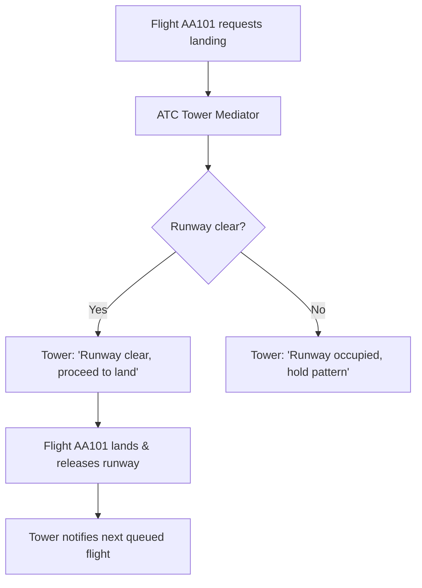

# Mediator Pattern: Air Traffic Control Tower Flight Coordination (JavaScript)

- **Source File:** `[design_patterns/09_Mediator/tower.js](file:///Users/shamanth/Desktop/DSA/problem-solving/design_patterns/09_Mediator/tower.js)`
- **Language:** JavaScript
- **Category:** Design Patterns / 09_Mediator
- **Navigation:** [← Back to Master Documentation Index](../README.md)

---

## 1. Problem Statement / Question

Implement the Mediator design pattern to coordinate landing and takeoff requests among airplanes through an Air Traffic Control (ATC) Tower without flights communicating directly with one another.

**Implementation Focus:** JavaScript Mediator pattern coordinating flights.

---

## 2. Algorithm & Approach

1. Define `Mediator` interface with `requestLanding(flight)` and `requestTakeoff(flight)`.
2. Define `Colleague` / `Flight` class holding a reference to the mediator.
3. ATC Tower coordinates runway availability, queuing requests and notifying flights when cleared.

---

## 3. Flowchart



---

## 4. Source Code

```javascript
class TowerMediator {
  constructor() {
    this.runways = [];
    this.airplanes = [];
  }

  addRunway(runway) {
    this.runways.push(runway);
  }

  addAirplane(airplane) {
    this.airplanes.push(airplane);
  }

  requestToLand(airplane) {
    for (let runway of this.runways) {
      if (runway.isAvailable) {
        runway.land(airplane);
        return;
      }
    }
    console.log(`All runways are busy, ${airplane.name} cannot land now.`);
  }

  requestToTakeoff(airplane) {
    for (let runway of this.runways) {
      if (runway.isAvailable) {
        runway.takeoff(airplane);
        return;
      }
    }
    console.log(`All runways are busy, ${airplane.name} cannot take off now.`);
  }
}

class Runway {
  constructor(name) {
    this.name = name;
    this.isAvailable = true;
  }

  land(airplane) {
    if (this.isAvailable) {
      console.log(`${airplane.name} is landing on ${this.name}.`);
      this.isAvailable = false;
      airplane.land();
    } else {
      console.log(`${this.name} is currently occupied.`);
    }
  }

  takeoff(airplane) {
    if (this.isAvailable) {
      console.log(`${airplane.name} is taking off from ${this.name}.`);
      this.isAvailable = false;
      airplane.takeoff();
    } else {
      console.log(`${this.name} is currently occupied.`);
    }
  }

  release() {
    this.isAvailable = true;
    console.log(`${this.name} is now available.`);
  }
}

class Airplane {
  constructor(name, mediator) {
    this.name = name;
    this.mediator = mediator;
    this.isFlying = false;
  }

  requestLanding() {
    console.log(`${this.name} is requesting to land.`);
    this.mediator.requestToLand(this);
  }

  requestTakeoff() {
    console.log(`${this.name} is requesting to take off.`);
    this.mediator.requestToTakeoff(this);
  }

  land() {
    this.isFlying = false;
    console.log(`${this.name} has landed.`);
  }

  takeoff() {
    this.isFlying = true;
    console.log(`${this.name} has taken off.`);
  }
}

// Example usage
const mediator = new TowerMediator();

const runway1 = new Runway('Runway 1');
const runway2 = new Runway('Runway 2');

mediator.addRunway(runway1);
mediator.addRunway(runway2);

const airplane1 = new Airplane('Airplane 1', mediator);
const airplane2 = new Airplane('Airplane 2', mediator);

mediator.addAirplane(airplane1);
mediator.addAirplane(airplane2);

// Airplane 1 requests to land
airplane1.requestLanding();

// Airplane 2 requests to land
airplane2.requestLanding();

// Runway 1 is released and now available
runway1.release();

// Airplane 2 can now land
airplane2.requestLanding();

// Airplane 1 requests to take off
airplane1.requestTakeoff();

// Runway 1 is released and now available
runway1.release();

// Airplane 2 requests to take off
airplane2.requestTakeoff();
```

---

## 5. Simple Dry Run

Flight communicates only with `tower`:
- `flight.requestLanding()` delegates to `this.tower.requestLanding(this)`.

---

## 6. Sample Output

```text
Tower: Flight 101 granted landing clearance
Tower: Flight 202 queued for runway
```

---

## 7. Complexity Analysis

- **Time Complexity:** $O(1)$ to mediate request or $O(k)$ for queued dispatch
- **Space Complexity:** $O(k)$ references to colleague flight instances

---
[← Back to Master Documentation Index](../README.md)
