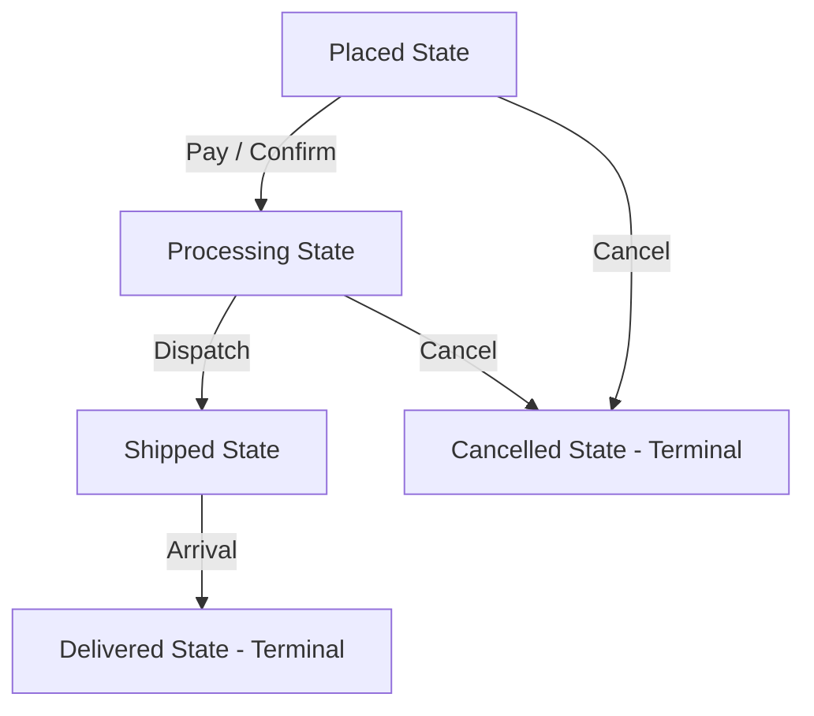

# State Pattern: E-Commerce Order Lifecycle State Transitions (Java)

- **Source File:** `[design_patterns/10_State/Order.java](file:///Users/shamanth/Desktop/DSA/problem-solving/design_patterns/10_State/Order.java)`
- **Language:** Java
- **Category:** Design Patterns / 10_State
- **Navigation:** [← Back to Master Documentation Index](../README.md)

---

## 1. Problem Statement / Question

Implement the State design pattern to model an order's lifecycle where behavior changes dynamically as state transitions from Placed to Processing, Shipped, and Delivered (or Cancelled).

**Implementation Focus:** Java State pattern for order processing.

---

## 2. Algorithm & Approach

1. Define `OrderState` interface with actions: `nextState(order)`, `cancel(order)`, `status()`.
2. Implement concrete states: `PlacedState`, `ProcessingState`, `ShippedState`, `DeliveredState`, `CancelledState`.
3. The `Order` context delegates state operations to its current state object.

---

## 3. Flowchart



---

## 4. Source Code

```java
// OrderState.java
public interface OrderState {
    void nextState(Order order);
    void prevState(Order order);
    String toString();
}

// NewOrderState.java
public class NewOrderState implements OrderState {
    @Override
    public void nextState(Order order) {
        order.setState(new ProcessingOrderState());
    }

    @Override
    public void prevState(Order order) {
        System.out.println("The order is already in the initial state.");
    }

    @Override
    public String toString() {
        return "New Order";
    }
}

// ProcessingOrderState.java
public class ProcessingOrderState implements OrderState {
    @Override
    public void nextState(Order order) {
        order.setState(new ShippedOrderState());
    }

    @Override
    public void prevState(Order order) {
        order.setState(new NewOrderState());
    }

    @Override
    public String toString() {
        return "Processing Order";
    }
}

// ShippedOrderState.java
public class ShippedOrderState implements OrderState {
    @Override
    public void nextState(Order order) {
        order.setState(new DeliveredOrderState());
    }

    @Override
    public void prevState(Order order) {
        order.setState(new ProcessingOrderState());
    }

    @Override
    public String toString() {
        return "Shipped Order";
    }
}

// DeliveredOrderState.java
public class DeliveredOrderState implements OrderState {
    @Override
    public void nextState(Order order) {
        System.out.println("The order is already in the final state.");
    }

    @Override
    public void prevState(Order order) {
        order.setState(new ShippedOrderState());
    }

    @Override
    public String toString() {
        return "Delivered Order";
    }
}

// Order.java
public class Order {
    private OrderState state;

    public Order() {
        state = new NewOrderState();
    }

    public void setState(OrderState state) {
        this.state = state;
    }

    public void nextState() {
        state.nextState(this);
    }

    public void prevState() {
        state.prevState(this);
    }

    @Override
    public String toString() {
        return "Order is currently in '" + state + "' state.";
    }

    public static void main(String[] args) {
        Order order = new Order();
        System.out.println(order);  // Output: Order is currently in 'New Order' state.

        order.nextState();
        System.out.println(order);  // Output: Order is currently in 'Processing Order' state.

        order.nextState();
        System.out.println(order);  // Output: Order is currently in 'Shipped Order' state.

        order.nextState();
        System.out.println(order);  // Output: Order is currently in 'Delivered Order' state.

        order.prevState();
        System.out.println(order);  // Output: Order is currently in 'Shipped Order' state.

        order.prevState();
        System.out.println(order);  // Output: Order is currently in 'Processing Order' state.

        order.prevState();
        System.out.println(order);  // Output: Order is currently in 'New Order' state.
    }
}
```

---

## 5. Simple Dry Run

1. Order created in `PlacedState`.
2. `order.next()` -> Transitions to `ProcessingState`.
3. `order.next()` -> Transitions to `ShippedState`.
4. `order.next()` -> Transitions to `DeliveredState`.
5. `order.next()` -> Already in final state, no further transition.

---

## 6. Sample Output

```text
Current state: Order Placed
Transition: Order is now Processing
Transition: Order Shipped
Transition: Order Delivered
```

---

## 7. Complexity Analysis

- **Time Complexity:** $O(1)$ per state transition
- **Space Complexity:** $O(1)$ single current state object reference

---
[← Back to Master Documentation Index](../README.md)
