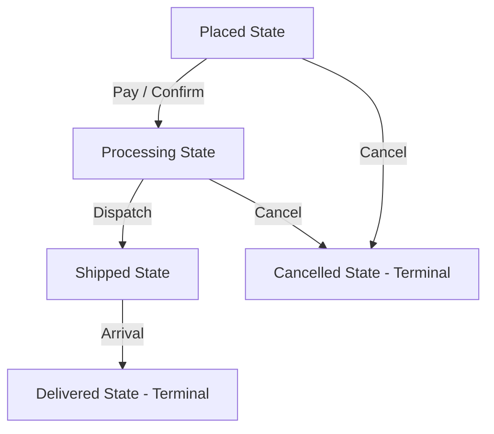

# State Pattern: E-Commerce Order Lifecycle State Transitions (JavaScript)

- **Source File:** `[design_patterns/10_State/order.js](file:///Users/shamanth/Desktop/DSA/problem-solving/design_patterns/10_State/order.js)`
- **Language:** JavaScript
- **Category:** Design Patterns / 10_State
- **Navigation:** [← Back to Master Documentation Index](../README.md)

---

## 1. Problem Statement / Question

Implement the State design pattern to model an order's lifecycle where behavior changes dynamically as state transitions from Placed to Processing, Shipped, and Delivered (or Cancelled).

**Implementation Focus:** JavaScript State pattern with transition methods.

---

## 2. Algorithm & Approach

1. Define `OrderState` interface with actions: `nextState(order)`, `cancel(order)`, `status()`.
2. Implement concrete states: `PlacedState`, `ProcessingState`, `ShippedState`, `DeliveredState`, `CancelledState`.
3. The `Order` context delegates state operations to its current state object.

---

## 3. Flowchart



---

## 4. Source Code

```javascript
class OrderState {
    nextState(order) {
        throw new Error('nextState method should be implemented');
    }
    
    prevState(order) {
        throw new Error('prevState method should be implemented');
    }

    toString() {
        throw new Error('toString method should be implemented');
    }
}

class NewOrderState extends OrderState {
    nextState(order) {
        order.state = new ProcessingOrderState();
    }

    prevState(order) {
        console.log("The order is already in the initial state.");
    }

    toString() {
        return 'New Order';
    }
}

class ProcessingOrderState extends OrderState {
    nextState(order) {
        order.state = new ShippedOrderState();
    }

    prevState(order) {
        order.state = new NewOrderState();
    }

    toString() {
        return 'Processing Order';
    }
}

class ShippedOrderState extends OrderState {
    nextState(order) {
        order.state = new DeliveredOrderState();
    }

    prevState(order) {
        order.state = new ProcessingOrderState();
    }

    toString() {
        return 'Shipped Order';
    }
}

class DeliveredOrderState extends OrderState {
    nextState(order) {
        console.log("The order is already in the final state.");
    }

    prevState(order) {
        order.state = new ShippedOrderState();
    }

    toString() {
        return 'Delivered Order';
    }
}

class Order {
    constructor() {
        this.state = new NewOrderState();
    }
    
    nextState() {
        this.state.nextState(this);
    }
    
    prevState() {
        this.state.prevState(this);
    }
    
    toString() {
        return `Order is currently in '${this.state.toString()}' state.`;
    }
}

// Example Usage
const order = new Order();
console.log(order.toString());  // Output: Order is currently in 'New Order' state.

order.nextState();
console.log(order.toString());  // Output: Order is currently in 'Processing Order' state.

order.nextState();
console.log(order.toString());  // Output: Order is currently in 'Shipped Order' state.

order.nextState();
console.log(order.toString());  // Output: Order is currently in 'Delivered Order' state.

order.prevState();
console.log(order.toString());  // Output: Order is currently in 'Shipped Order' state.

order.prevState();
console.log(order.toString());  // Output: Order is currently in 'Processing Order' state.

order.prevState();
console.log(order.toString());  // Output: Order is currently in 'New Order' state.
```

---

## 5. Simple Dry Run

Context holds `this.state`:
- `order.next()` calls `this.state.next(this)`.
- Reassigns `order.setState(new ProcessingState())`.

---

## 6. Sample Output

```text
State changed: Placed -> Processing
State changed: Processing -> Shipped
Order successfully delivered!
```

---

## 7. Complexity Analysis

- **Time Complexity:** $O(1)$ per state transition
- **Space Complexity:** $O(1)$ single current state object reference

---
[← Back to Master Documentation Index](../README.md)
