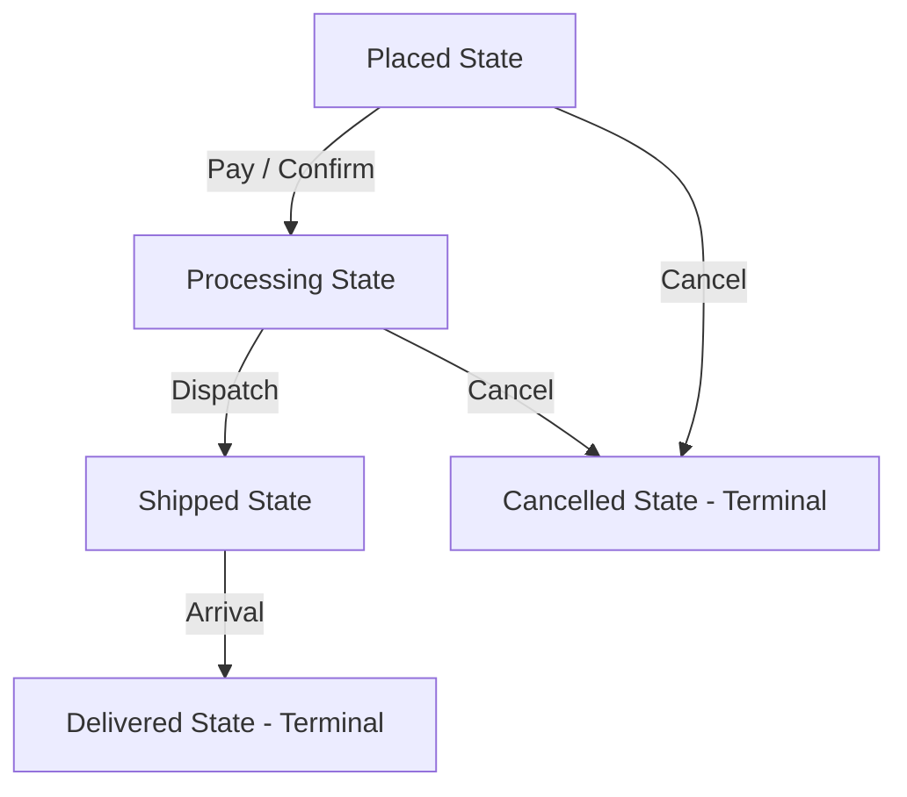

# State Pattern: E-Commerce Order Lifecycle State Transitions (Python)

- **Source File:** `[design_patterns/10_State/order.py](file:///Users/shamanth/Desktop/DSA/problem-solving/design_patterns/10_State/order.py)`
- **Language:** Python
- **Category:** Design Patterns / 10_State
- **Navigation:** [← Back to Master Documentation Index](../README.md)

---

## 1. Problem Statement / Question

Implement the State design pattern to model an order's lifecycle where behavior changes dynamically as state transitions from Placed to Processing, Shipped, and Delivered (or Cancelled).

**Implementation Focus:** Python State pattern with abstract states.

---

## 2. Algorithm & Approach

1. Define `OrderState` interface with actions: `nextState(order)`, `cancel(order)`, `status()`.
2. Implement concrete states: `PlacedState`, `ProcessingState`, `ShippedState`, `DeliveredState`, `CancelledState`.
3. The `Order` context delegates state operations to its current state object.

---

## 3. Flowchart



---

## 4. Source Code

```python
from abc import ABC, abstractmethod

class OrderState(ABC):
    @abstractmethod
    def next_state(self, order):
        pass
    
    @abstractmethod
    def prev_state(self, order):
        pass
    
    @abstractmethod
    def __str__(self):
        pass

class NewOrderState(OrderState):
    def next_state(self, order):
        order.state = ProcessingOrderState()

    def prev_state(self, order):
        print("The order is already in the initial state.")

    def __str__(self):
        return "New Order"

class ProcessingOrderState(OrderState):
    def next_state(self, order):
        order.state = ShippedOrderState()

    def prev_state(self, order):
        order.state = NewOrderState()

    def __str__(self):
        return "Processing Order"

class ShippedOrderState(OrderState):
    def next_state(self, order):
        order.state = DeliveredOrderState()

    def prev_state(self, order):
        order.state = ProcessingOrderState()

    def __str__(self):
        return "Shipped Order"

class DeliveredOrderState(OrderState):
    def next_state(self, order):
        print("The order is already in the final state.")

    def prev_state(self, order):
        order.state = ShippedOrderState()

    def __str__(self):
        return "Delivered Order"

class Order:
    def __init__(self):
        self.state = NewOrderState()
        
    def next_state(self):
        self.state.next_state(self)
        
    def prev_state(self):
        self.state.prev_state(self)
        
    def __str__(self):
        return f"Order is currently in '{self.state}' state."


order = Order()
print(order)  # Output: Order is currently in 'New Order' state.

order.next_state()
print(order)  # Output: Order is currently in 'Processing Order' state.

order.next_state()
print(order)  # Output: Order is currently in 'Shipped Order' state.

order.next_state()
print(order)  # Output: Order is currently in 'Delivered Order' state.

order.prev_state()
print(order)  # Output: Order is currently in 'Shipped Order' state.

order.prev_state()
print(order)  # Output: Order is currently in 'Processing Order' state.

order.prev_state()
print(order)  # Output: Order is currently in 'New Order' state.
```

---

## 5. Simple Dry Run

Concrete state classes handle invalid transitions:
- E.g. Cannot cancel delivered order.

---

## 6. Sample Output

```text
Order state: Placed
Order state: Processing
Order state: Delivered
Cannot cancel delivered order.
```

---

## 7. Complexity Analysis

- **Time Complexity:** $O(1)$ per state transition
- **Space Complexity:** $O(1)$ single current state object reference

---
[← Back to Master Documentation Index](../README.md)
