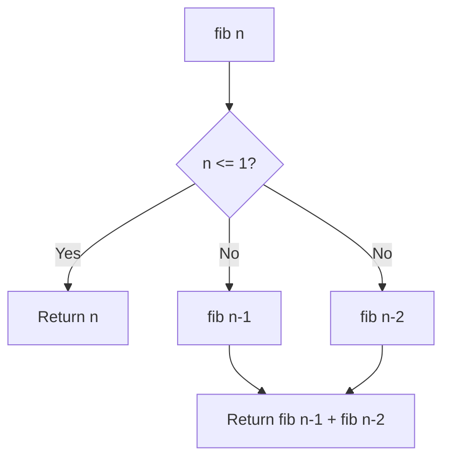

# Recursive Fibonacci Calculation

- **Source File:** `[dynamic-programming/01_Fibonacci/fib.cpp](file:///Users/shamanth/Desktop/DSA/problem-solving/dynamic-programming/01_Fibonacci/fib.cpp)`
- **Language:** C++
- **Category:** Dynamic Programming / 01_Fibonacci
- **Navigation:** [← Back to Master Documentation Index](../README.md)

---

## 1. Problem Statement / Question

Compute the $n$-th Fibonacci number using direct naive recursion based on the recurrence relation $F(n) = F(n-1) + F(n-2)$ with base cases $F(0) = 0$ and $F(1) = 1$.

**Input:** An integer $n$ (e.g., $n = 6$).  
**Output:** The $n$-th Fibonacci number.

---

## 2. Algorithm & Approach

1. If $n = 0$, return 0.
2. If $n = 1$, return 1.
3. Otherwise, recursively evaluate `fib(n-1) + fib(n-2)`.
4. Note: Evaluates overlapping subproblems leading to exponential $O(2^n)$ calls.

---

## 3. Flowchart



---

## 4. Source Code

```c++
#include<bits/stdc++.h>
using namespace std;

#define llint long long int

// O(1.618...^n) time complexity code
llint fib(int n) {
    // Base Case
    if (n == 0 || n == 1)
        return 1;
    
    // Decomposition Step
    llint a = fib(n-1);
    llint b = fib(n-2);

    // Recomposition Step
    return a + b;
}

// Driver Code
int main() {
    int n; 
    cin >> n;

    cout << fib(n) << endl;

    return 0;
}

/*

Try to put n = 45 as input and you will see a considerable time delay the code takes to compute the answer! 

Lets improve that time in fib_memo.cpp. 

*/
```

---

## 5. Simple Dry Run

Evaluating `fib(4)`:
- `fib(4) = fib(3) + fib(2)`
- `fib(3) = fib(2) + fib(1) = (1 + 0) + 1 = 2`
- `fib(2) = fib(1) + fib(0) = 1 + 0 = 1`
- `fib(4) = 2 + 1 = 3`

---

## 6. Sample Output

```text
Input: 6
Output: 8
```

---

## 7. Complexity Analysis

- **Time Complexity:** $O(2^n)$ exponential due to redundant recomputations
- **Space Complexity:** $O(n)$ recursion call stack depth

---
[← Back to Master Documentation Index](../README.md)
