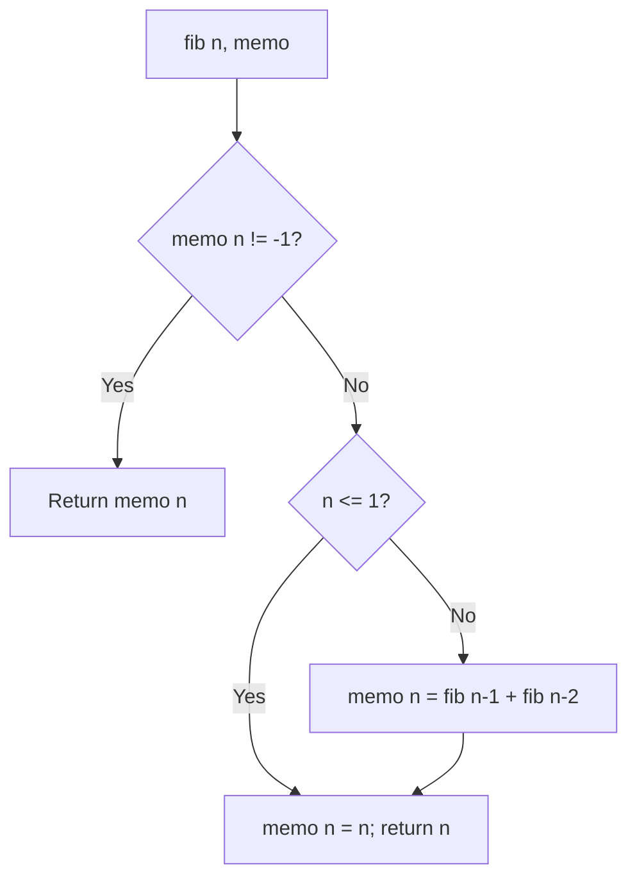

# Memoized Fibonacci (Top-Down Dynamic Programming)

- **Source File:** `[dynamic-programming/01_Fibonacci/fib_memo.cpp](file:///Users/shamanth/Desktop/DSA/problem-solving/dynamic-programming/01_Fibonacci/fib_memo.cpp)`
- **Language:** C++
- **Category:** Dynamic Programming / 01_Fibonacci
- **Navigation:** [← Back to Master Documentation Index](../README.md)

---

## 1. Problem Statement / Question

Optimize Fibonacci computation using top-down memoization (caching previously computed states in a table or hash map) to reduce time complexity from exponential to linear.

**Input:** Integer $n$ (e.g., $n = 40$).  
**Output:** $n$-th Fibonacci number in $O(n)$ time.

---

## 2. Algorithm & Approach

1. Maintain a memoization vector `memo` initialized with -1.
2. In `fib(n)`:
   - Check if `memo[n] != -1`; if so, return cached value immediately.
   - For base cases $n \le 1$, return $n$.
   - Compute `memo[n] = fib(n-1) + fib(n-2)`.
   - Return `memo[n]`.

---

## 3. Flowchart



---

## 4. Source Code

```c++
#include<bits/stdc++.h>
using namespace std;

#define llint long long int

// Memo table
llint memo[101];

// O(n) time complexity code
llint fib(int n) {
    // Base Case
    if (n == 0 || n == 1)
        return 1;
    
    // STEP 2: Before recursion, check if you know the answer
    if (memo[n] != -1)
        return memo[n];

    // Decomposition Step
    llint a = fib(n-1);
    llint b = fib(n-2);

    // Recomposition Step
    // STEP 3: Before returning the answer, store it for future
    memo[n] = a + b;
    return memo[n];
}

// Driver Code
int main() {
    int n; 
    cin >> n;

    // STEP 1: Initialize the memo table with -1
    for (int i = 0; i <= n; i++)
        memo[i] = -1;

    cout << fib(n) << endl;

    return 0;
}

/*

It is not a good practice to keep the memo table global. However, it is a decent appraoch for problem solving as you dont need to worry on passing it in your recursion and keeping its track. 

The size of the global memo table I pick it from the 'constraints' section of the problem. If 0 <= n <= 100, I create the memo table of 101 i.e. (max value of n) + 1.

Now try putting n = 45 again as input and see the time difference in which you see the answer!

*/
```

---

## 5. Simple Dry Run

For $n = 5$, `memo` initialized to `[-1, -1, -1, -1, -1, -1]`:
- `fib(0)` cached as 0, `fib(1)` cached as 1
- `fib(2) = 0 + 1 = 1`, memo[2] = 1
- `fib(3) = 1 + 1 = 2`, memo[3] = 2
- `fib(4) = 2 + 1 = 3`, memo[4] = 3
- `fib(5) = 3 + 2 = 5`, memo[5] = 5
Each subproblem is computed exactly once!

---

## 6. Sample Output

```text
Fibonacci(6) = 8
Fibonacci(40) = 102334155 (computed in < 1ms)
```

---

## 7. Complexity Analysis

- **Time Complexity:** $O(n)$ — each state from 0 to $n$ is evaluated once
- **Space Complexity:** $O(n)$ for memo array + $O(n)$ recursion call stack

---
[← Back to Master Documentation Index](../README.md)
