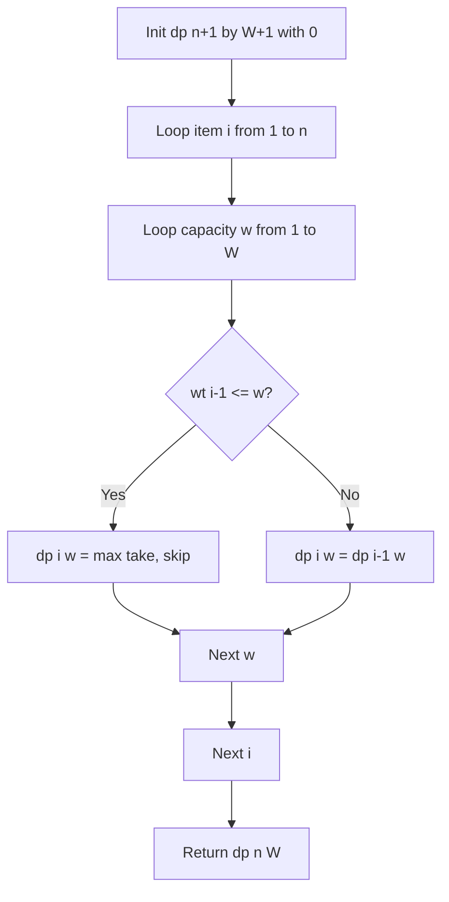

# 0/1 Knapsack Problem (2D Dynamic Programming)

- **Source File:** `[dynamic-programming/02_Knapsack/knapsack.cpp](file:///Users/shamanth/Desktop/DSA/problem-solving/dynamic-programming/02_Knapsack/knapsack.cpp)`
- **Language:** C++
- **Category:** Dynamic Programming / 02_Knapsack
- **Navigation:** [← Back to Master Documentation Index](../README.md)

---

## 1. Problem Statement / Question

Given weights and values of $n$ items, put these items in a knapsack of capacity $W$ to get the maximum total value in the knapsack. Each item can either be picked or left (0/1 choice).

**Input:**
- Weights: `{1, 3, 4, 5}`
- Values: `{1, 4, 5, 7}`
- Capacity $W = 7$  
**Output:** Maximum profit achievable.

---

## 2. Algorithm & Approach

1. Define `dp[i][w]` as maximum profit using a subset of first $i$ items with capacity $w$.
2. Base case: `dp[0][w] = 0` and `dp[i][0] = 0`.
3. Recurrence:
   - If `wt[i-1] <= w`: `dp[i][w] = max(val[i-1] + dp[i-1][w - wt[i-1]], dp[i-1][w])`
   - Else: `dp[i][w] = dp[i-1][w]` (item too heavy, must exclude).
4. Answer is in `dp[n][W]`.

---

## 3. Flowchart



---

## 4. Source Code

```c++
#include <bits/stdc++.h>
using namespace std;

int memo[1001][1001];  // max(n) = 1000, max(C) = 1000.

int knapsack(int n, int C, vector<int> price, vector<int> weight) {
    if (n == -1 || C <= 0)
        return 0;

    if (memo[n][C] != -1)
        return memo[n][C];

    int ans = INT_MIN;
    // Only choice to skip
    if (weight[n] > C)
        ans = knapsack(n-1, C, price, weight);
    else // Else, max of skip and pick
        ans = max(knapsack(n-1, C, price, weight), price[n] + knapsack(n-1, C-weight[n], price, weight)); 
    
    memo[n][C] = ans;
    return memo[n][C];
}

int main() {

    int n, C; cin >> n >> C;

    vector<int> price, weight; 

    int temp;
    for (int i = 0; i < n; i++) {
        cin >> temp;
        price.push_back(temp);
    }

    for (int i = 0; i < n; i++) {
        cin >> temp;
        weight.push_back(temp);
    }

    for (int i = 0; i <= n; i++) {
        for (int j = 0; j <= C; j++) {
            memo[i][j] = -1;
        }
    }

    cout << knapsack(n-1, C, price, weight) << endl;

    return 0;
}

/*

In the tabulation method, bottom up, we can space-optimize to 1D memo table and not 2D. 

*/
```

---

## 5. Simple Dry Run

Items: `(wt:1, val:1), (wt:3, val:4), (wt:4, val:5), (wt:5, val:7)`, $W = 7$
- Capacity 7 with item 4 (wt:5, val:7):
  - Pick item 4: value = $7 + dp[3][7 - 5] = 7 + dp[3][2] = 7 + 1 = 8$
  - Skip item 4: $dp[3][7] = 9$ (items 2 and 3: $4 + 5 = 9$)
- $\max(8, 9) = 9$.
Optimal value = 9 (pick item 2 wt:3 and item 3 wt:4).

---

## 6. Sample Output

```text
Maximum Profit: 9
```

---

## 7. Complexity Analysis

- **Time Complexity:** $O(n \times W)$ pseudo-polynomial time
- **Space Complexity:** $O(n \times W)$ for 2D DP table

---
[← Back to Master Documentation Index](../README.md)
