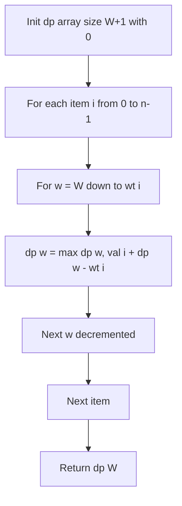

# 0/1 Knapsack Space Optimization (1D Array)

- **Source File:** `[dynamic-programming/02_Knapsack/knapsack_space_optimize.cpp](file:///Users/shamanth/Desktop/DSA/problem-solving/dynamic-programming/02_Knapsack/knapsack_space_optimize.cpp)`
- **Language:** C++
- **Category:** Dynamic Programming / 02_Knapsack
- **Navigation:** [← Back to Master Documentation Index](../README.md)

---

## 1. Problem Statement / Question

Optimize the 0/1 Knapsack space complexity from $O(n \times W)$ to $O(W)$ using a single 1D array traversed backwards.

**Input:** Item weights, values, and capacity $W$.  
**Output:** Maximum knapsack value using only $O(W)$ auxiliary memory.

---

## 2. Algorithm & Approach

1. Notice that `dp[i][w]` only depends on previous row `dp[i-1][w]` and `dp[i-1][w - wt[i-1]]`.
2. Maintain a single array `dp` of size $W+1$ initialized to 0.
3. For each item, traverse capacity $w$ **backwards** from $W$ down to `wt[i-1]`:
   - `dp[w] = max(dp[w], val[i-1] + dp[w - wt[i-1]])`
4. Backward traversal prevents using the same item multiple times!

---

## 3. Flowchart



---

## 4. Source Code

```c++
#include <bits/stdc++.h>
using namespace std;

int memo[1001];  // max(C) = 1000.

int knapsack(int n, int C, vector<int> price, vector<int> weight) {

    memo[0] = 0;
    for (int i = 1; i <= n; i++) {
        for (int w = C; w >= 0; w--) {
            if (weight[i-1] <= w)
                memo[w] = max(memo[w], memo[w-weight[i-1]] + price[i-1]);
        }
    }
    
    return memo[C];
}

int main() {

    int n, C; cin >> n >> C;

    vector<int> price, weight; 

    int temp;
    for (int i = 0; i < n; i++) {
        cin >> temp;
        price.push_back(temp);
    }

    for (int i = 0; i < n; i++) {
        cin >> temp;
        weight.push_back(temp);
    }

    // NO NEED TO INITIALIZE -1 IN CASE OF TABULATION

    // for (int i = 0; i <= n; i++) {
    //     for (int j = 0; j <= C; j++) {
    //         memo[i][j] = -1;
    //     }
    // }

    // Notice that we are passing here n and not n-1.
    cout << knapsack(n, C, price, weight) << endl;

    return 0;
}
```

---

## 5. Simple Dry Run

Items: `wt = [1, 3, 4]`, `val = [1, 4, 5]`, $W = 5$:
- Init: `dp = [0, 0, 0, 0, 0, 0]`
- Item 1 (wt:1, val:1): `dp = [0, 1, 1, 1, 1, 1]`
- Item 2 (wt:3, val:4):
  - $w=5$: $\max(1, 4 + dp[2]) = 4 + 1 = 5$
  - $w=4$: $\max(1, 4 + dp[1]) = 4 + 1 = 5$
  - $w=3$: $\max(1, 4 + dp[0]) = 4 + 0 = 4$
  - `dp = [0, 1, 1, 4, 5, 5]`
- Item 3 (wt:4, val:5):
  - $w=5$: $\max(5, 5 + dp[1]) = 6$
  - $w=4$: $\max(5, 5 + dp[0]) = 5$
  - `dp = [0, 1, 1, 4, 5, 6]`
Final result: `dp[5] = 6`.

---

## 6. Sample Output

```text
Maximum Knapsack Value: 6 (Space: O(W))
```

---

## 7. Complexity Analysis

- **Time Complexity:** $O(n \times W)$
- **Space Complexity:** $O(W)$ space (dramatic reduction from $O(n \times W)$)

---
[← Back to Master Documentation Index](../README.md)
