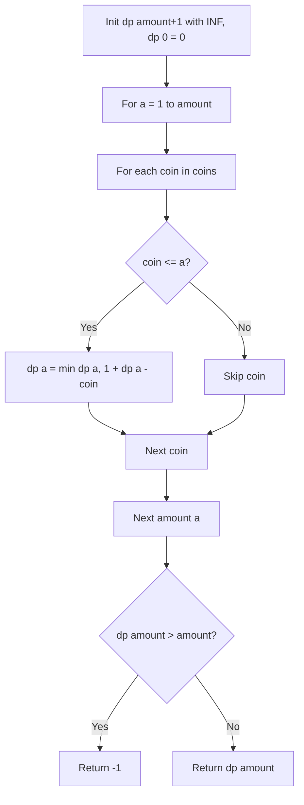

# LeetCode 322: Coin Change (Minimum Coins)

- **Source File:** `[dynamic-programming/02_Knapsack/LC_322.cpp](file:///Users/shamanth/Desktop/DSA/problem-solving/dynamic-programming/02_Knapsack/LC_322.cpp)`
- **Language:** C++
- **Category:** Dynamic Programming / 02_Knapsack
- **Navigation:** [← Back to Master Documentation Index](../README.md)

---

## 1. Problem Statement / Question

You are given an integer array `coins` representing coins of different denominations and an integer `amount` representing a total amount of money. Return the fewest number of coins that you need to make up that amount. If that amount cannot be made up by any combination, return `-1`.

**Input:** `coins = [1, 2, 5]`, `amount = 11`  
**Output:** `3` (5 + 5 + 1)

---

## 2. Algorithm & Approach

1. Initialize `dp` array of size `amount + 1` filled with `amount + 1` (infinity sentinel).
2. Base case: `dp[0] = 0` (zero coins needed for amount 0).
3. For each `i` from 1 to `amount`:
   - For each coin in `coins`:
     - If `coin <= i`: `dp[i] = min(dp[i], 1 + dp[i - coin])`
4. Return `dp[amount] > amount ? -1 : dp[amount]`.

---

## 3. Flowchart



---

## 4. Source Code

```c++
class Solution {
public:
    int memo[13][10001];

    int knapsack(vector<int> &coins, int n, int amount) {
        if (amount == 0)
            return 0;
        
        if (n == coins.size()) 
            return INT_MAX-1;

        if (memo[n][amount] != -1)
            return memo[n][amount];

        // You can always skip
        int skip_coin = knapsack(coins, n+1, amount);

        // You can only pick if amount > coins[n]
        int take_coin = INT_MAX-1;
        if (amount >= coins[n]) {
            take_coin = 1 + knapsack(coins, n, amount - coins[n]);
        }

        memo[n][amount] = min(skip_coin, take_coin);
        return memo[n][amount];
    }

    int coinChange(vector<int>& coins, int amount) {
        
        for (int i = 0; i <= coins.size(); i++)
            for (int j = 0; j <= amount; j++)
                memo[i][j] = -1;

        int ans = knapsack(coins, 0, amount);

        if (ans == INT_MAX-1)
            return -1;
        
        return ans;
        
    }
};
```

---

## 5. Simple Dry Run

Coins: `[1, 2, 5]`, Target: 11
- `dp[0] = 0`
- `dp[1] = 1` (1)
- `dp[2] = 1` (2)
- `dp[5] = 1` (5)
- `dp[6] = 1 + dp[5] = 2`
- `dp[10] = 1 + dp[5] = 2`
- `dp[11] = 1 + dp[10] = 3` (coins: 5, 5, 1)
Answer: 3.

---

## 6. Sample Output

```text
Minimum coins needed: 3
```

---

## 7. Complexity Analysis

- **Time Complexity:** $O(\text{amount} \times |\text{coins}|)$
- **Space Complexity:** $O(\text{amount})$ for DP array

---
[← Back to Master Documentation Index](../README.md)
