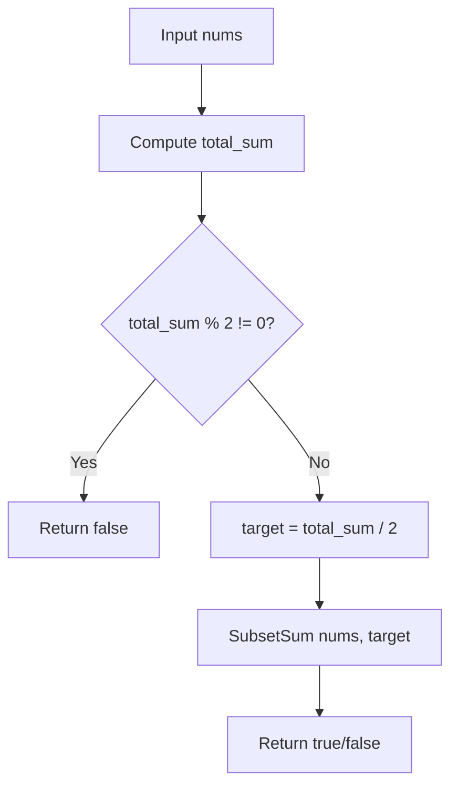

# LeetCode 416: Partition Equal Subset Sum

- **Source File:** `[dynamic-programming/02_Knapsack/LC_416.cpp](file:///Users/shamanth/Desktop/DSA/problem-solving/dynamic-programming/02_Knapsack/LC_416.cpp)`
- **Language:** C++
- **Category:** Dynamic Programming / 02_Knapsack
- **Navigation:** [← Back to Master Documentation Index](../README.md)

---

## 1. Problem Statement / Question

Given an integer array `nums`, return `true` if you can partition the array into two subsets such that the sum of the elements in both subsets is equal or `false` otherwise.

**Input:** `nums = [1, 5, 11, 5]`  
**Output:** `true` (Subsets: `[1, 5, 5]` and `[11]`)

---

## 2. Algorithm & Approach

1. Compute total sum of `nums`.
2. If total sum is odd, equal partition is impossible -> return `false`.
3. Set `target = total_sum / 2`.
4. Problem reduces to Subset Sum: Check if any subset sums to `target` using 1D/2D DP.

---

## 3. Flowchart



---

## 4. Source Code

```c++
class Solution {
public:
    int memo[201][20001];

    bool subset_sum(vector<int> &nums, int n, int sum) {
        if (n == -1)     // no more items left
            return 0;

        if (sum == 0)    // leftover sum is found.
            return 1;

        // Recall step
        if (memo[n][sum] != -1)
            return memo[n][sum];

        if (nums[n] > sum) {
            memo[n][sum] = subset_sum(nums, n-1, sum);
        } else {
            memo[n][sum] = subset_sum(nums, n-1, sum) || subset_sum(nums, n-1, sum-nums[n]);
        }

        return memo[n][sum];
    }

    bool canPartition(vector<int>& nums) {
        int sum = 0;
        for (auto x: nums) 
            sum += x;

        // Initialize it to -1
        for (int i = 0; i <= nums.size(); i++)
            for (int j = 0; j <= sum; j++)
                memo[i][j] = -1;

        if (sum%2 != 0)
            return false;
        else
            return subset_sum(nums, nums.size() - 1, sum/2);
    }
};
```

---

## 5. Simple Dry Run

`nums = [1, 5, 11, 5]`
- `total_sum = 22` (even)
- `target = 22 / 2 = 11`
- Can we form 11?
  - `{11}` sums to 11!
  - Also `{1, 5, 5}` sums to 11.
- Both partitions equal 11 -> returns `true`.

---

## 6. Sample Output

```text
Can partition equally: true
```

---

## 7. Complexity Analysis

- **Time Complexity:** $O(n \times \text{target})$ where $\text{target} = \frac{\sum \text{nums}}{2}$
- **Space Complexity:** $O(\text{target})$ with 1D DP optimization

---
[← Back to Master Documentation Index](../README.md)
