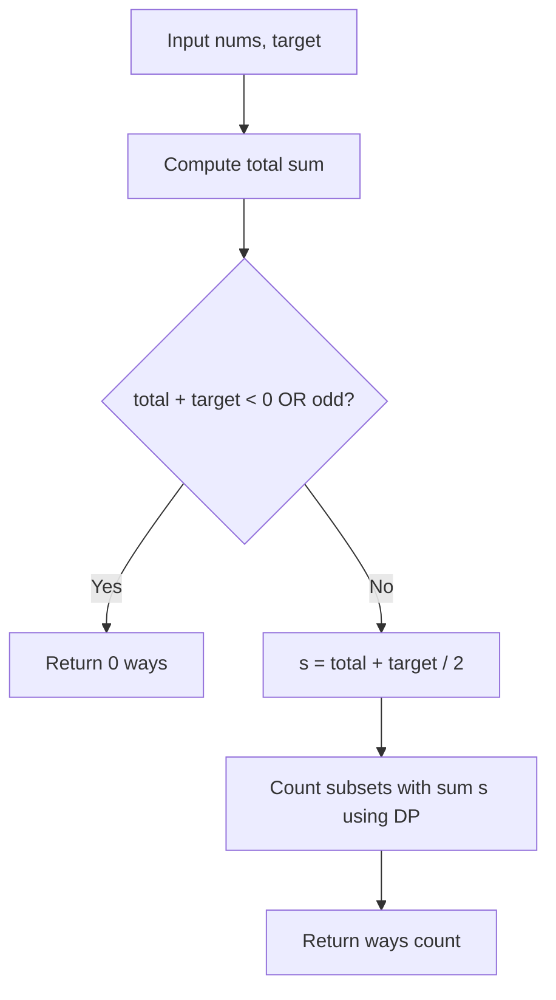

# LeetCode 494: Target Sum

- **Source File:** `[dynamic-programming/02_Knapsack/LC_494.cpp](file:///Users/shamanth/Desktop/DSA/problem-solving/dynamic-programming/02_Knapsack/LC_494.cpp)`
- **Language:** C++
- **Category:** Dynamic Programming / 02_Knapsack
- **Navigation:** [← Back to Master Documentation Index](../README.md)

---

## 1. Problem Statement / Question

You are given an integer array `nums` and an integer `target`. Build an expression out of nums by adding one of the symbols '+' and '-' before each integer and concatenate all symbols to evaluate. Return the number of different expressions that evaluate to `target`.

**Input:** `nums = [1, 1, 1, 1, 1]`, `target = 3`  
**Output:** `5`

---

## 2. Algorithm & Approach

1. Let $P$ be the subset of numbers with '+' and $N$ be the subset with '-':
   - $\text{sum}(P) - \text{sum}(N) = \text{target}$
   - $\text{sum}(P) + \text{sum}(N) = \text{total}$
   - $2 \cdot \text{sum}(P) = \text{total} + \text{target}$
   - $\text{sum}(P) = \frac{\text{total} + \text{target}}{2}$
2. If $(\text{total} + \text{target})$ is odd or negative, return 0.
3. Count the number of subsets with sum equal to $\text{sum}(P)$.

---

## 3. Flowchart



---

## 4. Source Code

```c++
class Solution {
public:
    int knapsack(vector<int> &arr, int n, int target) {
        if (n == arr.size()) {
            if (target == 0)
                return 1;
            return 0;
        }

        int pick = knapsack(arr, n+1, target + arr[n]);
        int skip = knapsack(arr, n+1, target - arr[n]);

        return pick + skip;
    }

    int findTargetSumWays(vector<int>& nums, int target) {
        return knapsack(nums, 0, target);
    }
};
```

---

## 5. Simple Dry Run

`nums = [1, 1, 1, 1, 1]`, `target = 3`
- `total = 5`
- `(5 + 3) / 2 = 4`
- Number of subsets of `{1, 1, 1, 1, 1}` summing to 4 is $\binom{5}{4} = 5$.
Ways:
1. `-1 + 1 + 1 + 1 + 1 = 3`
2. `+1 - 1 + 1 + 1 + 1 = 3`
3. `+1 + 1 - 1 + 1 + 1 = 3`
4. `+1 + 1 + 1 - 1 + 1 = 3`
5. `+1 + 1 + 1 + 1 - 1 = 3`
Result: 5.

---

## 6. Sample Output

```text
Number of ways: 5
```

---

## 7. Complexity Analysis

- **Time Complexity:** $O(n \times s)$ where $s = \frac{\text{total} + \text{target}}{2}$
- **Space Complexity:** $O(s)$ auxiliary space

---
[← Back to Master Documentation Index](../README.md)
