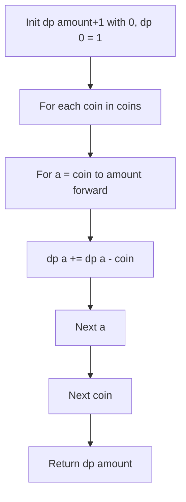

# LeetCode 518: Coin Change II (Combination Count)

- **Source File:** `[dynamic-programming/02_Knapsack/LC_518.cpp](file:///Users/shamanth/Desktop/DSA/problem-solving/dynamic-programming/02_Knapsack/LC_518.cpp)`
- **Language:** C++
- **Category:** Dynamic Programming / 02_Knapsack
- **Navigation:** [← Back to Master Documentation Index](../README.md)

---

## 1. Problem Statement / Question

Given an integer array `coins` and an integer `amount`, return the number of combinations that make up that amount. You may assume you have an infinite number of each kind of coin (Unbounded Knapsack variant).

**Input:** `amount = 5`, `coins = [1, 2, 5]`  
**Output:** `4` (5; 2+2+1; 2+1+1+1; 1+1+1+1+1)

---

## 2. Algorithm & Approach

1. Initialize `dp` table of size `amount + 1` with 0, and `dp[0] = 1`.
2. Outer loop over `coins`:
   - Inner loop over `a` from `coin` to `amount` **forward**:
     - `dp[a] += dp[a - coin]`
3. Forward loop handles unlimited / unbounded coin repetitions while avoiding permutations.

---

## 3. Flowchart



---

## 4. Source Code

```c++
class Solution {
public:
    int knapsack(const vector<int>& coins, int amount, int index, vector<vector<int>>& memo) {
        // Base cases
        if (amount == 0) {
            return 1;
        }
        if (amount < 0 || index < 0) {
            return 0;
        }
        
        // Check memoization table
        if (memo[index][amount] != -1) {
            return memo[index][amount];
        }
        
        // Calculate the number of ways by including the current coin and excluding it
        int include = knapsack(coins, amount - coins[index], index, memo);
        int exclude = knapsack(coins, amount, index - 1, memo);
        
        // Store the result in the memoization table
        memo[index][amount] = include + exclude;
        
        return memo[index][amount];
    }

    int change(int amount, vector<int>& coins) {
        // Initialize the memoization table with -1
        vector<vector<int>> memo(coins.size(), vector<int>(amount + 1, -1));
        return knapsack(coins, amount, coins.size() - 1, memo);
    }
};
```

---

## 5. Simple Dry Run

`amount = 5`, `coins = [1, 2, 5]`
- Init: `dp[0] = 1`, all others 0
- Coin 1: All amounts from 1 to 5 get `dp[a] = 1`
- Coin 2:
  - $a=2$: `dp[2] += dp[0] = 2` (`[1,1]`, `[2]`)
  - $a=3$: `dp[3] += dp[1] = 2` (`[1,1,1]`, `[2,1]`)
  - $a=4$: `dp[4] += dp[2] = 3` (`[1,1,1,1]`, `[2,1,1]`, `[2,2]`)
  - $a=5$: `dp[5] += dp[3] = 3`
- Coin 5:
  - $a=5$: `dp[5] += dp[0] = 3 + 1 = 4` (`[5]`)
Final result: 4 combinations.

---

## 6. Sample Output

```text
Total coin combinations: 4
```

---

## 7. Complexity Analysis

- **Time Complexity:** $O(|\text{coins}| \times \text{amount})$
- **Space Complexity:** $O(\text{amount})$ space

---
[← Back to Master Documentation Index](../README.md)
