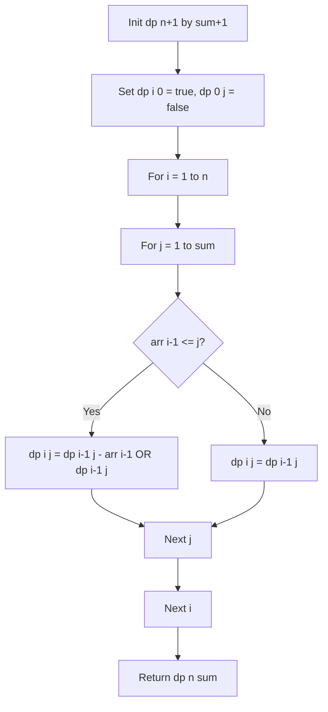

# Subset Sum Problem

- **Source File:** `[dynamic-programming/02_Knapsack/subset_sum.cpp](file:///Users/shamanth/Desktop/DSA/problem-solving/dynamic-programming/02_Knapsack/subset_sum.cpp)`
- **Language:** C++
- **Category:** Dynamic Programming / 02_Knapsack
- **Navigation:** [← Back to Master Documentation Index](../README.md)

---

## 1. Problem Statement / Question

Given a set of non-negative integers and an integer `sum`, determine if there is a subset of the given set whose elements sum up to exactly `sum`.

**Input:** `arr = {3, 34, 4, 12, 5, 2}`, `sum = 9`  
**Output:** `true` (since subset `{4, 5}` has sum 9).

---

## 2. Algorithm & Approach

1. Define boolean table `dp[n+1][sum+1]`.
2. Base cases:
   - `dp[i][0] = true` (sum 0 is always possible with empty subset).
   - `dp[0][j] = false` for $j > 0$ (no elements cannot form positive sum).
3. Recurrence:
   - If `arr[i-1] <= j`: `dp[i][j] = dp[i-1][j - arr[i-1]] || dp[i-1][j]`
   - Else: `dp[i][j] = dp[i-1][j]`
4. Return `dp[n][sum]`.

---

## 3. Flowchart



---

## 4. Source Code

```c++
/* PROBLEM STATEMENT: Subset Sum Problem

Given a set of non-negative integers and a value sum, the task is to check if there is a subset of the given set whose sum is equal to the given sum. 

For example, given set[] = {3, 34, 4, 12, 5, 2}, sum = 9
Output is True. Because there is a subset (4, 5) with sum 9.

*/

#include <bits/stdc++.h>
using namespace std;

int memo[1001][100001]; // max(n) = 1000, sum = 100000

bool subset_sum(int n, int sum, vector<int> arr) {
    // No more elements left
    if (n == -1)
        return 0;

    // Leftover sum is zero, answer found.
    if (sum == 0)
        return 1;

    if (memo[n][sum] != -1)
        return memo[n][sum];

    int ans = INT_MIN;
    // Only choice to skip
    if (arr[n] > sum)
        ans = subset_sum(n-1, sum, arr);
    else // Else, max of skip and pick
        ans = subset_sum(n-1, sum, arr) || subset_sum(n-1, sum-arr[n], arr); 
    
    memo[n][sum] = ans;
    return memo[n][sum];
}

int main() {
    int n, sum; cin >> n >> sum;

    vector<int> arr; 

    int temp;
    for (int i = 0; i < n; i++) {
        cin >> temp;
        arr.push_back(temp);
    } 

    // Set the memo to -1
    for (int i = 0; i <= n; i++)
        for (int j = 0; j <= sum; j++) 
            memo[i][j] = -1;

    cout << subset_sum(n-1, sum, arr) << endl;

    return 0;
}

/*

Note: Here, we are asked if it is possible to form a subset or not. Hence, we are able to reduce the time complexity from O(2^n) to O(n*sum). If they were to actually ask you to print the subsets, in that case there is no other option but to generate all possible subsets and check for the sum and return that particular subset. This will result in O(2^n) time complexity. 

Making subsets will fall in the realm of backtracking!!

There is a variation called `Equal sum partition`. https://leetcode.com/problems/partition-equal-subset-sum/description/

This

*/
```

---

## 5. Simple Dry Run

Input: `arr = [3, 4, 5, 2]`, `sum = 9`
- `dp[0][0] = true`
- Considering elements `{3, 4, 5}`:
  - Can make 4 using `{4}`
  - Can make 5 using `{5}`
  - Target 9: `dp[3][9] = dp[2][9 - 5] || dp[2][9] = dp[2][4] || dp[2][9]`
  - Since `dp[2][4]` is true (from element 4), `dp[3][9] = true`!
- Output: subset `{4, 5}` sums to 9.

---

## 6. Sample Output

```text
Found a subset with given sum: true
```

---

## 7. Complexity Analysis

- **Time Complexity:** $O(n \times \text{sum})$
- **Space Complexity:** $O(n \times \text{sum})$

---
[← Back to Master Documentation Index](../README.md)
