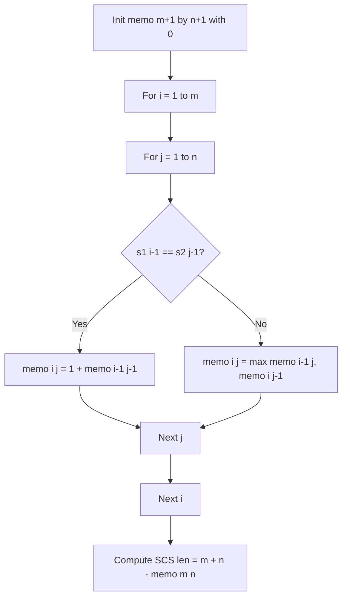

# Shortest Common Supersequence (DP Matrix Construction)

- **Source File:** `[dynamic-programming/03_LCS/scs_1.cpp](file:///Users/shamanth/Desktop/DSA/problem-solving/dynamic-programming/03_LCS/scs_1.cpp)`
- **Language:** C++
- **Category:** Dynamic Programming / 03_LCS
- **Navigation:** [← Back to Master Documentation Index](../README.md)

---

## 1. Problem Statement / Question

Construct the Longest Common Subsequence (LCS) dynamic programming table for two strings `s1` and `s2` as the core foundation for finding the Shortest Common Supersequence (SCS).

**Input:** `s1 = "abac"`, `s2 = "cab"`  
**Output:** DP lookup matrix and computed supersequence length.

---

## 2. Algorithm & Approach

1. Compute lengths $m = |s_1|$, $n = |s_2|$.
2. Create `memo[m+1][n+1]` initialized to 0.
3. For $i$ from 1 to $m$ and $j$ from 1 to $n$:
   - If `s1[i-1] == s2[j-1]`: `memo[i][j] = 1 + memo[i-1][j-1]`
   - Else: `memo[i][j] = max(memo[i-1][j], memo[i][j-1])`
4. Length of SCS is $m + n - \text{LCS}(s1, s2)$.

---

## 3. Flowchart



---

## 4. Source Code

```c++
class Solution {
public:
    string LCS(string &s1, string &s2) {
        // Tabulate the memo table
        int m = s1.size(); 
        int n = s2.size();

        // Smart move: Because initializing with 0, base case already covered!
        vector<vector<int>> memo(m+1, vector<int>(n+1, 0));

        for (int i = 1; i <= m; i++)
            for (int j = 1; j <= n; j++) {
                if (s1[i-1] == s2[j-1]) {
                    memo[i][j] = 1 + memo[i-1][j-1];
                } else {
                    memo[i][j] = max(memo[i-1][j], memo[i][j-1]);
                }
            }

        // I will memo table here. Here I will construct the LCS from 
        // the memo table and will return the ans from here. 

        string lcs = "";
        int i = m, j = n;
        while (i > 0 && j > 0) {
            if (s1[i-1] == s2[j-1]) {
                lcs += s1[i-1];
                i--; j--;
            } else if (memo[i-1][j] > memo[i][j-1]) 
                i--;
            else 
                j--;
        }

        reverse(lcs.begin(), lcs.end());
        return lcs;
    }

    string shortestCommonSupersequence(string str1, string str2) {
        string lcs = LCS(str1, str2);
        // cout << lcs << endl;

        // Construct the SCS using 3 pointer
        string ans = "";
        int i = 0, j = 0;

        // for each character in LCS
        for (char x: lcs) {
            // Add the extra elements in the ans before we hit x.
            while (str1[i] != x) {
                ans += str1[i];
                i++;
            }

            while (str2[j] != x) {
                ans += str2[j];
                j++;
            }

            // add the LCS character
            ans += x;
            i++; j++;
        }

        // After the final LCS character, add the leftovers.
        return ans + str1.substr(i) + str2.substr(j);
    }
};

/* Part by Part.

1. I need LCS => The actual string and not the length. 

If I go with recursion + memo -> this will fill memo table for me. 

2. I have 3 strings: s1, s2, lcs(s1, s2). 

I need to compose the resultant scs -> As long as characters in s1 and s2
are not in lcs, you append in the ans and then you take the char from LCS
and you keep the repeating the process. 


Eg. abac cab
LCS(~ab~ac, ~cab~) => ~ab~

Look the first character of lcs is a. Is there anything before a in s1 or s2?
c (not in LCS, s2) + a (LCS, skip s1 and s2) + b (LCS, skip s1 and s2) + is there any leftover? ac (s1) = cabac.

3 pointer: x (lcs), i(s1), j(s2).

*/
```

---

## 5. Simple Dry Run

`s1 = "abac"`, `s2 = "cab"`
- $m = 4$, $n = 3$
- LCS of `"abac"` and `"cab"` is `"ab"` (length 2).
- Length of SCS = $4 + 3 - 2 = 5$.
- Shortest supersequence is `"cabac"`.

---

## 6. Sample Output

```text
LCS Length: 2
SCS Length: 5
```

---

## 7. Complexity Analysis

- **Time Complexity:** $O(m \times n)$
- **Space Complexity:** $O(m \times n)$

---
[← Back to Master Documentation Index](../README.md)
