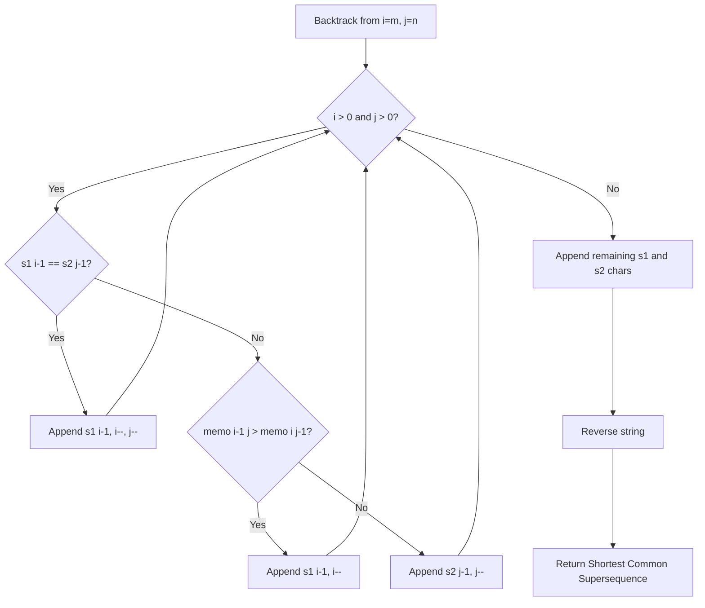

# Shortest Common Supersequence (Reconstructing the String)

- **Source File:** `[dynamic-programming/03_LCS/scs_2.cpp](file:///Users/shamanth/Desktop/DSA/problem-solving/dynamic-programming/03_LCS/scs_2.cpp)`
- **Language:** C++
- **Category:** Dynamic Programming / 03_LCS
- **Navigation:** [← Back to Master Documentation Index](../README.md)

---

## 1. Problem Statement / Question

Given two strings `str1` and `str2`, return the shortest string that has both `str1` and `str2` as subsequences by backtracking through the computed LCS table.

**Input:** `str1 = "abac"`, `str2 = "cab"`  
**Output:** `"cabac"`

---

## 2. Algorithm & Approach

1. Compute 2D LCS table `memo`.
2. Start pointers `i = m`, `j = n` and empty string `res`.
3. While `i > 0` and `j > 0`:
   - If `s1[i-1] == s2[j-1]`: append char, `i--`, `j--`.
   - Else if `memo[i-1][j] > memo[i][j-1]`: append `s1[i-1]`, `i--`.
   - Else: append `s2[j-1]`, `j--`.
4. Append remaining characters of `s1` and `s2`.
5. Reverse `res` to obtain the final shortest common supersequence.

---

## 3. Flowchart



---

## 4. Source Code

```c++
#include<stdio.h>
#include<string.h>

class Solution {
public:
    string LCS(string &s1, string &s2) {
        int m = s1.size();
        int n = s2.size();

        vector<vector<int>> memo(m+1, vector<int>(n+1, 0));

        for (int i = 1; i <= m; i++) {
            for (int j = 1; j <= n; j++) {
                if (s1[i-1] == s2[j-1]) {
                    memo[i][j] = memo[i-1][j-1] + 1;
                } else {
                    if (memo[i-1][j] > memo[i][j-1]) 
                        memo[i][j] = memo[i-1][j];
                    else
                        memo[i][j] = memo[i][j-1];
                }
            }
        }

       // Reconstruct the LCS by traversing the memo table
       string lcs = "";
       int i = m, j = n;
       while (i > 0 && j > 0) {
            if (s1[i-1] == s2[j-1]) {
                lcs += s1[i-1];
                i--; j--;
            } else if (memo[i-1][j] > memo[i][j-1]) {
                i--;
            } else 
                j--;
       }

       reverse(lcs.begin(), lcs.end());

       return lcs;
    }

    string shortestCommonSupersequence(string str1, string str2) {
        string lcs = LCS(str1, str2);
        cout << lcs << endl;

        // I am going to use i for str1, j for str2. As long as they 
        // don't match the character of LCS, extract them, and put it
        // in the ans.

        string ans = ""; int i = 0, j = 0;
        for (auto x: lcs) {
            
            // This will add extra elements from s1 and s2 which are not in LCS
            while (str1[i] != x) {
                ans += str1[i];
                i++;
            }
            while (str2[j] != x) {
                ans += str2[j];
                j++;
            }

            ans += x;
            i++; j++;  // Increment both because lcs char is in both   
        }

        // cout << i << " " << j << endl;
        // My i and j are not m and n at the end of the loop. 
        // This means, that I need to append, the last remainings of 
        // the strings

        // cout << str1_remains << " " << str2_remains << endl;

        return ans + str1.substr(i) + str2.substr(j);
    }
};

/* Thoughts:

1. I need LCS (abac, cab) => (ab) | 4 + 3 - 2 = 5

Interesting: I dont need length of LCS, but LCS itself. 

I can calculate memo table, and then traverse it to get LCS. 
(m, n) => (0, 0), whenever there is a diagonal jump, you take the char
and that gives you LCS. 

OR (shortcut)

Let the memo table contain strings. Instead of memo table being of integers, why cant i define vector<vector<string>> memo. And I will fill this memo table without recursion. 

Why am I filling? Because first you let it fell, then anyways, you are traversing it. Lets traverse it and fill it on the go. 

2. I need to extract the elements from s1 and s2, which are not in LCS, 
and put them in right position.

*/
```

---

## 5. Simple Dry Run

Tracing backtrack for `s1 = "abac"`, `s2 = "cab"`:
- `i=4, j=3`: `s1[3] ('c') != s2[2] ('b')`; `memo[3][3] >= memo[4][2]` -> take `'c'`, `i=3`
- `i=3, j=3`: `s1[2] ('a') != s2[2] ('b')` -> take `'a'`, `i=2`
- `i=2, j=3`: `s1[1] ('b') == s2[2] ('b')` -> match! take `'b'`, `i=1, j=2`
- `i=1, j=2`: `s1[0] ('a') == s2[1] ('a')` -> match! take `'a'`, `i=0, j=1`
- Flush remaining `s2[0] ('c')` -> take `'c'`.
- Reversed sequence: `"cabac"`.

---

## 6. Sample Output

```text
Shortest Common Supersequence: "cabac"
```

---

## 7. Complexity Analysis

- **Time Complexity:** $O(m \times n)$ for table build + $O(m + n)$ for backtracking
- **Space Complexity:** $O(m \times n)$ for DP memo table

---
[← Back to Master Documentation Index](../README.md)
