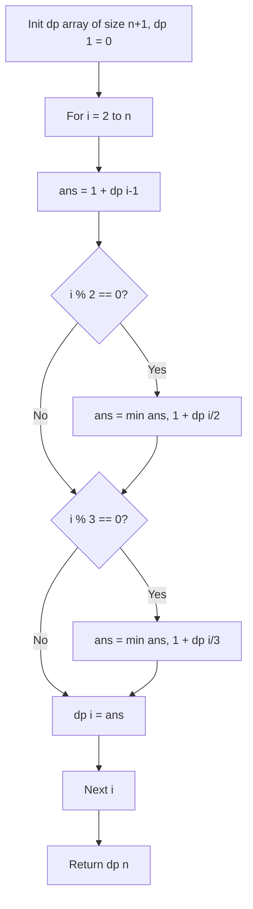

# Minimum Steps to One

- **Source File:** `[dynamic-programming/Problem_Set_Easy/01_min_steps_to_one.cpp](file:///Users/shamanth/Desktop/DSA/problem-solving/dynamic-programming/Problem_Set_Easy/01_min_steps_to_one.cpp)`
- **Language:** C++
- **Category:** Dynamic Programming / Problem_Set_Easy
- **Navigation:** [← Back to Master Documentation Index](../README.md)

---

## 1. Problem Statement / Question

Given an integer `n`, find the minimum number of operations required to reduce `n` to 1 using the following allowable moves:
1. Subtract 1 from `n` (`n = n - 1`)
2. If `n % 2 == 0`, divide by 2 (`n = n / 2`)
3. If `n % 3 == 0`, divide by 3 (`n = n / 3`)

**Input:** $n = 10$  
**Output:** $3$ ($10 \rightarrow 9 \rightarrow 3 \rightarrow 1$)

---

## 2. Algorithm & Approach

1. Define `dp[i]` as the minimum steps to reduce $i$ to 1.
2. Base case: `dp[1] = 0`.
3. For $i$ from 2 to $n$:
   - `dp[i] = 1 + dp[i-1]` (always valid move).
   - If `i % 2 == 0`: `dp[i] = min(dp[i], 1 + dp[i/2])`.
   - If `i % 3 == 0`: `dp[i] = min(dp[i], 1 + dp[i/3])`.
4. Return `dp[n]`.

---

## 3. Flowchart



---

## 4. Source Code

```c++
/*   PROBLEM STATEMENT: Minimum Steps to One

You are given a number 'n'. On this n, you can perform 3 operations.

a) If n is divisble by 3, you can divide it by 3.
b) If n is divisible by 2, you can divide it by 2. 
c) Otherwise, you can reduce the number by 1. 

What are the minimum number of operations required for n, so that it gets reduced to 1?

Example: I have number 5. It can be reduced to 1 in 3 steps. 
5 -> (reduce by 1) 4 -> (divide by 2) 2 -> (divide by 2) 1! OR
5 -> (reduce by 1) 4 -> (reduce by 1) 3 -> (divide by 3) 1!

How to solve it?

SOLUTION: 

It may look like it's a greedy question, but it is not. Consider this case when n = 10. 

You cannot divide this by 1. So greedily it is better to divide it by 2 and make it 5, than reduce it by 1 and make it 9. But,

10 -> 5 -> 4 -> 2 -> 1 (4 steps). 
10 -> 9 -> 3 -> 1 (3 steps).

min_steps_to_one(n) = 1 + min(a, b, c) 

where a = min_steps_to_one(n/3) if n is divisible by 3
      b = min_steps_to_one(n/2) if n is divisible by 2
      c = min_steps_to_one(n-1) 

*/

#include <bits/stdc++.h>
using namespace std;

int memo[100001];

int min_steps_to_one(int n) {
    if (n == 1)
        return 0;

    if (memo[n] != -1)
        return memo[n];

    int a = INT_MAX, b = INT_MAX, c = INT_MAX;

    if (n%3 == 0)
        a = min_steps_to_one(n/3) + 1;
    
    if (n%2 == 0)
        b = min_steps_to_one(n/2) + 1;
    
    c = min_steps_to_one(n-1) + 1;

    memo[n] = min(a, min(b, c));
    return memo[n];
}

int main() {
    int n; 
    cin >> n;

    for (int i = 0; i <= n; i++)
        memo[i] = -1;

    cout << min_steps_to_one(n) << endl;
    return 0;
}
```

---

## 5. Simple Dry Run

Computing for $n = 10$:
- `dp[1] = 0`
- `dp[2] = 1` (2 / 2 = 1)
- `dp[3] = 1` (3 / 3 = 1)
- `dp[4] = 2` (4 / 2 = 2 -> 1)
- `dp[9] = 1 + dp[3] = 2` (9 / 3 = 3)
- `dp[10]`:
  - via -1: $1 + dp[9] = 1 + 2 = 3$
  - via /2: $1 + dp[5] = 1 + 3 = 4$
  - Min = 3 ($10 \rightarrow 9 \rightarrow 3 \rightarrow 1$)

---

## 6. Sample Output

```text
Minimum steps to reduce 10 to 1: 3
```

---

## 7. Complexity Analysis

- **Time Complexity:** $O(n)$ linear time
- **Space Complexity:** $O(n)$ for DP table

---
[← Back to Master Documentation Index](../README.md)
