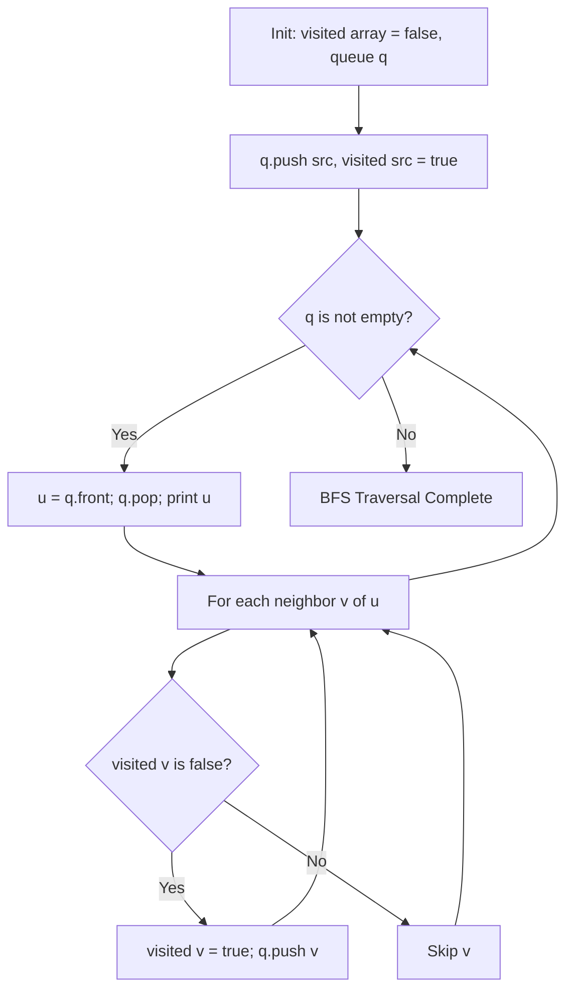

# Breadth-First Search (BFS) Traversal in C++

- **Source File:** `[graphs/bfs.cpp](file:///Users/shamanth/Desktop/DSA/problem-solving/graphs/bfs.cpp)`
- **Language:** C++
- **Category:** Graphs / Traversals
- **Navigation:** [← Back to Master Documentation Index](../README.md)

---

## 1. Problem Statement / Question

Given an undirected graph with $V$ vertices and $E$ edges represented as an adjacency list, perform Breadth-First Search (BFS) traversal starting from a given source node using a queue.

**Input:** $V = 6$, $E = 5$, source node = 0. Edges: `(0-1), (0-2), (1-3), (2-4), (4-5)`  
**Output:** Sequence of vertices visited in level order.

---

## 2. Algorithm & Approach

1. Maintain a boolean `visited` vector initialized to `false` and a queue `q`.
2. Push source vertex `src` into `q` and mark `visited[src] = true`.
3. While `q` is not empty:
   - Dequeue front vertex `u` and process/print it.
   - For each adjacent neighbor `v` of `u`:
     - If `visited[v]` is false: mark `visited[v] = true` and push `v` into `q`.
4. Guarantees level-by-level visitation and shortest path on unweighted graphs.

---

## 3. Flowchart



---

## 4. Source Code

```c++
#include<bits/stdc++.h>
using namespace std;

// 'u' is a node 'from', 'v' is a node 'to': from u to v
void add_edge_list(vector<vector<int>> &g, int u, int v) {
    g[u].push_back(v);      
    g[v].push_back(u);      // Delete this line if graph is directed
}

void add_edge_matrix(vector<vector<int>> &g, int u, int v) {
    g[u][v] = 1;
    g[v][u] = 1;            // Delete this line for directed graph
}

// Two functions to perform the BFS

// LIST
void bfs_list(vector<vector<int>> &g, int start) {
    cout << "BFS LIST:\n";

    int n = g.size();
    bool* visited = new bool[n]();
    int* level = new int[n]();
    int* parent = new int[n]();
    queue<int> q;
    int i = 1;
    
    // process the start node
    q.push(start);
    visited[start] = true;
    level[start] = i-1;
    parent[start] = -1;

    while (!q.empty()) {
        int u = q.front(); q.pop();
        cout << u << " ";      // Printing: Anything with the node, should be done here.
        for (auto v: g[u]) {
            // Anything with the edge, should be done here.
            if (!visited[v]) {
                q.push(v);
                visited[v] = true;
                level[v] = i;
                parent[v] = u;
            }
        }
        i++;
    }

    cout << endl << endl;

    for (int i = 0; i < n; i++)
        cout << i << " ";
    cout << endl;

    for (int i = 0; i < n; i++) {
        cout << level[i] << " ";
    }
    cout << endl;

    for (int i = 0; i < n; i++) {
        cout << parent[i] << " ";
    }
    cout << endl;

    // Shortest path logic
    int dest = 2; vector<int> path;
    while (dest != -1) {
        path.push_back(dest);
        dest = parent[dest];
    }
    reverse(path.begin(), path.end());

    for (auto x: path)
        cout << x << " ";
    cout << endl;
}

// MATRIX
void bfs_matrix(vector<vector<int>> &g, int start) {
    cout << "BFS MATRIX:\n";

    int n = g.size();
    bool* visited = new bool[n]();
    int* level = new int[n]();
    int* parent = new int[n]();
    queue<int> q;
    int i = 1;
    
    // process the start node
    q.push(start);
    visited[start] = true;
    level[start] = i-1;
    parent[start] = -1;

    while (!q.empty()) {
        int u = q.front(); q.pop();
        cout << u << " ";
        for (int v = 0; v < n; v++) {
            if (g[u][v] == 1 && !visited[v]) {
                q.push(v);
                visited[v] = true;
                level[v] = i;
                parent[v] = u;
            }
        }
        i++;
    }

    cout << endl;
}

int main() {
    int n, e; cin >> n >> e;

    // Adjacency list
    vector<vector<int>> adj_list(n, vector<int>());

    // Adjacency matrix
    vector<vector<int>> adj_matrix(n, vector<int>(n, 0));   // nxn matrix all zeros

    // Our nodes are from 0 to n-1
    while (e--) {
        int u, v; cin >> u >> v;
        add_edge_list(adj_list, u, v);
        add_edge_matrix(adj_matrix, u, v);
    }

    // Note: If you have a disconnected graph, go for DFS. Try to avoid BFS.
    bfs_list(adj_list, 0);
    bfs_matrix(adj_matrix, 0);

    return 0;
}
```

---

## 5. Simple Dry Run

Edges: `0-1, 0-2, 1-3, 2-4`:
- Start at 0: queue = `[0]`, visited = `{0}`
- Pop 0: neighbors 1, 2 added -> queue = `[1, 2]`
- Pop 1: neighbor 3 added -> queue = `[2, 3]`
- Pop 2: neighbor 4 added -> queue = `[3, 4]`
- Pop 3: no unvisited neighbors -> queue = `[4]`
- Pop 4: no unvisited neighbors -> queue = `[]`
Traversal order: `0 -> 1 -> 2 -> 3 -> 4`.

---

## 6. Sample Output

```text
BFS Traversal Order:
0 1 2 3 4
```

---

## 7. Complexity Analysis

- **Time Complexity:** $O(V + E)$ where $V$ is vertices and $E$ is edges
- **Space Complexity:** $O(V)$ for queue and visited array

---
[← Back to Master Documentation Index](../README.md)
