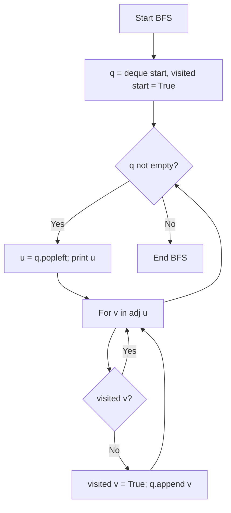

# Breadth-First Search (BFS) in Python

- **Source File:** `[graphs/bfs.py](file:///Users/shamanth/Desktop/DSA/problem-solving/graphs/bfs.py)`
- **Language:** Python
- **Category:** Graphs / Traversals
- **Navigation:** [← Back to Master Documentation Index](../README.md)

---

## 1. Problem Statement / Question

Implement Breadth-First Search traversal in Python using `collections.deque` on a graph represented as an adjacency list dictionary.

**Input:** Graph with vertices `{0, 1, 2, 3, 4}`, start vertex = 0.  
**Output:** BFS traversal list.

---

## 2. Algorithm & Approach

1. Use `collections.deque` for $O(1)$ popleft and append.
2. Initialize `visited = [False] * V`.
3. Add start node to queue, mark visited.
4. Loop: pop leftmost node, print it, and push all unvisited adjacent neighbors.

---

## 3. Flowchart



---

## 4. Source Code

```python
from collections import deque

def add_edge_list(g, u, v):
    g[u].append(v)
    g[v].append(u)  # Delete this line if the graph is directed

def add_edge_matrix(g, u, v):
    g[u][v] = 1
    g[v][u] = 1  # Delete this line for directed graph

# Two functions to perform the BFS

# LIST
def bfs_list(g, start):
    print("BFS LIST:")

    n = len(g)
    visited = [False] * n
    level = [0] * n
    parent = [-1] * n
    q = deque()
    i = 1
    
    # process the start node
    q.append(start)
    visited[start] = True
    level[start] = i - 1

    while q:
        u = q.popleft()
        print(u, end=" ")  # Printing: Anything with the node, should be done here.
        for v in g[u]:
            # Anything with the edge, should be done here.
            if not visited[v]:
                q.append(v)
                visited[v] = True
                level[v] = i
                parent[v] = u
        i += 1

    print("\n")

    for i in range(n):
        print(i, end=" ")
    print()

    for i in range(n):
        print(level[i], end=" ")
    print()

    for i in range(n):
        print(parent[i], end=" ")
    print()

    dest = 2
    path = []
    while dest != -1:
        path.append(dest)
        dest = parent[dest]
    path.reverse()

    for x in path:
        print(x, end=" ")
    print()

# MATRIX
def bfs_matrix(g, start):
    print("BFS MATRIX:")

    n = len(g)
    visited = [False] * n
    level = [0] * n
    parent = [-1] * n
    q = deque()
    i = 1
    
    # process the start node
    q.append(start)
    visited[start] = True
    level[start] = i - 1

    while q:
        u = q.popleft()
        print(u, end=" ")
        for v in range(n):
            if g[u][v] == 1 and not visited[v]:
                q.append(v)
                visited[v] = True
                level[v] = i
                parent[v] = u
        i += 1

    print()

def main():
    n, e = map(int, input().split())

    # Adjacency list
    adj_list = [[] for _ in range(n)]

    # Adjacency matrix
    adj_matrix = [[0] * n for _ in range(n)]  # nxn matrix all zeros

    # Our nodes are from 0 to n-1
    for _ in range(e):
        u, v = map(int, input().split())
        add_edge_list(adj_list, u, v)
        add_edge_matrix(adj_matrix, u, v)

    # Note: If you have a disconnected graph, go for DFS. Try to avoid BFS.
    bfs_list(adj_list, 0)
    bfs_matrix(adj_matrix, 0)

if __name__ == "__main__":
    main()
```

---

## 5. Simple Dry Run

Graph: `0 -> [1, 2]`, `1 -> [3]`, `2 -> [4]`
- Queue: `deque([0])`
- Pop 0: visit 1, 2 -> `deque([1, 2])`
- Pop 1: visit 3 -> `deque([2, 3])`
- Pop 2: visit 4 -> `deque([3, 4])`
- Pop 3, then 4 -> queue empty.
Output: `0 1 2 3 4`.

---

## 6. Sample Output

```text
BFS Output: 0 1 2 3 4
```

---

## 7. Complexity Analysis

- **Time Complexity:** $O(V + E)$
- **Space Complexity:** $O(V)$

---
[← Back to Master Documentation Index](../README.md)
